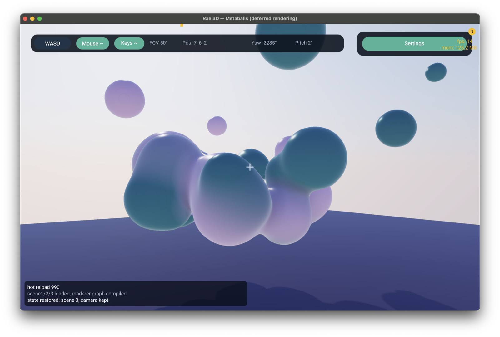
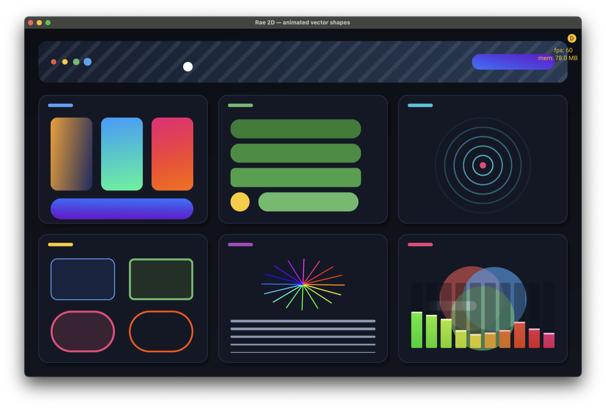
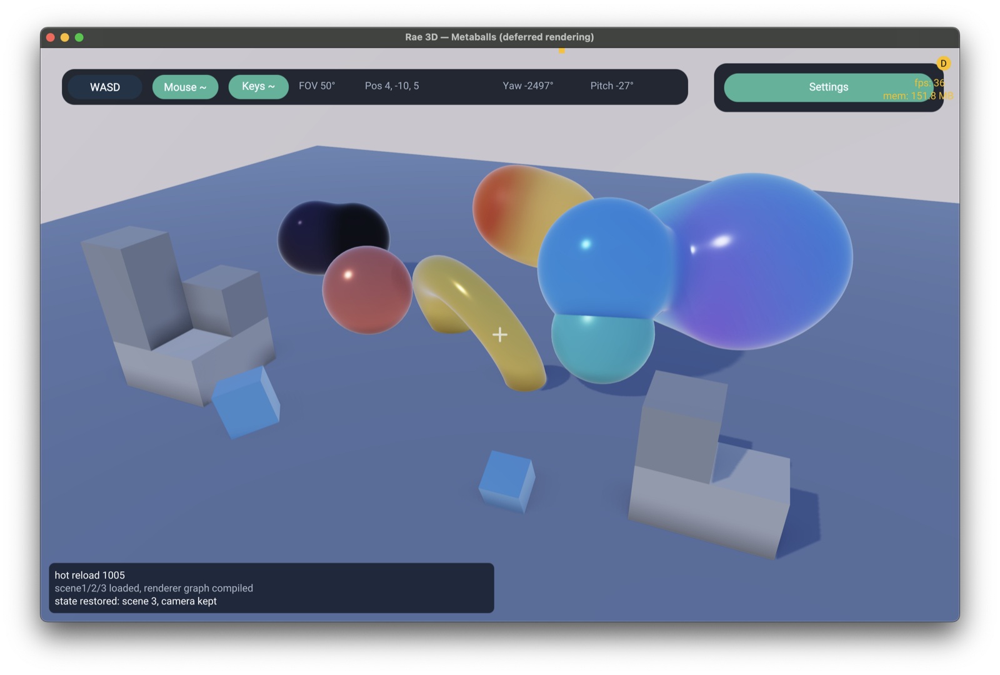
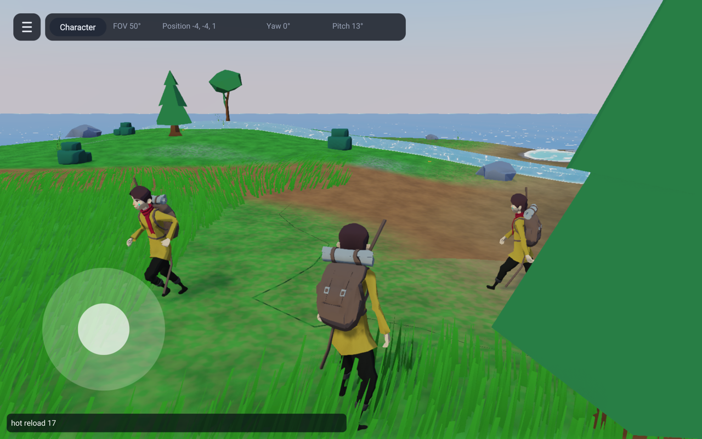
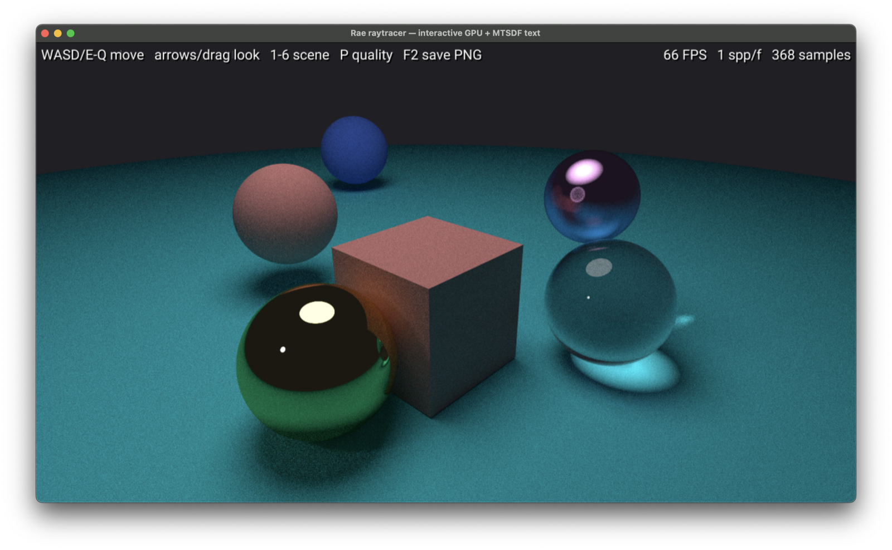
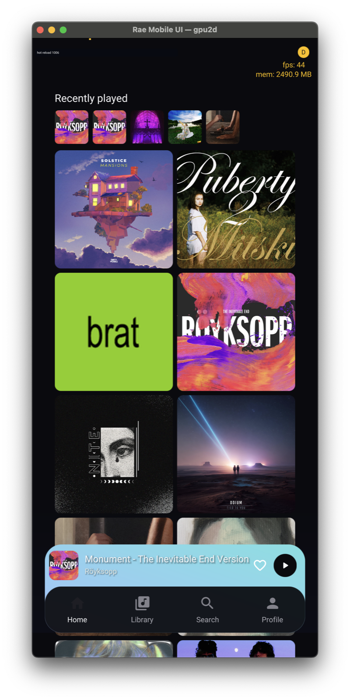
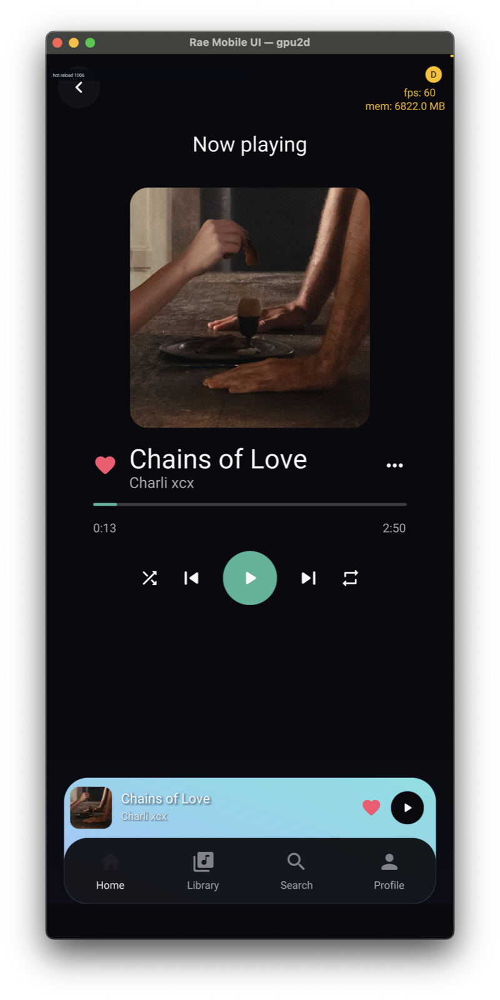
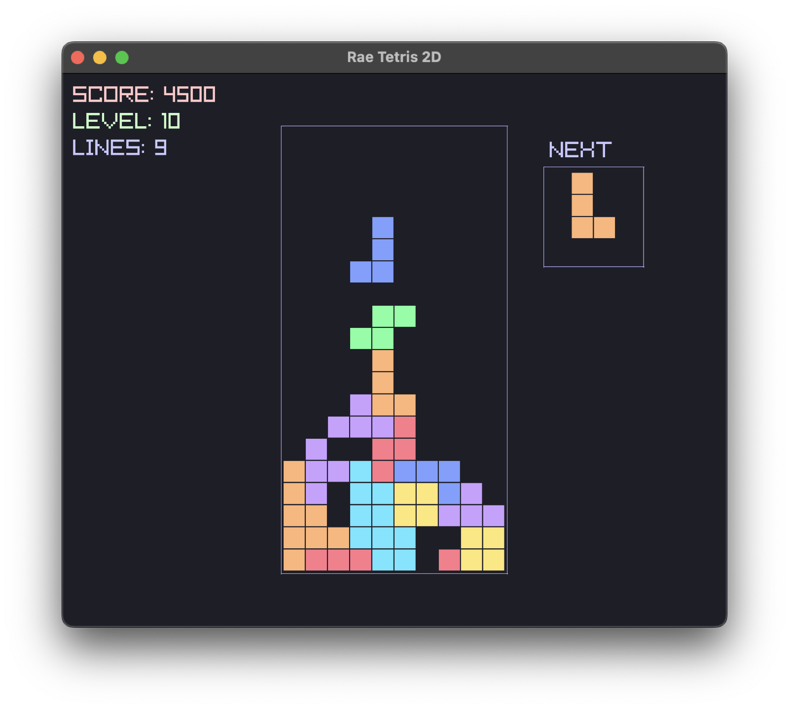
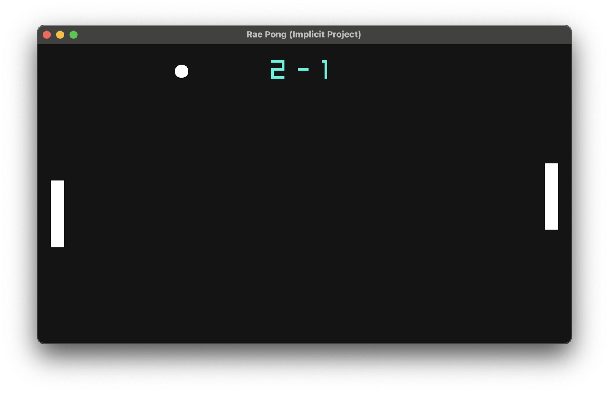

# Rae Programming Language

[](https://xkcd.com/927/)



A minimalistic, high-performance programming language that aims to be as readable and clear
in its syntax as possible.

Few concepts, few special cases, and nothing implicit. What a function does to
your data is in its signature; what a call means is at the call site. That suits
a person skimming at midnight and a model editing at scale for the same reason:
neither has to hold the missing half in their head.

Rae is built around the **Entity Component System (ECS)** as its general
architecture — not just for games, but as the default shape for programs of any
kind. Data lives in components on entities, behavior lives in systems that run
over them, and shared state is a resource owned by a World or App rather than a
global. One small, explicit, data-oriented model — the same for a UI, a
renderer, a simulation, or a plain CLI — is easier to reason about and to
refactor than a pile of ad-hoc patterns, and the language is shaped to make that
model clean rather than to bolt a framework on top.

## A taste

This is `examples/09_playlist`, verbatim — a type, a list of it, functions
with explicit parameter modes, method-call syntax, an optional result, and
interpolation, all in one file.

```rae
# A small taste of the language: a type, a list of it, functions with explicit
# parameter modes, method-call syntax, an optional result, and interpolation —
# most of what a Rae program is made of, in one file. No graphics, no runtime
# specifics; just the language.
type Track {
  title: String
  seconds: Int
  # Stars out of 5; 0 until the listener rates it
  rating: Int
}

# Parameter modes are always written out. `view` reads, `mod` may write back,
# `own` takes ownership — so a signature tells you what a call does to your data.
func totalSeconds(tracks: view List(Track)) ret Int {
  var total: Int = 0
  loop let track: view Track in tracks {
    total = total + track.seconds
  }
  ret total
}

func formatDuration(seconds: view Int) ret String {
  ret "{seconds / 60}m {seconds % 60}s"
}

# `mod Track` means this function may change the caller's track. It is called
# below as `first.rate(stars: 5)` — method-call syntax is sugar for
# `rate(track: first, stars: 5)`.
func rate(track: mod Track, stars: view Int) {
  track.rating = stars
}

# `opt view Track` is either `none` or a VIEW into an existing track (never a
# copy of it). The caller must check which before using it: `if let` binds the
# view when there is one.
func longest(tracks: view List(Track)) ret opt view Track {
  if tracks.length is 0 {
    ret none
  }
  # Find the winner by index, so no track is copied, then hand back a view of it.
  var bestIndex: Int = 0
  loop var i: Int = 1, i < tracks.length, ++i {
    if let candidate: view Track = tracks.viewAt(index: i) {
      if let best: view Track = tracks.viewAt(index: bestIndex) {
        if candidate.seconds > best.seconds {
          bestIndex = i
        }
      }
    }
  }
  ret tracks.viewAt(index: bestIndex)
}

func main() {
  # `var`, because `add` changes the list: a `let` is frozen as a whole, so
  # nothing in it may change after this line.
  var tracks: List(Track) = List.create(Track, cap: 3)
  tracks.add(value: Track { title: "Intro", seconds: 95, rating: 0 })
  tracks.add(value: Track { title: "Middle Eight", seconds: 212, rating: 0 })
  tracks.add(value: Track { title: "Outro", seconds: 143, rating: 0 })

  # Arguments are named at the call site, and "{}" is how a value becomes text.
  log("{tracks.length} tracks, {formatDuration(seconds: totalSeconds(tracks: tracks))}")

  loop let track: view Track in tracks {
    log("  {track.title} — {formatDuration(seconds: track.seconds)}")
  }

  # `modAt` hands back a mutable window; `rate` writes through it, into the list.
  if let first: mod Track = tracks.modAt(index: 0) {
    first.rate(stars: 5)
  }
  if let first: view Track = tracks.viewAt(index: 0) {
    log("{first.title} rated {first.rating} stars")
  }

  # The optional view, handled with `if let`: `view` makes it an alias, no copy.
  if let top: view Track = longest(tracks: tracks) {
    log("longest: {top.title} ({formatDuration(seconds: top.seconds)})")
  } else {
    log("no tracks")
  }
}
```

```
3 tracks, 7m 30s
  Intro — 1m 35s
  Middle Eight — 3m 32s
  Outro — 2m 23s
Intro rated 5 stars
longest: Middle Eight (3m 32s)
```

## Optionals: a value that may be missing

An **optional**, written `opt T`, is either a `T` or `none`. The type itself
says the value may be missing, so it is never a matter of convention. `none`
exists only where a type says `opt`: a plain `Track` is always a track, and an
`opt Track` must be checked with `if let` before it can be used, so a caller
cannot forget the empty case. That is the difference from `null` in most
languages, where any reference may be null and nothing makes you check.

An optional can hold a reference too: `opt view Track` is either `none` or a
view of a track that already exists, as below.

```rae
type Library {
  tracks: List(Track)
  current: Track
  playing: Bool
}

# An optional REFERENCE: a view of a track the library owns, or nothing at all.
func nowPlaying(library: view Library) ret opt view Track {
  if library.playing is false {
    ret none
  }
  ret view library.current
}

# `if let` narrows it to a reference for the branch. The `view` in the
# binding's type is what makes `track` an alias: without a mode it would be
# a copy.
if let track: view Track = nowPlaying(library: view library) {
  log("playing {track.title} — {formatDuration(seconds: track.seconds)}")
} else {
  log("nothing playing")
}
```

```
playing Middle Eight — 3m 32s
```

(or `nothing playing`, when the library is not playing.)

An optional reference costs a nullable pointer — the same eight bytes as a plain
one, with no box and no allocation — so `nowPlaying` hands back a window onto the
library's own track rather than a copy of it.

## What the syntax is doing

- **Named arguments, always.** `formatDuration(seconds: total)` rather than
  `formatDuration(total)`. Two arguments of the same type cannot be swapped
  silently, and a call reads without jumping to the declaration.
- **Parameter modes, always.** Every parameter is `view`, `copy`, `mod` or
  `own`; a bare `seconds: Int` is a compile error. "Does this function change my
  value" should never be a thing you have to guess or go and check.
- **`{}` is how a value becomes text.** Interpolation evaluates expressions and
  calls, so printing does not need a formatting mini-language.
- **The mode on the line says what a binding is.** `=` initializes a binding
  of the declared type; `view T` and `mod T` are types whose values are
  aliases, exactly as they already are for parameters and `loop let`.
  Aliasing is marked by the mode keyword everywhere, and nowhere else. So
  `let x: Track = v` is a fresh deep copy, `let x: view Track = place` is a
  read-only alias, `let x: mod Track = place` is a writing alias, and
  `own y` on the right is a move — whatever the type holds. (Decided
  2026-10-20, replacing the `=>` alias binder, which is a compile error since
  compiler 0.2.96; see `docs/binding-modes-design.md`.)

### Bindings, one table

`=` on a declaration line initializes. `=` on any other line writes into
the place the name denotes. An alias is never rebound: after
`let m: mod Particle = world.a`, the line `m = world.b` deep-copies
`world.b` INTO `world.a`; it does not make `m` point at `world.b`. A `view`
on the left of such a line is an error.

| binding | `x = v` on a later line | `x.f = v` |
|---|---|---|
| `let x: T = v` | error: a `let` is frozen | error |
| `var x: T = v` | replaces `x` with a deep copy of `v`; the source never changes | allowed |
| `let x: view T = place` | error: 'cannot assign through read-only view' | error: 'cannot mutate through read-only view' |
| `let x: mod T = place` | deep-copies `v` into the place | allowed, writes the place |
| `var x: view T` / `var x: mod T` | error: 'aliases are bind-once; declare with let' | — |
| `loop let x: view T in list` | error (read-only) | error |
| `loop let x: mod T in list` | deep-copies `v` into the element | writes the element |
| `loop var x: mod T in list` | error: 'aliases are bind-once; declare with let' | — |
| `loop var x: T in list` | a writable local copy of each element | the copy only |
| parameter `a: T` | error: a parameter needs a mode | — |
| parameter `a: view T` | error (read-only) | error |
| parameter `a: mod T` | deep-copies `v` into the caller's place | writes the caller's place; a `let` cannot be passed |

Every alias row also refuses an alias of a temporary
(`let v: view T = makeThing()`: 'cannot bind a reference to a call that
returns ownership'), a `view` passed on to `mod`, and a `mod` alias or `mod`
loop over a `let`. There is no `var` alias: `var` means rebindable, and an
alias never is.

## No type inference: types are always written

Rae has **no type inference, by design** — and will not add it. Every binding
states its type:

```rae
let count: Int = 5
let track: Track = loadTrack(path: path)
let pos: Vec2 = { x: 1.0, y: 2.0 }  # struct: type on the left, fields on the right
```

`let count = 5` or `let track = loadTrack(...)` is a **compile error**, not a
convenience — the compiler tells you to write the type.

This is the same principle as named arguments and parameter modes: the
information that matters is on the page, not reconstructed in the reader's head.
A local's type is part of what a function does, so it is written where the local
is introduced — you never scroll to a definition, hover in an editor, or run the
inferencer in your head to learn what `x` is. It also keeps errors honest: an
inferred binding silently takes whatever type the right-hand side happens to
produce, so a wrong or changed return type flows outward and surfaces far away
(or miscompiles); a written type is checked at the binding and the mistake is
reported there. The cost — a few characters per line — buys code that reads the
same for a human and for a tool, which is the whole point of the language.

(Inference-free does not mean annotation-heavy everywhere: `if let v: T = ...`
narrows an optional, `let v: view T = place` binds an alias whose type you
still write, and a struct is built as `let p: Point = { ... }`. What is *never* inferred is
the type of a binding.)

## No member functions: every function is a free function

Rae has no member functions, no static member functions and no methods inside a
type. A type is only data. Every function is a free function, written at the top
level of a module, and the value it works on is an ordinary named parameter:

```rae
type Track {
  title: String
  stars: Int
}

# A free function. The track it changes is its first parameter.
func rate(track: mod Track, stars: view Int) {
  track.stars = stars
}
```

The dot is only syntax. `first.rate(stars: 5)` is the same call as
`rate(track: first, stars: 5)`: the value before the dot becomes the first
argument. So you can still think of `rate` as a member function of `Track`, or as
an extension function, because anyone can write such a function for any type, in
any file.

**All functions look the same.** In a language with classes, you choose every
time: a member function, a static member function, or a free function? Each
choice has its own rules for what the function can see and how it is called.
In Rae there is nothing to choose. A function is a function, and the dot is
available for all of them.

**No hidden `this`.** A member function gets an extra parameter that is not in
its parameter list. Inside the function, a field name can mean a field of that
hidden object, so the function reads data that the call does not show. That
works a bit like global state, and it makes the function harder to reason about.
In Rae, everything a function can use is in its parameter list, with its mode:
`mod Track` says that `rate` may change the track, and that is all it gets. The
same rule makes the "no globals" rule below work.

**No inheritance either.** For the same reasons, Rae has no inheritance or other
class-hierarchy features. Use **composition**: put the shared part in its own
type, and give that type its own functions.

```rae
type Health {
  current: Int
  maximum: Int
}

type Player {
  name: String
  health: Health
}

type Monster {
  kind: Int
  health: Health
}

func heal(health: mod Health, amount: view Int) {
  health.current = health.current + amount
}

# The same function works on both, through the part they share
player.health.heal(amount: 10)
monster.health.heal(amount: 5)
```

When the same code must work for many types, write a **generic function**
(a template): its type is a parameter, `T: type`. The standard `List` works this
way. `add` is one function for every element type:

```rae
func add(T: type, this: mod List(T), value: own T) { ... }

names.add(value: "Ada")  # a List(String)
scores.add(value: 42)  # a List(Int)
```

## No globals: shared state has an owner

There is no hidden, program-wide, mutable channel between functions. Mutable
state that lives at the top level — outliving every function, owned by no one,
reachable and writable from anywhere — is a compile error. A value with no owner
and an invisible lifetime is exactly the thing that makes a program hard to
reason about, for a person and for a tool.

Constants are fine, because a constant is not state: `const maxRetries: Int = 5`
is a fixed compile-time value, not a global. What is banned is shared *mutable*
state, not names for fixed values.

Instead, shared state has an owner. It lives as a **resource on a World or App**
and is passed to the systems that use it through the same `mod`/`view` parameter
that already says who may read or change it — a former global `activeTheme`
becomes `app.theme`, threaded to the code that touches it. This is the ECS architecture
doing the work the language points you toward: every piece of state is somewhere
specific, and a call's signature tells you whether it can move.

## Refactoring stability: change the type, keep the meaning

In most mainstream languages, what `=` does depends on the type. That makes a
type change a semantic change — in lines that never appear in the diff.

Dart, for example:

```dart
int process(int x) {
  var y = x;      // copy: ints are values
  y = 42;
  return x;       // x is untouched
}
```

Someone later promotes `int` to a class:

```dart
Track process(Track x) {
  var y = x;      // same line — now an ALIAS: classes are references
  y.value = 42;   // mutates the caller's object
  return x;       // x is not what the caller sent
}
```

`var y = x` silently changed from copy to alias. The line didn't change; the
diff doesn't contain it; no call site admits that callers' objects now get
mutated. Java, C#, Python, JavaScript and Kotlin work the same way — primitives
copy, objects alias, and the boundary between the two is the type, not the
code. Swift has the same flip one level up: turn a `struct` into a `class` and
every `let y = x` in the program quietly stops copying.

C and C++ don't have this flip at `=` — assignment copies, and refactoring
`int` to `int*` is loud, because every use site has to change too. C++ has the
same trap at the call boundary instead: change a parameter from `Track` to
`Track&` and every existing call still compiles, unchanged — `process(x)` now
mutates the caller's object and nothing at the call site says so. Rust avoids
the problem at both places: `=` never aliases, borrowing is spelled at the
binding and at the call site (`&mut x`), and when a type change turns a copy
into a move, every later use of the moved-from value is a compile error rather
than a change in behaviour.

In Rae, `=` initializes a binding of the declared type, and `view T` and
`mod T` are types whose values are aliases, exactly as they already are for
parameters and `loop let`. Aliasing is marked by the mode keyword
everywhere, and nowhere else. So the meaning survives the refactor:

```rae
func process(x: view Track) ret Track {
  var y: Track = x  # still a copy: no mode, so a fresh copy, whatever the type
  y.value = 42  # mutates the copy only
  ret x  # x is untouched, same as the Int version
}
```

If aliasing is what you want, you have to say so — and saying so propagates:

```rae
func process(x: mod Track) ret Track {
  # the signature must say mod
  let y: mod Track = x  # an alias: the mode says so
  y.value = 42  # writes to the caller's track
  ret x
}
```

Now every caller reads `process(x: mod track)` — the mutation is admitted at
the signature, at the call site, and at the binding. A read-only window can't
be promoted along the way (`let y: mod Track = x` is an error when `x` is `view`),
and writing through a view is an error, full stop:

```rae
let v: view Track = x
v.value = 42          # ERROR: v is a view
v = other             # ERROR: a view is never written, and never rebound
```

So the `Int` → `Track` refactor cannot silently succeed with a changed
meaning. Either the behaviour is identical, or the compiler stops on every
line whose intent has to be restated. For a human that is a safety property.
For an AI agent editing hundreds of files, it is the difference between a type
migration and a bug-injection campaign.

## Memory safety without a borrow checker

Rae is close to memory-safe, and it gets there **without a borrow checker** — no
lifetime annotations, no `'a`, no solver to fight. One rule does most of the
work:

**References don't outlive what they point at.** `view` and `mod` are
non-owning references. A struct cannot store one (a compile error), and a
function can hand one back only when it points into data the caller already
owns — a parameter, or something reached through one — never into the
function's own locals (*reference escapes local storage*). The owner — a
`List(T)`, a `Track`, whatever — lives in some enclosing scope; a reference
borrows it and never outlives it.

That single rule removes the largest family of memory bugs by construction:

- **No dangling references.** A `view Track` cannot be kept somewhere the
  `Track` isn't. It cannot be stored, and it can only be returned toward the
  owner's own scope, so it cannot outlive the value it points into — there is no
  "reference that survived its owner."
- **No use-after-free across scopes.** A borrow cannot be held in a struct or
  carried past its owner, so a drop elsewhere cannot leave it dangling.
- **No aliased-mutation surprises.** A binding without a mode copies —
  always, whatever the type (see above); an alias is spelled by `view` /
  `mod` on its own line, and a writing alias only where the signature
  already admits `mod`. A read-only `view` can't be promoted to a writer, and writing
  through a `view` is a compile error.

Rust guarantees the same absence of dangling references, but pays for it with a
borrow checker and lifetime annotations — a real, learnable, non-trivial cost.
Rae buys most of that guarantee with a rule you can hold in your head: *a
reference is never stored, and never outlives its owner.* Ownership itself is
explicit — `own` moves a value, the compiler tracks the move and frees at scope
exit, and using a moved-from value is a compile error — so there is no garbage
collector either.

**The honest "almost."** This is not a proof of memory safety, and Rae does not
claim one:

- `extern`/FFI and the raw `Ptr` type are unchecked, exactly as in any systems
  language — that is the escape hatch to C and the GPU.
- Cross-thread sharing is a separate story the concurrency model is still
  growing into.

So: minimalistic, and *almost* memory-safe. The common, program-wide failure
modes — dangling references, use-after-free from escaped borrows, silent aliased
mutation — are gone by construction, and what remains is local and legible. For
a human that is a small rule instead of a large system. For an AI agent
generating and refactoring code, it is a model simple enough to reason about
correctly — which is the whole point of Rae.

## Targets

**Compiled** is the default: the compiler emits C and links a native binary.

**Browser WASM** builds the same source into an SDL3 + WebGPU bundle with
Emscripten (`rae build --target wasm`), or a headless WASI module for programs
that only print (`compiler/tools/wasm_build.sh`). Many of the examples run in a
browser, and the dashboard below opens them there with a click.

Built on top, all in Rae except the raw GPU and platform calls:

- **2D renderer** — WebGPU through wgpu-native and SDL3: shapes, MSDF text,
  images, clipping, a design-resolution coordinate system.

  

- **3D renderer** — forward and deferred paths over the same scenes, with PBR
  materials, cascaded shadows, SSAO, TAA, SDF metaballs, glTF loading and
  skinned animation, and a physical sky (Preetham and Hosek-Wilkie).

  
  
  

- **UI** — an ECS whose widgets are entities and whose layout is a `.raescene`
  document, with a theme of palette slots, spacing and text styles.

  <p>
    
    
  </p>

- **Standard library** — about 400 modules: containers, strings, JSON, files, maths,
  time, a calendar, crypto, PNG and DEFLATE written in Rae rather than bound.

## Getting started

```sh
make -C compiler                                     # builds compiler/bin/rae
./compiler/bin/rae run examples/01_hello/Main.rae    # from the repo root
```

Run examples from the repo root: the ones that load assets resolve their paths
from there.

`rae run` builds and runs; `rae build --target wasm --out app.html …` produces a
browser bundle; `rae watch` rebuilds and restarts on save, and an app using
`lib/HotReload` keeps its state across the restart. `rae init` scaffolds a
project.

On a terminal, `rae run` and `rae build` show a two-line progress display
while they work — an activity ticker (one dot a second, wrapping) over a
twenty-cell bar that estimates the build from the shares each phase (module
loading, sema, C emission, the C compiler) took the last time this entry was
built (kept under `.rae/apps/`). It is only drawn on a TTY, so pipes and the
test suite never see it; `RAE_PROGRESS=off` turns it off.

### One layout: the compiler formats first

Rae has one canonical source layout and the compiler is its authority — there
is no style configuration. `rae run`, `rae build` and `rae watch` rewrite the
program's `.rae` files canonically (atomic, in place) before compiling them;
`--check-format` or `RAE_FORMAT=check` refuse to write and fail with the file
list instead, which is what CI and the test suite use. `rae format <files|dirs>`
does the same on demand (`--check`, `--stdout`, `--stdin`, `--json`,
`--rules --json`). The rules in one screen: 2-space indent, 100 columns, LF, one
final newline; parameters and arguments share a line up to three items when the
whole call fits, and go one per line (no commas, `)` at the declaration's
indent) from four or when they do not; object/collection literals and enum
members the same from five; a `type` body is always one field per line; a file
is capped at 1,000 lines and is refused, never auto-split.

```rae
func clamp(value: copy Float, low: copy Float, high: copy Float) ret Float {
  ret Math.max(a: low, b: Math.min(a: value, b: high))
}

func createRenderer(
  device: view Device
  window: mod Window
  settings: view RendererSettings
  diagnostics: mod Diagnostics
) ret Renderer {
  let material: Material3d = { baseColor: color, metallic: 0.1, roughness: 0.65 }
  ret Renderer { device: device, material: material }
}
```

Run the test suite with `bash compiler/tools/watch-tests.sh` (it wraps
`make -C compiler test` and streams the run to the dashboard) — about 750 cases.

## Devtools Web: the best way to see this

`tools/devtools-web` is a local dashboard. It browses every
example, runs each one natively or in the browser with a click, and shows build
health, the test tree and history.

```sh
make setup     # installs Devtools dependencies and builds the compiler
make dev       # http://localhost:3000
```

Start on the **Featured** tab — a cross-section of what the language can do:

| | |
|---|---|
| **Metaballs (deferred rendering)** | the 3D renderer, with a settings panel and a sky that moves with the time of day |
| **3D Renderer — Walker Character** | a skinned, animated glTF character |
| **Physics Playground — Box3D** | six physics scenes on Rae's physics engine, upstream Box3D's C library, from a pyramid of up to 10k boxes to a hinged bridge; fly around and machine-gun balls into them |
| **Vehicle — Box3D** | Box3D's Driving car on a height-field course: suspension, steering, a torque split, a ramp to jump, light crates to scatter and a stunt park |
| **Mobile UI — GPU2D** | a phone-shaped application at real app scale |
| **UI Editor — .raescene viewer** | opens any authored `.raescene` and shows it as the UI system renders it, with a live inspector |
| **2D Renderer — Animated shapes** | the 2D shape pipeline in motion, with a sound-style EQ visualizer |
| **Raytracer — GPU + MTSDF text** | a path tracer on the GPU with a crisp text overlay |
| **3D Renderer — Ocean** | an FFT ocean in cascades, with a free camera |
| **Procedural Props** | rocks, trees and textures generated in code |
| **Tetris 2D** | a complete little game |
| **Playlist** | the taste above, as a runnable program — most of the language, no graphics |
| **Functions and interpolation** | one step past hello world, no graphics |




The two UI examples are worth opening next: `104_ui_hello` is a value and three
buttons — the smallest thing that is still an application — and `105_ui_counter`
is the same idea with a `.raescene` layout, a theme and a list rebuilt from data.

The dashboard runs examples Compiled by default, and the ones that support it
also run in an embedded WebGPU canvas.

## Where to look next

| | |
|---|---|
| `spec/rae.md` | the language spec |
| `docs/` | about 140 design notes, including the ownership model and the renderer architecture |
| `examples/` | over 80 programs, from hello world up; retired integrations live under `examples/legacy/` |

## License

MIT — see `LICENSE`.
