# Oxeye daisy recovery

The daisy now has a continuously curved, narrower stem, rounded cupped rays,
unequal head angles and small lower leaf groups. The patch groups roots around
several unequal centres. Three shared material meshes still own the whole patch.
The old generator and materials remain available, and an unchanged old plant
stands 0.60 m to the left of the candidate in Autumn Grove.

This is a visual improvement over the rejected thick stalks and flat heads.
It is not a claim that the surrounding meadow matches the reference landscapes.
The botanical centre detail and some close leaf shapes remain simplified.

## Botanical and composition references

The target remains **oxeye daisy, Leucanthemum vulgare**. The
[NCSU Plant Toolbox photographs and description](https://plants.ces.ncsu.edu/plants/leucanthemum-vulgare/)
and [RHS description](https://www.rhs.org.uk/plants/32804/leucanthemum-vulgare/details)
show solitary white ray heads around yellow discs, slender stems, broad lower
leaves and smaller upper leaves. The candidate retains a single head per stem.
Its 44–79 cm height law is unchanged. The **11–14 cm head diameter is deliberately
enlarged** for the walker camera; this is not botanical scale accuracy.

G01/G02 inform fine stems, connected ground cover and unequal groups. They are
composition references, not evidence that their flowers are this species.
The private [comparison presentation](../../../peli_ideoita/environmentReferenceStudy/recoveryReview/index.html#daisy-recovery)
places these renders beside both crops and two credited botanical photographs.
No reference photograph became a production texture. The meshes are original
procedural geometry; no new image or alpha-cutout material is used.

## Matched images

All pairs use the same seed, height law, world placement, camera, sun hour,
exposure, fixed clock and zero wind. Single seed: **1307**. Thirteen-plant patch:
**1871**. Forest seven-plant prototype: **584**. The candidate intentionally
changes root grouping, lean, head tilt, head diameter and materials. It does not
change the seed or substitute a different showcase specimen to disguise them.
The ground and grass are identical between the two captured alternatives.

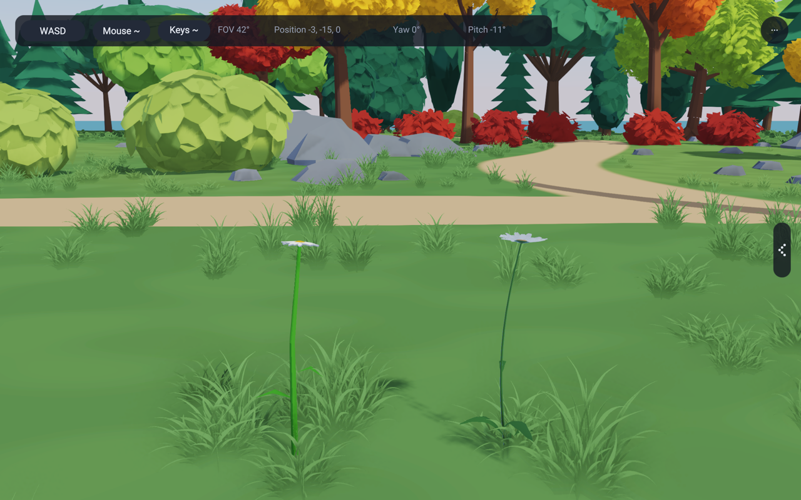

| View | Preserved rejected control | Candidate |
|---|---|---|
| Close | 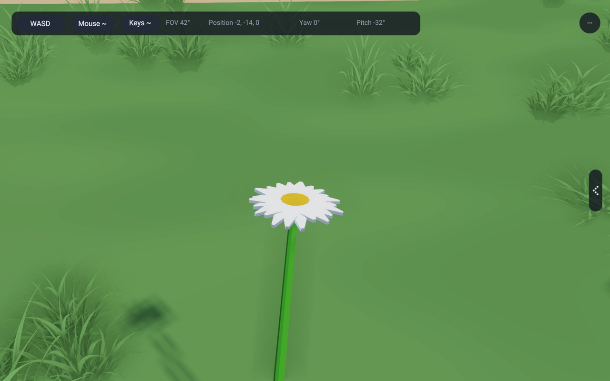 | 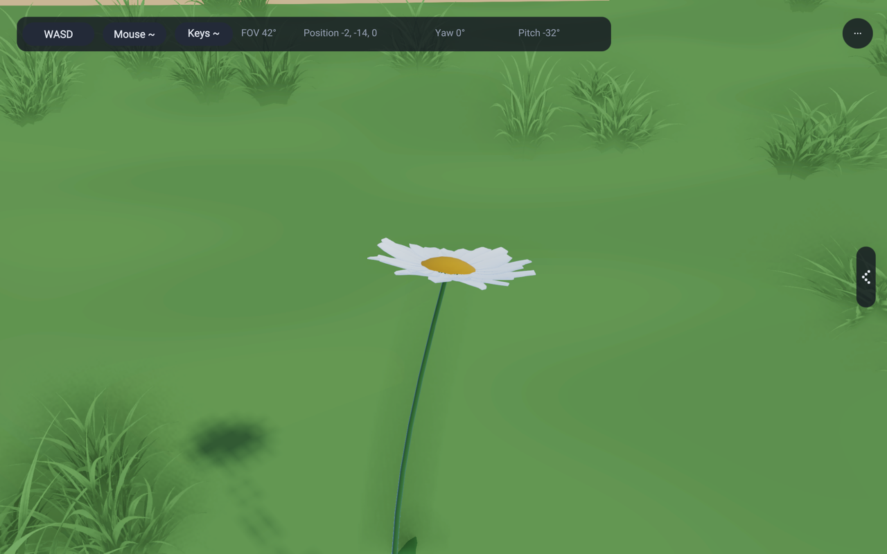 |
| Side | 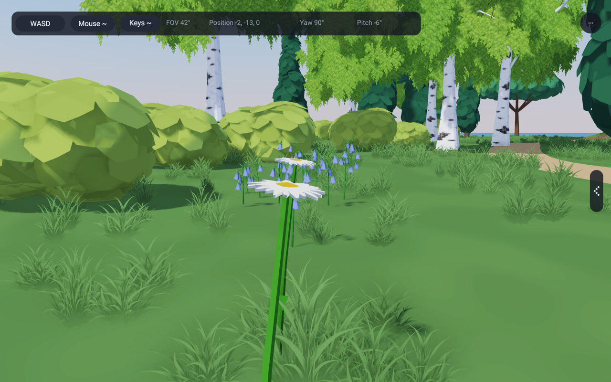 | 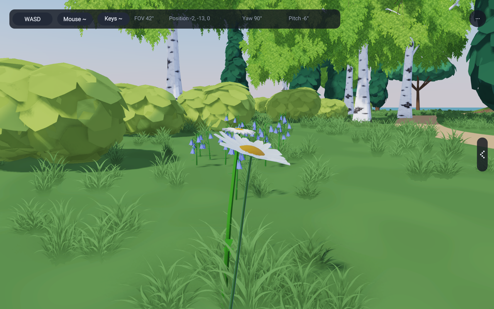 |
| Low sun, rear | 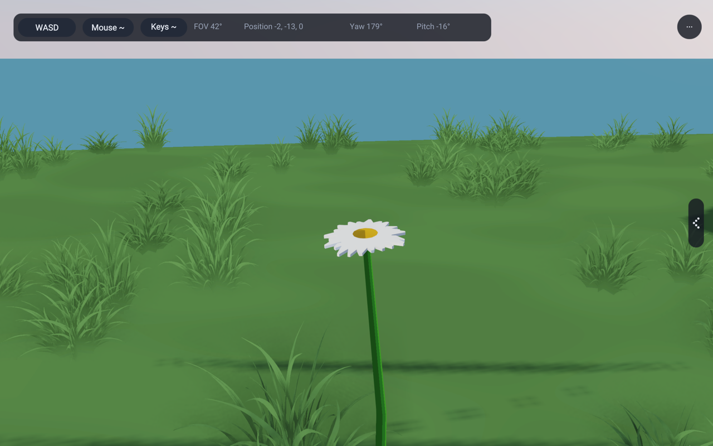 | 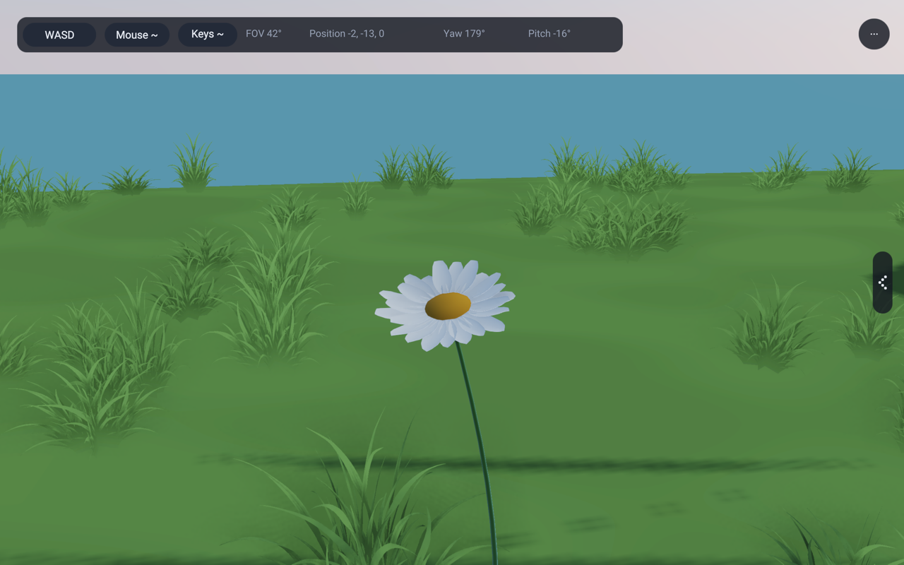 |
| Patch | 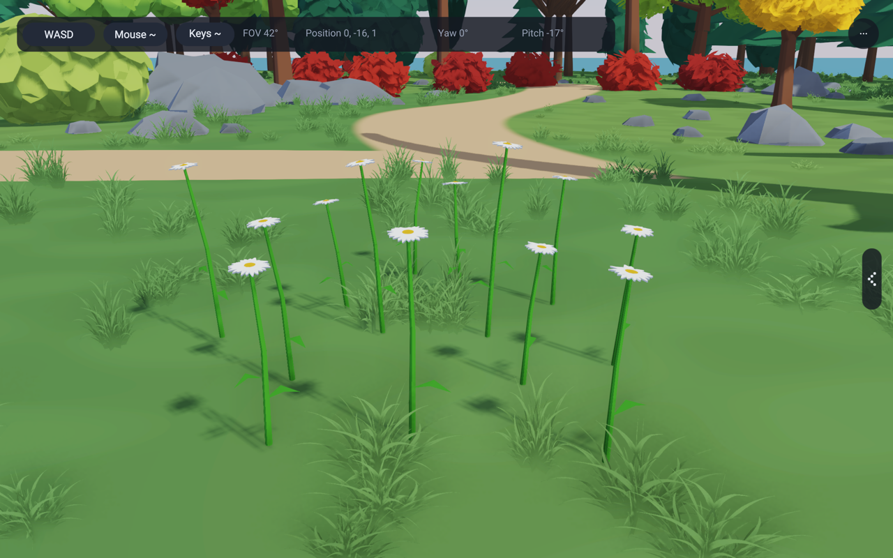 | 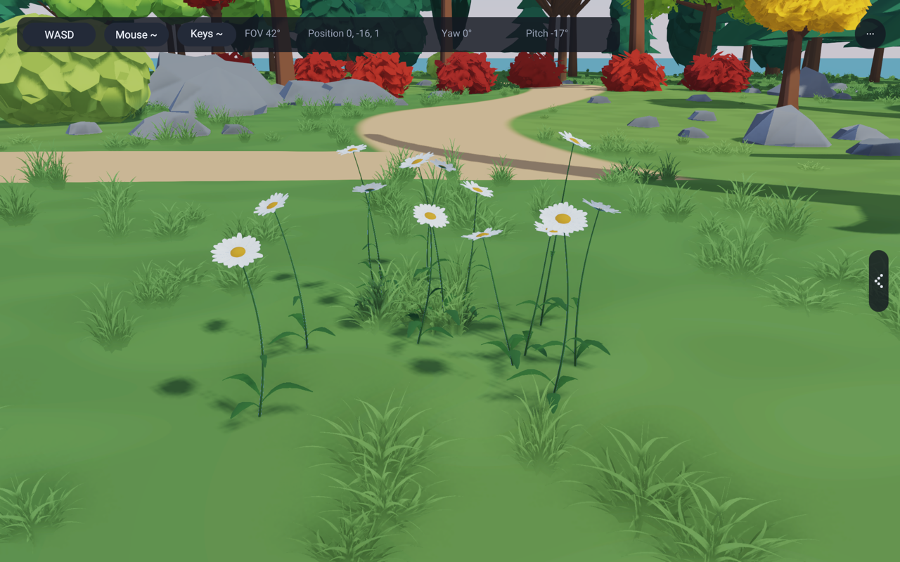 |
| Patch, rear low sun | 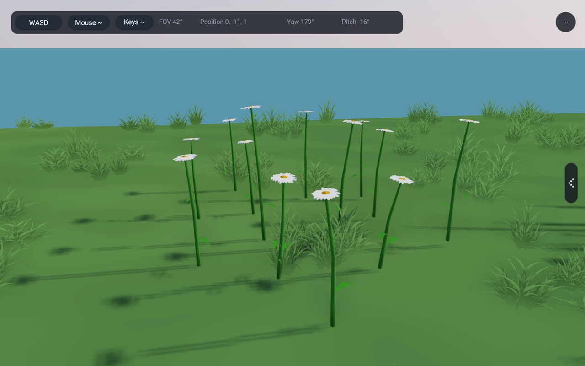 | 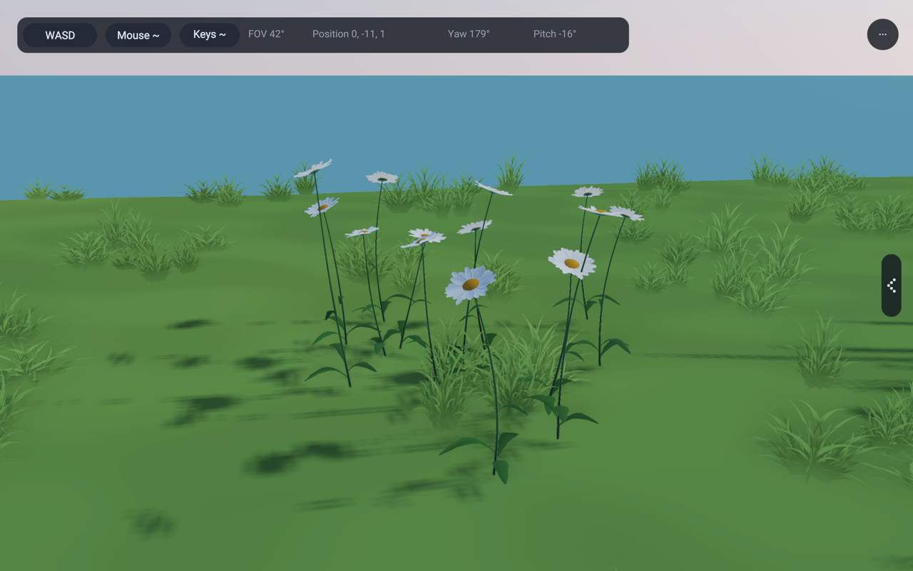 |
| Night | 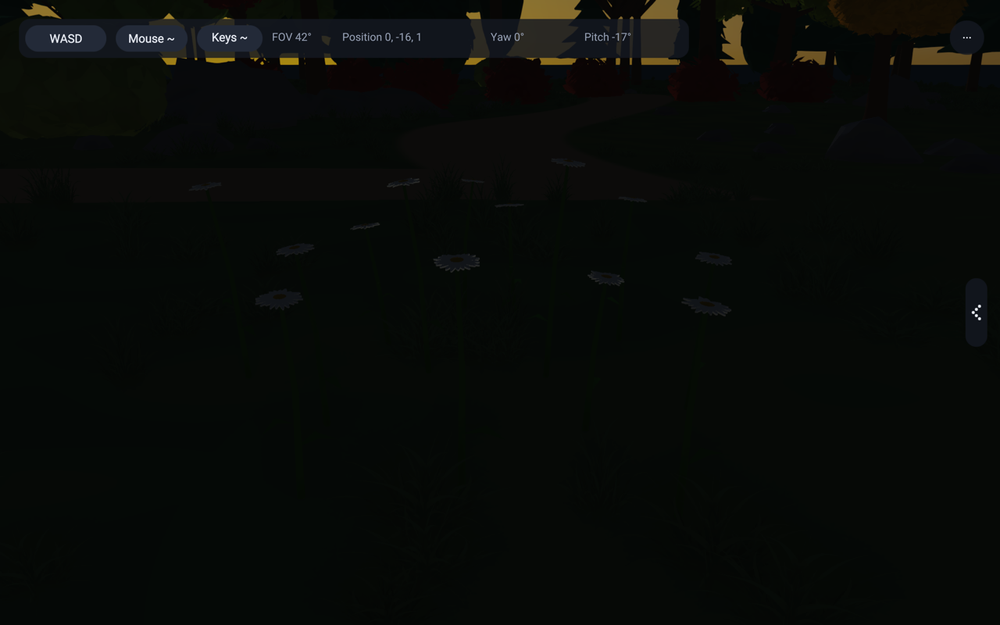 | 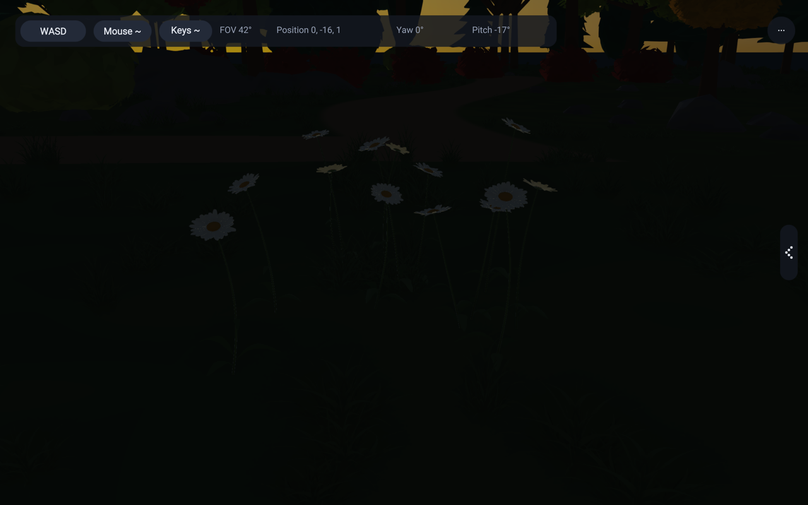 |

The first toon-material trial still looked like flat white symbols. The chosen
candidate uses rough physical shading for its three parts, independently of the
terrain's toon switch. No exposure change, emission or disabled shadows was used.
The low-sun view reveals the cup and unequal rays; the night view confirms that
both petals and centres darken with the scene. The fixed old plant is visible
behind the candidate in the side view, so its thick straight stalk should not
be mistaken for an extra candidate stem.

## In the shared forest

| View | Preserved control | Candidate |
|---|---|---|
| Walker eye height |  | 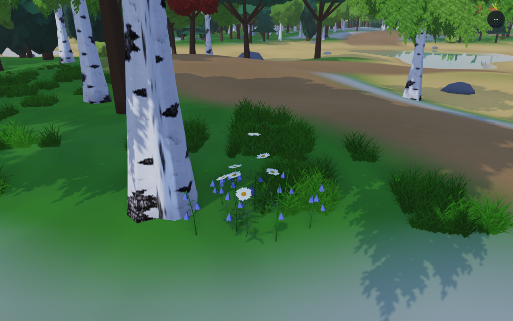 |
| Night | 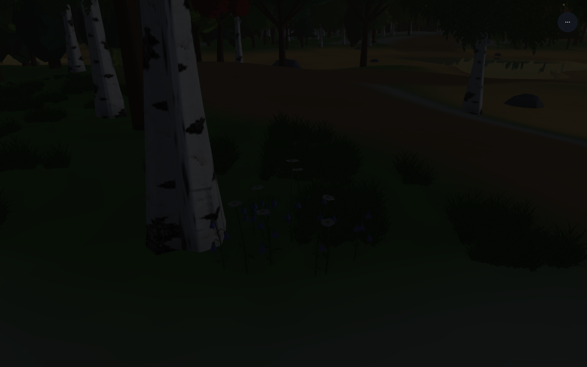 | 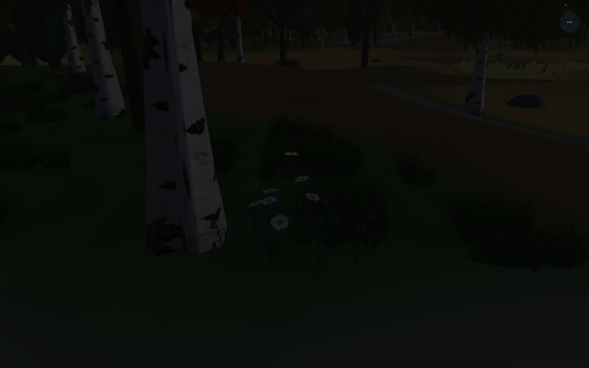 |

This is the existing streamed flower placement in cell (-1, 0), near
(-18.1647, 5.39762), not an injected showcase prop. The camera is 1.745 m above
world zero, approximately 1.7 m above the patch ground. The harebells, trees,
biome, streaming, seven-plant capacity and forest density remain unchanged.
The same `WalkerFlowers` prototype serves 136, 137 and 143.

The grove's flower reservation now prevents large props but permits grass.
Rock and trunk grass exclusions retain their previous behaviour. This removes
an artificial bare circle around the study without raising grass density.

## Geometry, wind and ownership

`procgen/OxeyeGeometry` builds the transported-frame tapered stem, shallow
scalloped leaves, thin two-sided curved rays and rounded disc. Every part of a
plant carries the same buried root pivot and flexibility. The existing wind
shader rotates the complete plant coherently about that root; it does not bend
separate petals away from their attachments. The candidate introduces no new
physics or deformation shader. This remains simple whole-stem sway, not an
elastic stem simulation or independent petal flutter.

Each forest patch uses three mesh prototypes and three preallocated instance
batches, regardless of petal count. Daisies now enter the deferred shadow pass
through those same batches. That adds at most three submissions per cascade,
not one per plant. The wind metadata and instance sway are shared by visible
and shadow passes. The forward walker retains its existing renderer policy.
The ordinary owned mesh/list cleanup and renderer resource shutdown remain in
place. The grove's unchanged single control adds three study-only mesh entities.

The leaves and petals are geometry, so there is no daisy texture/mip/alpha
threshold to tune. Thin silhouettes still depend on raster coverage and SMAA;
this does not eliminate distant stem stipple. Material roughness is 0.94;
linear stem/petal/disc colours are (0.035, 0.125, 0.018), (0.72, 0.74, 0.65),
and (0.52, 0.26, 0.012).

## Cost

| Prototype | Control vertices / triangles | Candidate vertices / triangles |
|---|---:|---:|
| Single, seed 1307 | 1,128 / 376 | 1,580 / 2,732 |
| Thirteen plants, seed 1871 | 14,568 / 4,856 | 20,540 / 35,516 |

The extra triangles describe two petal surfaces and their thin edges. This is
an explicit close-view cost, not an optimization. Generation happens once per
prototype. A request is capped at 24 plants; no per-frame mesh generation or
new instance population is added. Large-area flower LOD is still separate work.

In matching 900-frame forest runs, the four post-warm-up GPU windows had median
whole-frame totals **16.481 ms control / 16.584 ms candidate**. Process CPU time
was **10.07 / 10.06 seconds**, peak RSS **268.7 / 270.8 MiB**, over **15.30 / 15.43
seconds** wall time. Both variants use the new shared shadow submission, so
this is a mesh/material comparison, not a measurement of adding flower shadows.
The fixed frame limiter and other desktop load dominate these short runs;
they do not establish an isolated flower GPU cost or a speedup. The detailed
[measurements](images/daisy-recovery/costs.json) include per-pass observations
and resource counts. Run `python3 tools/measure-daisy-recovery.py <forest-binary>
/tmp/rae-daisy-cost` to repeat the same camera and density.

## Wind phase evidence

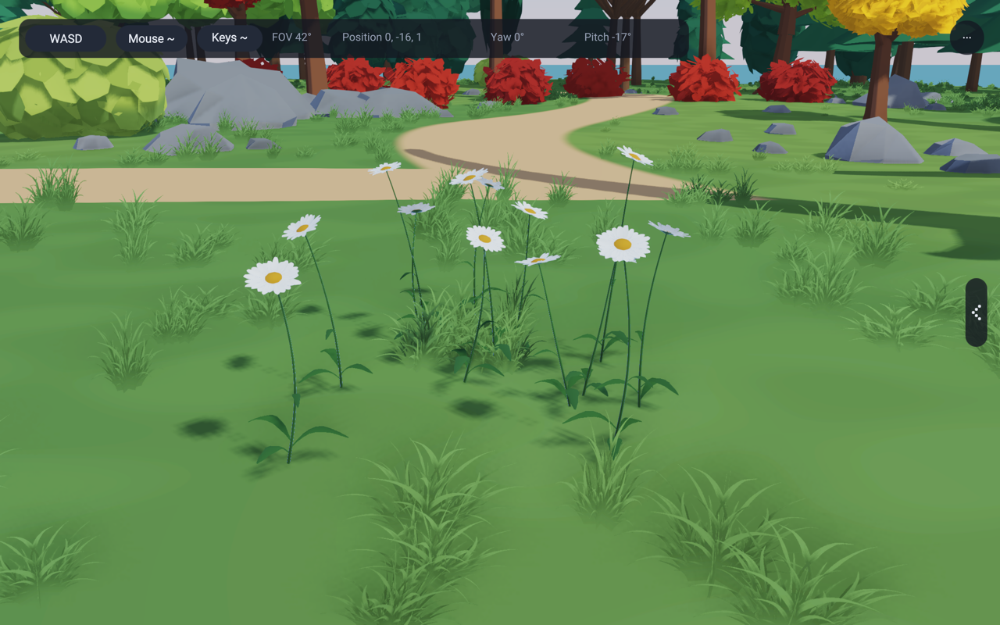

These are three fixed-clock samples, not a continuous-motion acceptance claim.
The root stays buried; the head, disc and leaves move together. Reproduce with
`--view patch --reuse-binary --wind 1.5 --frames 120 --tag=-wind120` on the
capture tool. The root/flexibility fixture and production GPU wind check cover
attachment consistency between those images.

## Reproduction and checks

`python3 tools/capture-daisy-recovery.py /tmp/rae-daisy-review` builds one
temporary grove binary and captures the control/candidate pairs. Add `--forest`
and set `DAISY_FOREST_CAMERA='1 1.5708 0.24 -0.38 4.2 -15.4 5.4 1.745 0 0 0 0'`
for the forest pair. `--view side --reuse-binary` repeats a selected view.
Every app run has a timeout. Window geometry is restored on exit. Full bitmaps,
logs and binaries remain outside git. The committed manifests record the exact
camera fields, source hashes, sun hour, fixed step and PNG hashes:
[grove](images/daisy-recovery/138-manifest.json),
[forest](images/daisy-recovery/143-manifest.json).

The capture uses a 1280 × 800 point window (2560 × 1600 native bitmap here),
1280 × 800 review PNGs, 60 steps at 1/30 second, exposure 1, DRS off, scale 1,
and existing shadows, SSAO, SMAA and bloom. `RAE_DAISY_CONTROL=1` restores the
old meshes and materials in all shared consumers.

Passed: fixtures **1240** (finite indexed geometry, nondegenerate triangles,
unit normals, deterministic arrays, bounds, capped count, matching buried wind
pivots across all three parts over five seeds, preserved control counts),
**1241** (unchanged harebell) and **1239** (walker grass exclusions). The fixture
runner also checks owned-allocation cleanup. The production **leafWind** GPU
check passed, including anchored roots and rigid relative distances.

Example gates **136, 137, 138 and 143** passed: forward/deferred integration,
flat live memory in 136, fourteen grove inspection views and the 31,090-tree
forest. These are functional checks; they do not approve the art.
Format-check-tree passed for 1,820 files; example-copy and banned-terms gates
also passed. The preserved control function body is byte-identical to the
previous generator, and capture source/image hashes and report links were checked.

## Remaining art limits

The yellow centres lack the botanical photographs' fine floret structure.
The rays are still visibly modeled from very close grazing angles. Basal leaves
are rounded and restrained but simpler than real oxeye leaves. The forest
repeats one seven-plant prototype, and existing harebells share its placement.
Some thin stems stipple at distance. Wider meadow grouping, mixed-species rhythm
and flower LOD are not solved by this bounded species pass. G01/G02 still show
richer ground-cover composition and quieter surrounding scenery.
