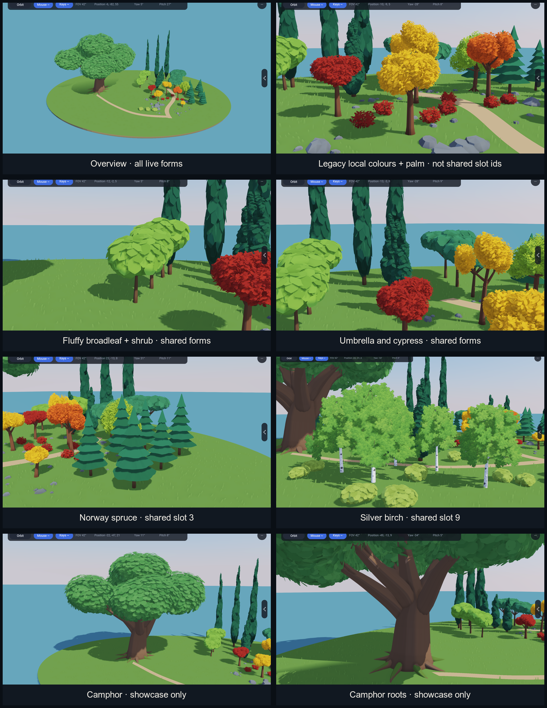

# Environment art direction

This document records the tree and shrub inventory before the landscape art
work begins. It assigns a botanical target to every current shared tree kind
and every separate 138 generator. The names describe the intended finished
silhouette and structure. They do not claim that the current meshes already
look botanically correct.

No numeric forest kind changes in this inventory. `PropPlacement.kind`,
`TreeVariant.species`, impostor atlas layers, physics lookup and saved seeded
placement all depend on the current order. A visual task may replace the mesh
behind a kind, but it must keep the kind number unless it includes an explicit
migration.

## Current contact sheet

The sheet is derived from the checked-in 138 reference frames
`Grove.png`, `Trees.png`, `Fluffy.png`, `Evergreen.png`, `Spruces.png`,
`Birches.png`, `Camphor.png` and `Roots.png`. It shows the current output, not
the quality target. The legacy autumn panel uses 138-local colour numbers; it
does not show the shared numeric kinds directly.

## Stable shared forest kinds

`lib/app3d/GroveTrees.rae` adds these kinds to `PropField` in numeric order.
The old constant remains the compatibility key until its later species task
renames code and all consumers together.

| Kind | Old code name | Chosen common and botanical identity | Current source | Current placed height | Season or preset | Finished silhouette and wood target |
|---:|---|---|---|---:|---|---|
| 0 | `speciesBroadleaf` | Small-leaved lime / littleleaf linden (*Tilia cordata*) | `FluffyForm.broadleaf` | 4.8–7.2 m | green summer crown | Broad oval to rounded crown with an uneven loose edge. Use several unequal ascending scaffold limbs. Young bark is grey-brown and lightly furrowed; old bark has dark ridges. This is the main rounded-crown tree. |
| 1 | `speciesUmbrella` | Stone pine (*Pinus pinea*) | `FluffyForm.umbrella` | 5.6–7.4 m | dark evergreen | Exposed trunk with lower limbs shed and a high, wide parasol crown. Main limbs radiate and divide into irregular needle masses. Mature bark has red-brown and grey scaly plates. |
| 2 | `speciesCypress` | Mediterranean cypress (*Cupressus sempervirens*) | `FluffyForm.cypress` | 8.0–11.5 m | blue-dark evergreen | Very narrow fastigiate column, with a thin visible trunk and tightly upright slender stems. Keep the existing successful thin proportions. Bark changes from grey to grey-brown and becomes lightly furrowed. |
| 3 | `speciesSpruce` | Norway spruce (*Picea abies*) | `FluffyForm.spruce`; foliage routes to `procgen/Spruce` | 5.5–8.5 m | dark evergreen | Conical crown with unequal branch whorls, open gaps and slightly hanging secondary growth. Avoid identical stacked skirts. Bark is grey-brown to purplish and becomes flaky and scaly. |
| 4 | `speciesOrange` | Sugar maple (*Acer saccharum*), autumn-orange preset | `procgen/Foliage.broadleafTree` | 4.2–6.8 m | copper, orange and restrained red | Dense spreading oval crown on a strong ascending scaffold. Keep broad colour groups and visible forks. Bark is light grey to grey-brown, then long irregular furrows and ridges. |
| 5 | `speciesRed` | Red maple (*Acer rubrum*), scarlet preset | `procgen/Foliage.broadleafTree` | 4.2–6.8 m | scarlet and red-orange | Rounded crown with ascending branches and a lighter, finer twig rhythm than the sugar maple. Young bark is smooth light grey; old bark develops dark vertical ridges. |
| 6 | `speciesGold` | Golden Globe ginkgo (*Ginkgo biloba* ‘Golden Globe’) | `procgen/Foliage.broadleafTree` | 4.2–6.8 m | clear autumn gold | Rounded crown, selected as the second rounded-crown candidate. Use visible ascending branch fans and small openings rather than a maple silhouette. The mature trunk should carry grey-brown furrows. Fan-leaf texture and branching must distinguish it from slots 4 and 5. |
| 7 | `speciesCrimson` | Bloodgood Japanese maple (*Acer palmatum* ‘Bloodgood’) | `procgen/Foliage.broadleafTree` | 4.2–6.8 m | burgundy summer to bright crimson autumn | Broad upright round crown with layered spreading branches and a muscular multi-stem option. Keep the crown smaller and more open than the large maples. Smooth grey to dark reddish wood and fine red twigs support the deep foliage. |
| 8 | `speciesPalm` | Date palm (*Phoenix dactylifera*) | `procgen/Foliage.palmWood` and `palmLeaves` | 5.0–6.5 m | glaucous evergreen | Straight unbranched scarred trunk with one apex crown of stiff pinnate fronds and open sky between fronds. The current branched wood with rounded leaf crowns is a generator mismatch; its later task replaces that form without changing kind 8. |
| 9 | `speciesBirch` | Silver birch (*Betula pendula*) | `procgen/Birch` | 6.5–8.5 m | fresh green; optional gold later | Slender white stem, dark scars, asymmetrical rising limbs and hanging fine twigs. Preserve visible wood and sparse crown sectors. The shared bark and leaf textures are already the closest current starting point. |

The ten rows above are exhaustive: every value from zero through
`treeSpeciesCount - 1` appears once. Slots 4–7 currently share one broadleaf
geometry and differ mainly by seed and colour. Their identities require later
geometry work; colour alone is not being used as botanical evidence.

### Selection and placement

`speciesForPick` and `treeSpeciesAt` provide the same stable mapping to all
walkers. A 36 m block chooses one main kind and three trees in ten receive a
mixed kind. Main stands call `speciesForPick(..., palms: false)`: picks at or
above the gold threshold remain kind 6. Kinds 7 and 8 therefore occur only in
the mixed population. This is existing placement behaviour and is preserved.

- 136 and 137 use `IslandForest.plantIslandForest`: 300 entity-backed trees on
  the island. Each placement stores the kind in both `PropPlacement.kind` and
  `TreeVariant.species`.
- 143 uses `WideForest.plantWideForest`: the same ten kinds over the 1.2 km
  forest. Trees are `PropField` placements and nearby pooled physics trunks use
  the same kind and scale rules.
- `WalkerTerrain.createForestField` calls `addForestKinds` once. The list index,
  impostor atlas layer and kind number are all the same integer.
- Shared bushes use `createBushParts`; they are not an eleventh tree kind.

Every shared kind has a near mesh, a mid level and an impostor. Silver birch
currently reuses its near mesh for the mid level. The later visual tasks retain
this coverage until a tested replacement is ready.

## Generator and showcase inventory

This table lists each live generator or preset once. A row can have several
consumers because 138 and the walkers deliberately share procedural sources.

| Generator or preset | Shared mapping | Live consumers | Current distinction |
|---|---|---|---|
| `FluffyForm.broadleaf` | kind 0, small-leaved lime target | `GroveTrees`; 138 `FluffyGrove` inspection row and woodland | Rounded scalloped foliage patches over one trunk and branch preset. |
| `FluffyForm.umbrella` | kind 1, stone pine target | `GroveTrees`; 138 `FluffyGrove` inspection row and woodland | Raised flat-spreading crown preset. |
| `FluffyForm.cypress` | kind 2, Mediterranean cypress target | `GroveTrees`; 138 `FluffyGrove` six-tree inspection row and woodland | Narrow column, including three extra-tall 138 specimens. |
| `FluffyForm.spruce` plus `procgen/Spruce.spruceLeaves` | kind 3, Norway spruce target | `GroveTrees`; 138 `FluffyGrove` six-tree inspection row and woodland | Six scalloped foliage tiers. `fluffyLeaves` delegates to the spruce generator. |
| `procgen/Foliage.broadleafTree` and `broadleafLeaves` | kinds 4–7 | `GroveTrees`; 138 `GroveScene` legacy broadleaves | One flared trunk and fork layout currently serves four shared targets. Leaves are individual generated meshes grouped around branch tips. |
| `procgen/Foliage.palmWood` and `palmLeaves` | kind 8, date palm target | `GroveTrees`; one 138 `GroveScene` legacy palm | Current segmented stem branches into round leaf crowns. It is a compatibility placeholder, not yet a date-palm silhouette. |
| `procgen/Birch` | kind 9, silver birch | `GroveTrees`; five trees in 138 `BirchGrove` | Separate white-bark stem, twig wood and irregular textured leaf sprays. |
| `procgen/Camphor` and `CamphorGeometry` | no shared kind | one tree in 138 `CamphorGrove` | One 27.9 m mature camphor tree with buttress roots, seven main scaffold limbs, moss and a broad evergreen crown. It does not belong in normal forest selection. |
| `procgen/SculpturalFork` | no shared kind | young and mature bare studies in 138 | Reusable continuous trunk with open-patch joined primary branches, stable carried frames, unequal angles and a lobed root flare. It is an isolated geometry proof until a later species task adopts it. |
| `FluffyForm.bush` | no tree kind; common hazel target (*Corylus avellana*) | shared walker bush instancers; 138 inspection row and woodland, capped at 18 | Current preset has foliage and no wood. The target is a low rounded, multi-stem thicket with smooth pale bark, not a miniature tree ball. |

138 currently builds the forms through four separate modules:

- `GroveScene` places six legacy plants: three local orange broadleaves, one
  local red broadleaf, one local crimson broadleaf and one green palm.
- `FluffyGrove` places the five `FluffyForm` values in inspection rows and a
  seeded woodland capped at 38 trees and 18 bushes.
- `BirchGrove` places five trees from shared kind 9 meshes.
- `CamphorGrove` places one separate mature specimen.

### The 138 numbering discrepancy

`GroveScene.foliagePaint` has a local value range that predates
`GroveTrees`. Its value 0 is orange, 1 red, 2 green and 3 crimson. These are
paint indices, not forest kinds. In particular, local value 2 is the green
palm in 138, while shared kind 2 is cypress and shared kind 6 is the golden
ginkgo target. The compatibility map is:

| 138 local paint value and form | Shared identity it represents | Shared kind |
|---|---|---:|
| 0, broadleaf | sugar maple, autumn-orange preset | 4 |
| 1, broadleaf | red maple, scarlet preset | 5 |
| 2, palm | date palm, evergreen preset | 8 |
| 3, broadleaf | Bloodgood Japanese maple, crimson preset | 7 |

138 has no legacy gold specimen for shared kind 6. Its existing green value 2
must not be recoloured to gold because that would also recolour the palm. The
Golden Globe ginkgo task must add an explicit inspection of shared kind 6 while
preserving all current varieties. Later composition work can replace the local
paint numbers with named presets, but it must not pass them directly as shared
kind numbers.

## Botanical reference contract

The species choices use form, branching, bark and mature habit, not only leaf
colour. The source pages below provide the factual baseline. The private T01–T10
art crops in the Landscape art plan remain style and composition references;
they do not identify species.

- **Small-leaved lime:** [North Carolina Extension, *Tilia cordata*](https://plants.ces.ncsu.edu/plants/tilia-cordata/common-name/small-leaved-lime/) describes a dense pyramidal-to-oval tree, 50–60 ft tall, with grey-brown bark that develops deep dark ridges.
- **Stone pine:** [North Carolina Extension, *Pinus pinea*](https://plants.ces.ncsu.edu/plants/pinus-pinea/common-name/umbrella-pine/) describes the raised umbrella crown, loss of lower branches, dark glossy needles and irregular red-brown scaly bark.
- **Mediterranean cypress:** [North Carolina Extension, *Cupressus sempervirens*](https://plants.ces.ncsu.edu/plants/cupressus-sempervirens/common-name/mediterranean-cypress/) records the 40–70 ft by 3–6 ft columnar habit, upright slender stems and grey-brown bark.
- **Norway spruce:** [North Carolina Extension, *Picea abies*](https://plants.ces.ncsu.edu/plants/picea-abies/common-name/common-spruce/) records a conical 40–60 ft tree, upright young branches, more pendulous mature growth and flaky scaled bark.
- **Sugar maple:** [North Carolina Extension, *Acer saccharum*](https://plants.ces.ncsu.edu/plants/acer-saccharum/common-name/northern-sugar-maple/) describes a dense spreading crown, yellow-orange-red autumn colour and long irregular bark ridges.
- **Red maple:** [North Carolina Extension, *Acer rubrum*](https://plants.ces.ncsu.edu/plants/acer-rubrum/) describes its rounded crown, ascending branches, scarlet autumn range and the change from smooth light-grey bark to dark vertical plates.
- **Golden Globe ginkgo:** [North Carolina Extension, *Ginkgo biloba*](https://plants.ces.ncsu.edu/plants/ginkgo-biloba/common-name/ginkgo/) identifies ‘Golden Globe’ as a rounded male cultivar with good gold fall colour. The species has fan-shaped leaves and a normally pyramidal habit, which prevents the preset from becoming another maple.
- **Bloodgood Japanese maple:** [North Carolina Extension, *Acer palmatum* ‘Bloodgood’](https://plants.ces.ncsu.edu/plants/acer-palmatum-bloodgood/) describes a broad upright rounded tree up to 20 ft, dense spreading and layered branches, muscular multi-trunks, burgundy foliage and bright crimson fall colour.
- **Date palm:** [Kew Plants of the World Online, *Phoenix dactylifera*](https://powo.science.kew.org/taxon/urn%3Alsid%3Aipni.org%3Anames%3A668912-1/general-information) describes a solitary straight unbranched scarred trunk, a terminal crown and stiff pinnate fronds with many leaflets.
- **Silver birch:** [North Carolina Extension, *Betula pendula*](https://plants.ces.ncsu.edu/plants/betula-pendula/common-name/european-weeping-birch/) records the changing pyramidal-to-oval form, white bark and drooping branch character.
- **Camphor tree:** [North Carolina Extension, *Cinnamomum camphora*](https://plants.ces.ncsu.edu/plants/cinnamomum-camphora/common-name/camphortree/) describes a 40–50 ft by 50–70 ft dense spreading evergreen with major branching, surface roots and dark furrowed, ridged bark.
- **Common hazel:** [North Carolina Extension, *Corylus avellana*](https://plants.ces.ncsu.edu/plants/corylus-avellana/common-name/european-hazel/) describes a 12–20 ft rounded multi-shoot shrub with winding stems, smooth pale bark and rounded leaves.

Real mature dimensions guide proportions and character. The examples keep the
smaller current game scale listed in the kind table. A later task must explain
any size change because physics trunks, clearances, bounds, LOD framing and
forest density all use those dimensions.

## Later work boundaries

The individual species tasks own geometry, foliage, bark, wind and visual
evidence. This inventory only chooses names and mappings. It does not add a
kind, delete a current plant, alter the random distribution, replace foliage or
refresh any visual reference. The final integration tasks must use the mapping
above when they label views and compare 138 with 136, 137 and 143.

## Meadow flower reference

The first shared ground flower is the **oxeye daisy** (*Leucanthemum vulgare*).
[Kew Plants of the World Online](https://powo.science.kew.org/taxon/30296198-2)
accepts that name and records it as a perennial native across Europe into
western and northern Asia. The
[USDA Forest Service description](https://www.fs.usda.gov/pnw/pubs/pnw_gtr817.pdf)
records a 1–3 ft flowering stem, a solitary composite head with 20–30 white ray
florets around yellow disc florets, and coarse lower leaves. The shared
recovered prototype keeps those defining parts: one head per curved slender
stem, 21–25 unequal cupped rays, a rounded disc and restrained basal/upper leaves. Its 44–79 cm seeded heights
fit the source range; the 11–14 cm rendered heads are deliberately larger than a
typical wild head so their silhouette remains readable from the walker camera.

`procgen/MeadowFlower.rae` generates one bounded plant or a patch of at most 24
plants as three meshes: stem/leaves, off-white ray florets and yellow discs.
Petals use thin close geometry with modeled top, underside and outer edges. This
was chosen over cutout patches because the first reference species has a sparse,
recognisable radial silhouette and the close geometry keeps real normals and
grazing edges without alpha shimmer. The three materials are rough, lit and
non-emissive. Every plant shares one root pivot across all three parts, while a
patch is reused through three instanced batches. There is no entity, material
or draw per petal.

The [daisy recovery comparison](daisy-recovery.md) preserves the rejected plant
beside the candidate and records matched light/camera views and mesh costs.

The second shared ground flower is the **harebell** (*Campanula rotundifolia*).
[Kew Plants of the World Online](https://powo.science.kew.org/taxon/urn%3Alsid%3Aipni.org%3Anames%3A30036649-2/general-information)
accepts the species and records its broad temperate native range. The
[South Dakota State University specimen description](https://openprairie.sdstate.edu/nativeplant/142/)
records delicate 15–70 cm erect or ascending stems, short upper branches,
narrow sessile stem leaves and a terminal few-flowered raceme of nodding blue,
fused campanulate corollas. The
[Missouri Botanical Garden description](https://plantfinder.mobot.org/PlantFinderDetails.aspx?isprofile=0&letter=C&taxonid=278849)
also describes wiry stems, nodding blue flowers in small clusters and rounded
basal leaves that usually wither before flowering.

`procgen/Harebell.rae` keeps that identity in its geometry. Each plant has a
thin leaning stem, sparse narrow leaves and two to five alternating upper
pedicels. Every open bell has one fused body, five pointed lobes, a modeled
inside and a five-sepal calyx. The mouth and length are deliberately enlarged
so the hanging silhouette remains readable at the walker camera. Seeded plants
vary from about 30 to 65 cm and patches are capped at 20 plants.

The harebell uses two shared meshes and two rough, non-emissive materials:
green wood/leaves/calyces and blue-violet corollas. Modeled outer, inner and rim
surfaces were selected instead of alpha cards because the open mouth and
backlit edge define this species. This avoids cutout mip shimmer while giving
side and rear views real lighting. A complete plant shares one root wind pivot,
so stems, pedicels and bells move together. The walkers instance one fixed
nine-plant patch through these two batches beside the daisy's three batches;
plant and head counts do not create more materials or draw batches.
