# Golden Globe ginkgo refinement

**Forest kind 6 / speciesGold remains Ginkgo biloba ‘Golden Globe’.** Its
prototype seed is still 1125, height 5.5 m and width parameter 2 m. Placement
probabilities, per-instance scales and the ten species numbers are unchanged
in 136, 137 and 143. No palm is recoloured.

## Species and crown

[Clemson Extension](https://hgic.clemson.edu/factsheet/ginkgo-maidenhair-tree-care-growing-guide/)
describes ‘Golden Globe’ as developing a broad rounded crown with bright yellow
fall colour. [UConn's plant database](https://plantdatabase.uconn.edu/detail.php?pid=193)
describes fan-shaped notched leaves, alternate arrangement and small groups on
short spurs. [University of Utah](https://facilities.utah.edu/tree-tour/tree-display.php?tree_name=ginkgo)
describes grey-brown ridged bark with shallow darker furrows. Those features
provide the botanical target. The supplied T04/T05/T07 crops guide connected
colour masses, fine edges and exposed wood, rather than species identification.

The Rae generator uses a curved leader and two unequal joined spreading primary
limbs. Thirty-three alternate short shoots distribute leaf sprays around those
axes, instead of the maple's opposing shoot rhythm. Omitted lower shoots leave
windows around the wood. The crown is rounded but deliberately uneven. The
first candidate was too flat from one side; shorter primary reaches and shoots
spread around each axis make the selected version fuller in depth.

| Original kind-6 generator and material | Selected ginkgo, same seed/size/camera/light |
|---|---|
| 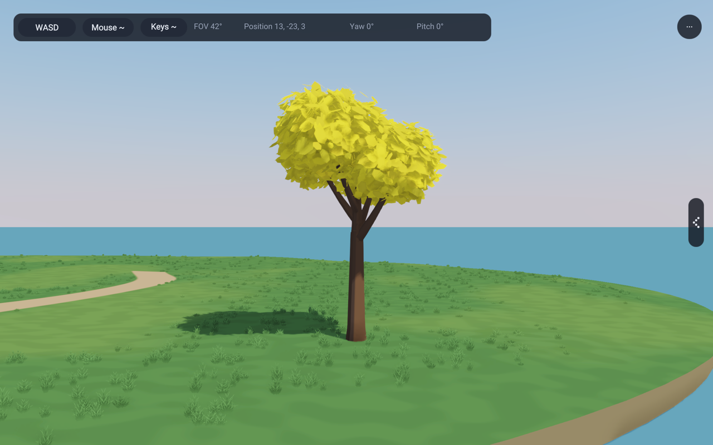 | 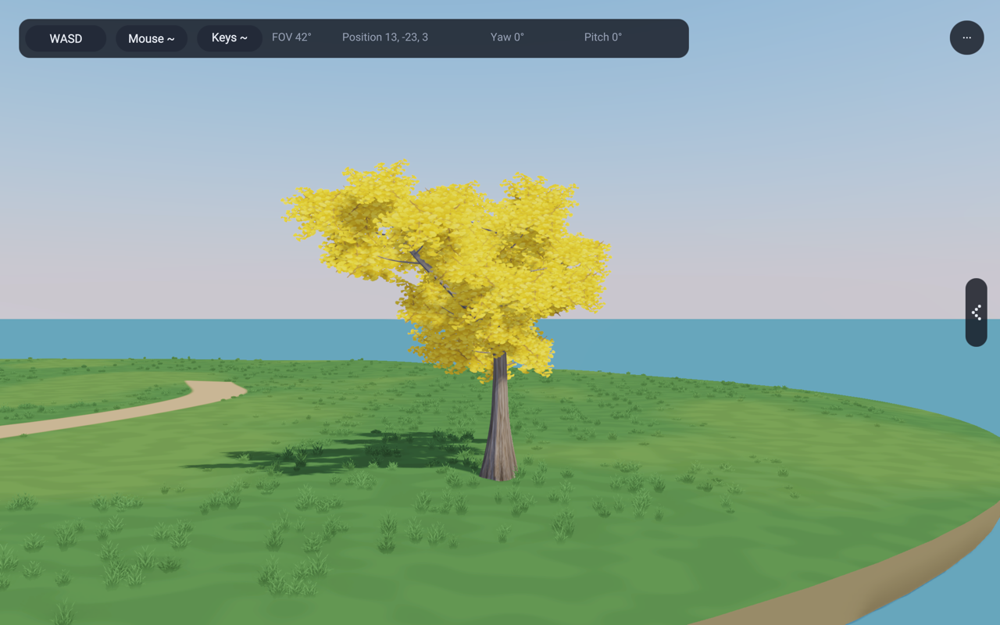 |

| Bare scaffold | Side |
|---|---|
| 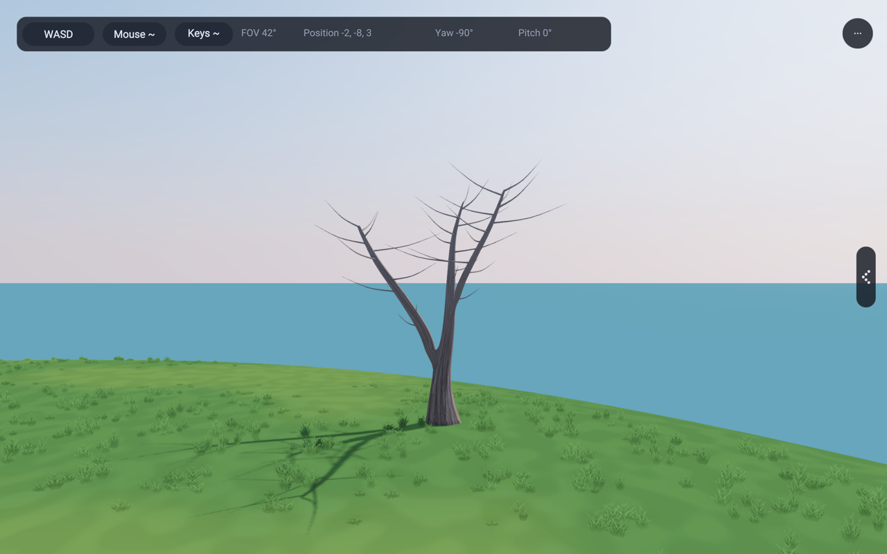 | 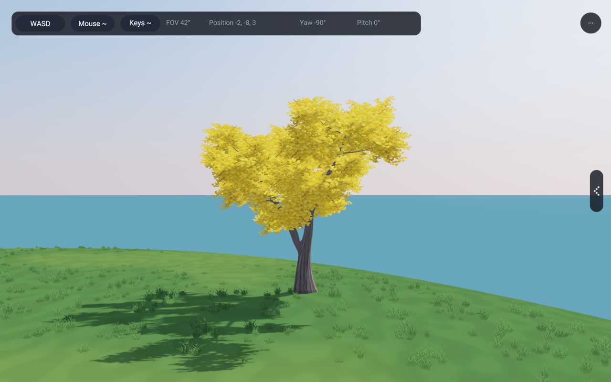 |

| Seed 311, 4.5 m isolated study | Seed 2189, 5.5 m isolated study |
|---|---|
| 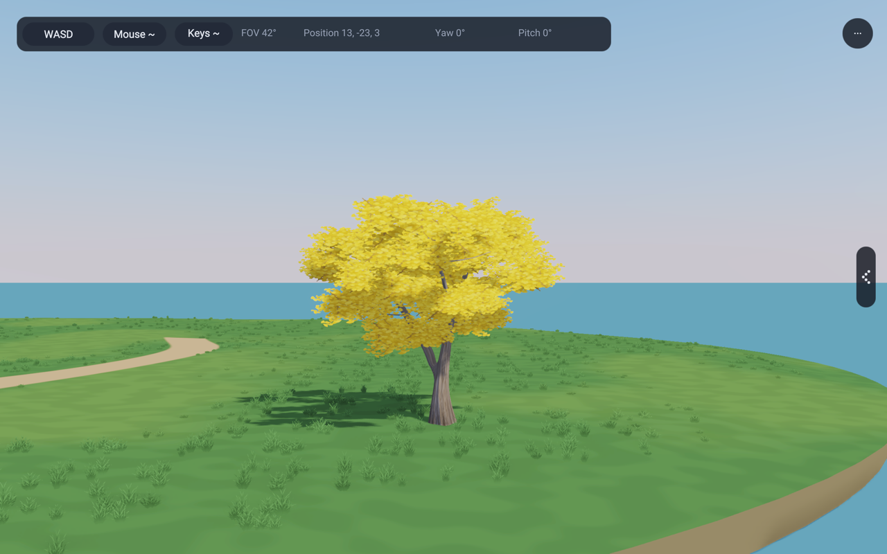 | 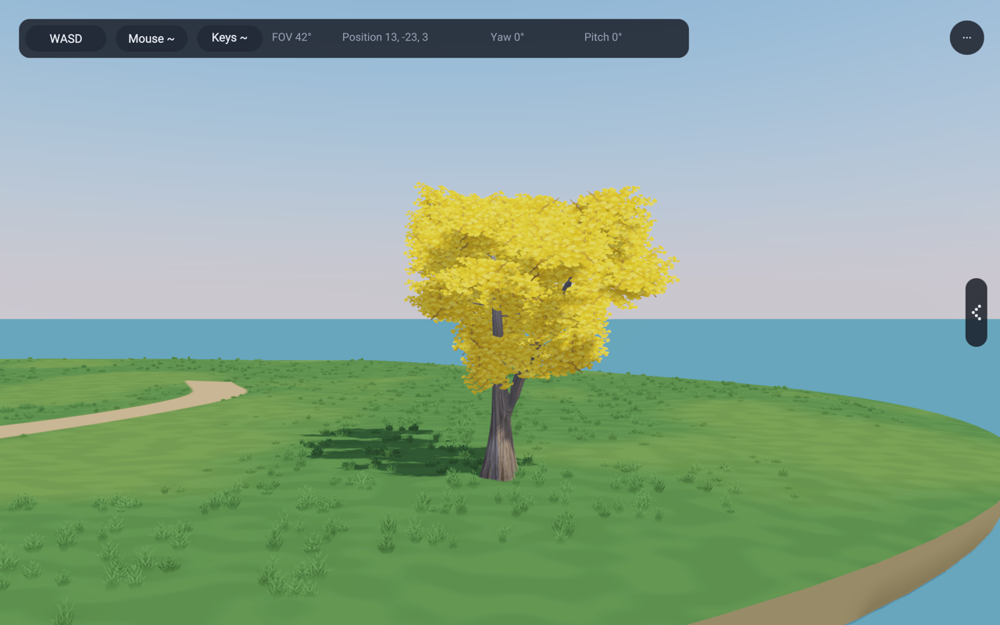 |

## Material and lighting

An original transparent cutout supplies small scalloped fan leaves. A first
texture had too much individual-leaf contrast. The selected edit reduces its
baked shading so the existing broad crown normals carry the lighting. Three
unequal overlapping camera-facing cards form each spray; their centres and
normal directions remain attached to the branches. Texture mirroring and
alternate vertical flips vary the edge. This is the recovered shared treatment,
with ginkgo-specific geometry and art, not a new rendering path.

Grey-brown bark has shallow vertical furrows, grading to smoother younger wood
above. Its height coordinate samples this age gradient once rather than repeating
the rough base along every twig. Primary wood remains rigid. Each spray's three
cards share a twig-root wind pivot. Existing alpha cutout, coverage-preserving
mips, two-sided lighting, shadows and atlas capture remain active. There is no
emission or global lighting/shadow change.

| Below the crown | Low sun behind the tree |
|---|---|
| 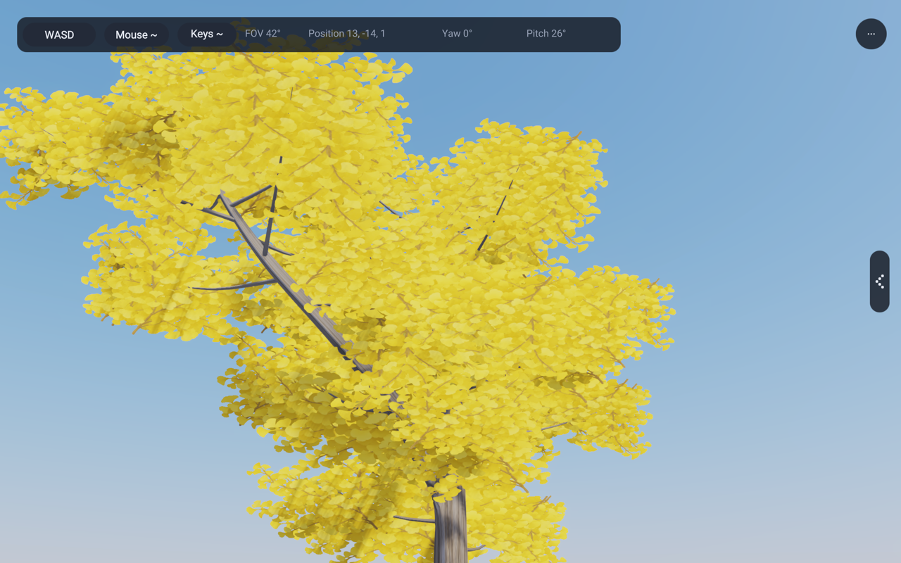 | 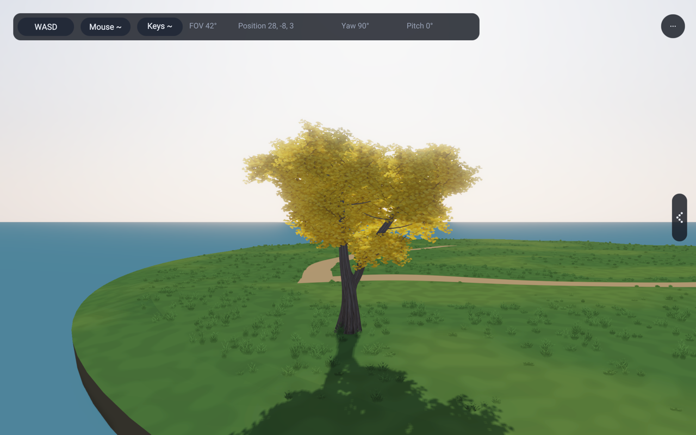 |

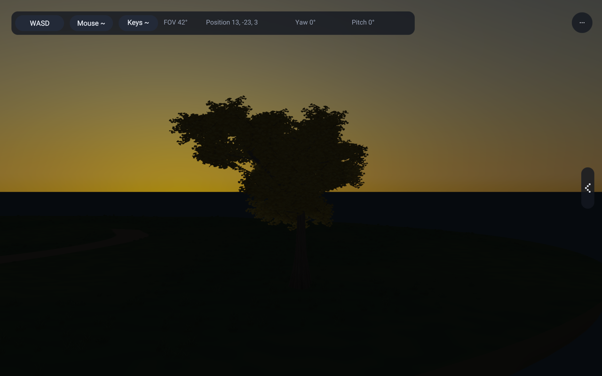

[Asset provenance and generation prompts](../lib/assets/trees/ginkgoAssets.md)
record the selected original leaf/bark images. The reference photos supply no
production pixels.

## Showcase and forest

138 previously had no gold specimen. Its local green paint value 2 remains the
existing date palm (shared kind 8). `GinkgoGrove` adds three explicitly named
kind-6 inspection trees at (13,-8), (19,-4), (16,2). All older fixed specimens
remain. The existing scene selector gains “Golden Globe ginkgo”, also available
through `RAE_GROVE_VIEW=ginkgo`.

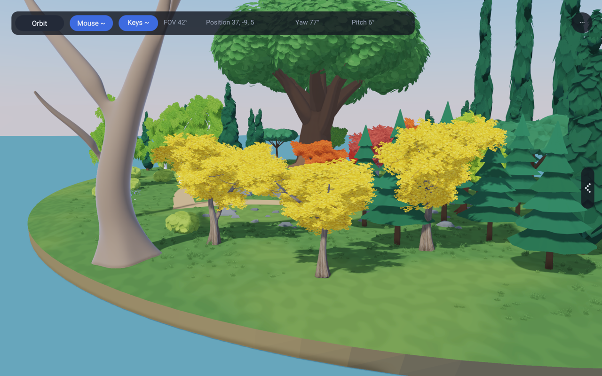

| Original forest gold trees | Shared ginkgo in the same forest |
|---|---|
| 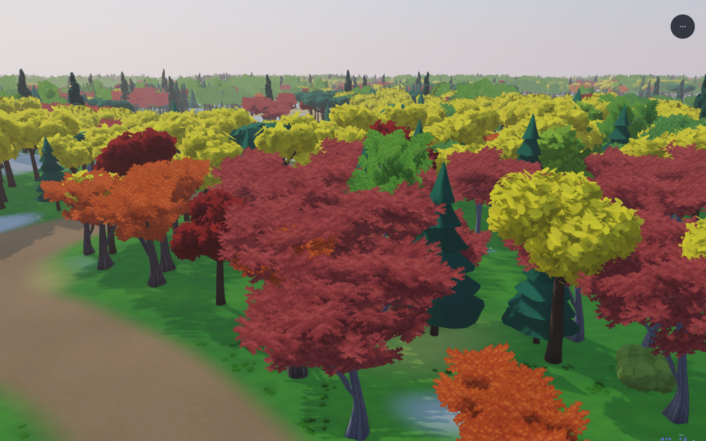 | 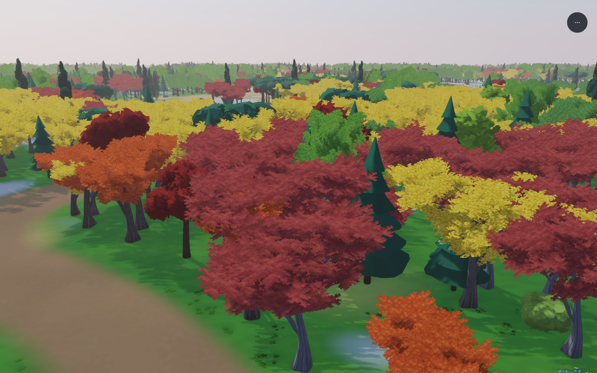 |

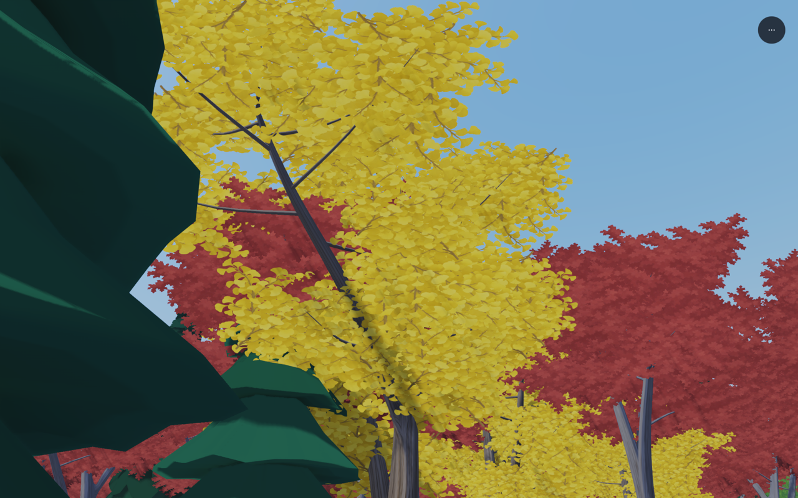

These are the existing 31,090 seeded forest placements, not a replacement scene
made for the screenshot. The individual comparison targets kind-6 placement
15961 at (-17.872,-22.143,-0.736705), scale 1.17655. Neighbours occlude parts of
its crown; the grove isolation views show the full silhouette without moving
that forest tree.

## Cost and coverage

The selected seed 1125 uses **4,125 vertices / 6,454 triangles**: 33 sprays,
99 cards and 198 foliage triangles, with the remaining geometry in joined wood
and short curved shoots. The old full-detail kind-6 control uses 39,561 vertices
and 52,938 triangles. Four shared material/mesh parts remain: wood and three
foliage tones, all foliage tones sharing one image. Two 512-square RGBA images
with full mip chains represent about 2.67 MiB of image data before renderer
allocation overhead.

Near and middle levels share mesh handles. **The middle ginkgo mesh is not
reduced yet.** The far atlas is baked from these same textured posed meshes;
the hardware check verifies all view cells and mip coverage, not only an
average of the deliberately unposed control. 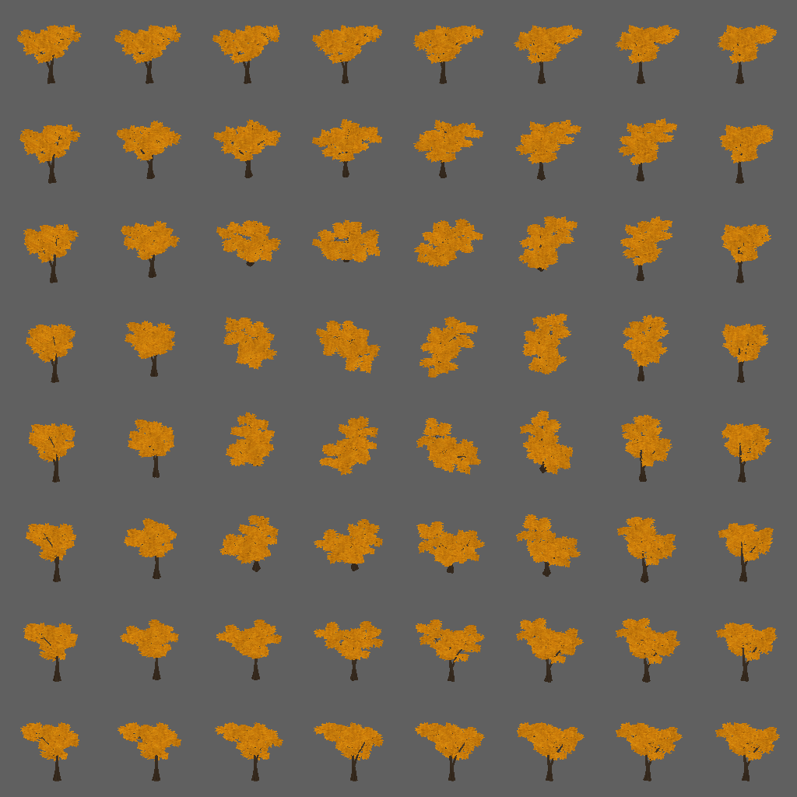

The conservative rotating-card
bound is 0.96 × prototype height around z = 0.55 × height, including the tested
wind allowance. This is larger than the former opaque-leaf bound.

The geometry reduction is not a measured frame-time claim. Alpha overdraw and
the unreduced middle mesh still need consideration in later performance work.

## Reproduction and remaining limits

Run `tools/capture-ginkgo-studies.py` with an output directory outside git.
The saved manifest records cameras, seeds, dimensions, fixed clock, wind,
source/asset hashes and binary hash. Static views use 60 frames at 1/60 second,
wind 0, Preetham 10:00 (17:15 for low-sun, 23:00 for night), exposure 1,
1280 × 800 review output, deferred toon, cascaded shadows, SSAO, SMAA and bloom.
The control changes only the ginkgo geometry/material; its specimen placement,
size and camera are identical. Forest control uses the unchanged preceding
binary; manifests distinguish reused binaries from current source hashes.

The private recovery presentation puts these frames beside T04/T05/T07 and
retains the first candidate for comparison. It also includes a six-second fixed
walk at wind 1.2. Start/middle/end frames were inspected; that sampled review
does not establish the absence of all temporal card artifacts. Source crops and large BMP/video
files remain outside git.

The improvement is visible in leaf silhouettes, softer internal shading and
branch-supported openings. It is **not a claim that the references are matched**:
close views still reveal overlapping cards and repeated fan motifs, some angles
have lumpy branch ends, and the bark's painted ridges stretch along slender
forks. The golden canopy remains more visibly leaf-marked than the broad quiet
masses in T04/T05. Those limits are visible in the published underside frames.

## Checks run

- Six focused fixtures importing `app3d/GroveTrees` pass, including the new
  70-seed ginkgo geometry/bounds/rigid-wood/determinism test. The geometry
  coverage fixture now records identical near/middle ginkgo coverage; actual
  textured coverage is checked separately on the GPU.
- `leafWind`, `surfaceImages` and `impostorBake` hardware checks pass. Ginkgo
  image layers are included in ordinary and posed bake paths, with every
  posed view cell and mip checked.
- Example gates 136, 137, 138 and 143 pass. 138 now runs fifteen named views,
  including `ginkgo`; 136 also checks live memory stability.
- Changed Rae files pass formatting; example-copy and banned-terms gates pass.

Compiler package version: 0.2.148. No C implementation or shader changes.
