# Grass patches and motion recovery

The ground and tuft bases now use the same seeded colour field. Existing roots
are gathered into unequal small groups, with shorter tufts in sparse sectors.
The grove's dirt paths are painted on its ground using the same mask that
excludes grass. This removes the separate elevated path meshes and aligns the
painted edge with placement. The walker terrain keeps its own biome and roads.

This is a ground-cover improvement, not a claim of matching the complete G01–G03
landscapes. Those references also depend on flower composition, richer rock
shapes and finished tree silhouettes. Those assets were not redesigned here.

## Matched views

All pairs use the same app, camera, light, wind phase, seed, texture, height and
width settings and 0.55 density budget. The before binaries contain 9774d0de's
visual code plus the identical optional walking-camera capture hook. Dynamic
resolution is disabled; render scale is fixed at 1. Review PNGs are 1280 × 800
from 2560 × 1600 window bitmaps. The capture manifest records the settings.

| Grove context | Before | After |
|---|---|---|
| Clearing | 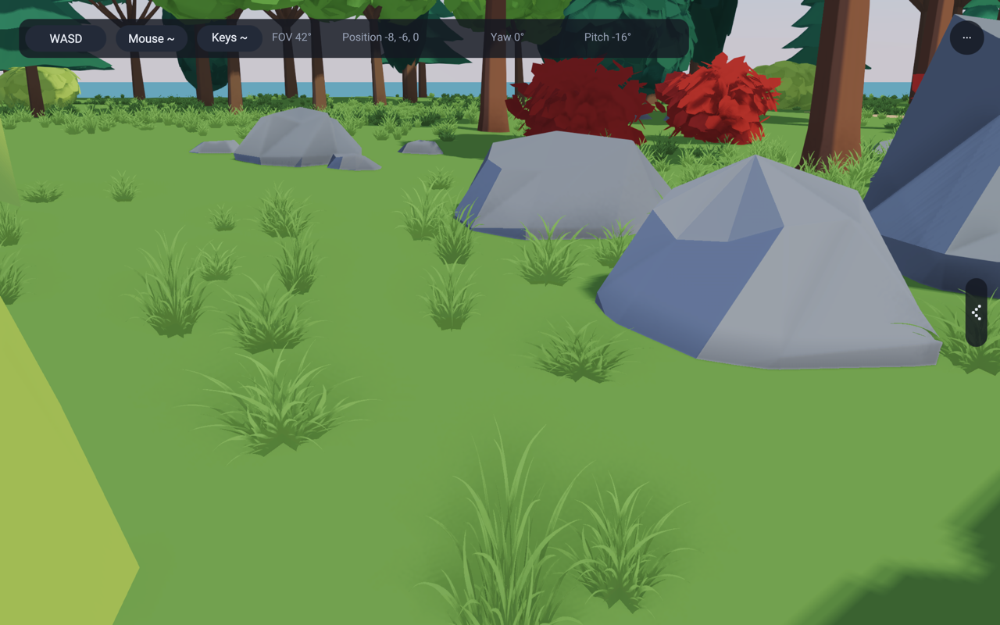 | 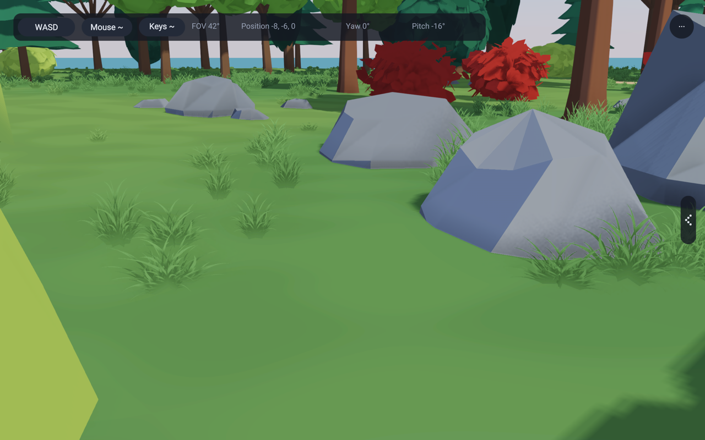 |
| Forest edge | 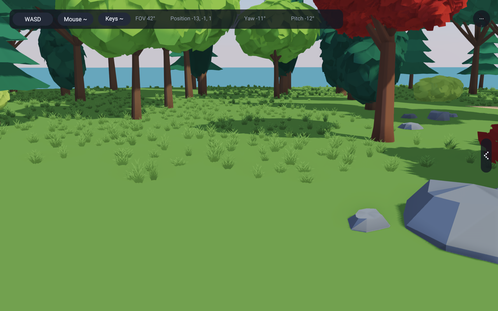 | 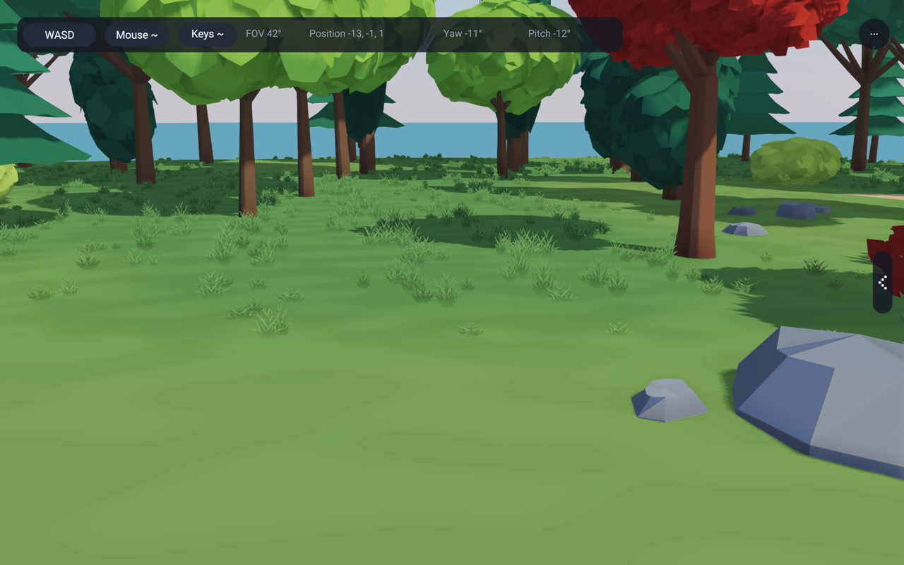 |
| Path contact | 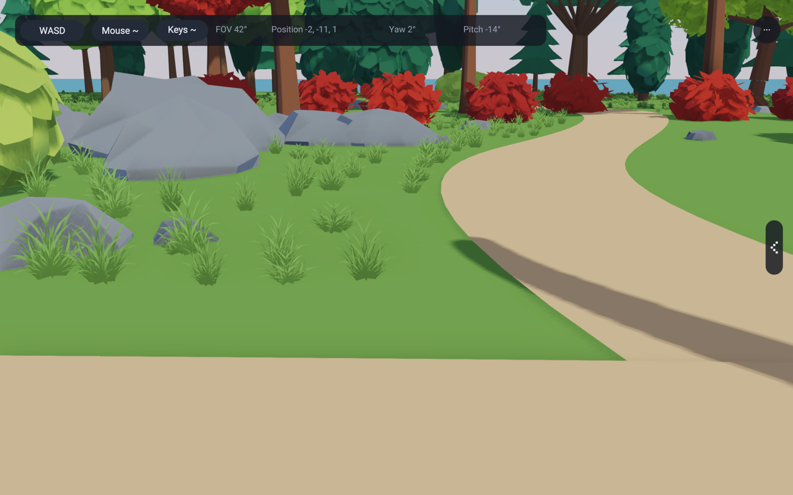 | 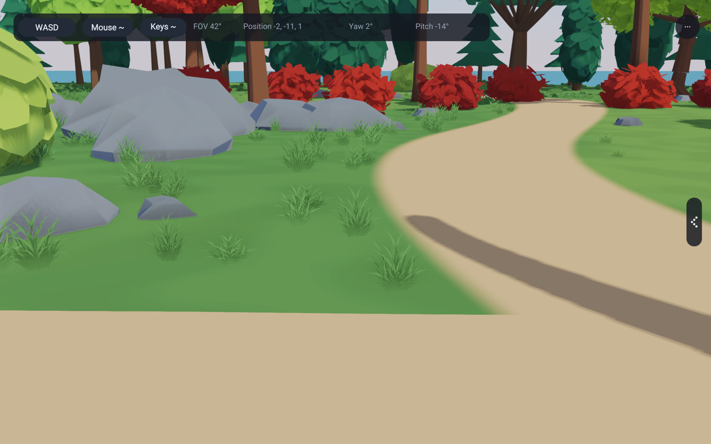 |

| Forest context | Before | After |
|---|---|---|
| Clearing | 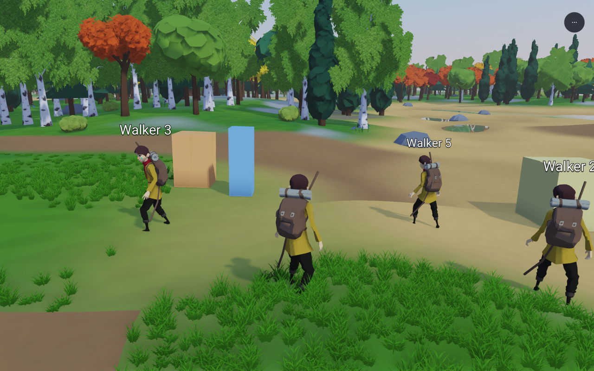 | 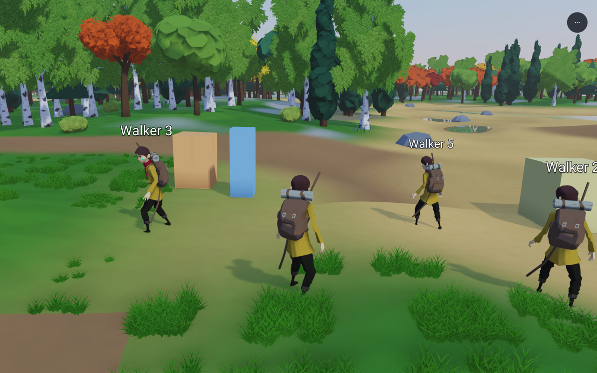 |
| Forest edge | 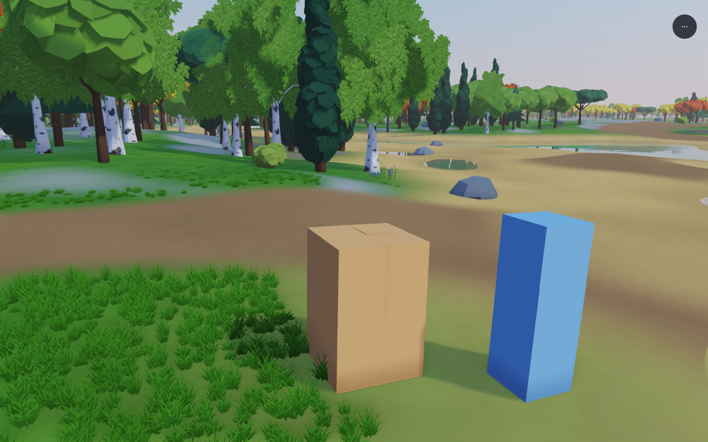 | 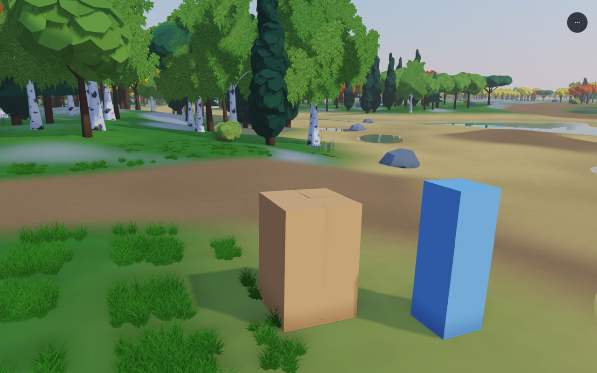 |
| Path contact | 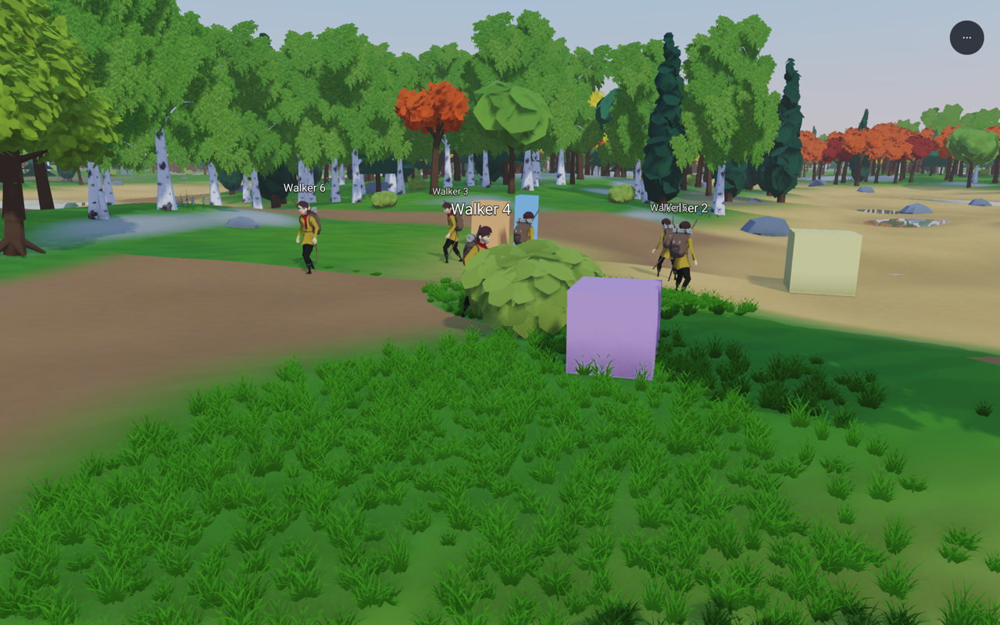 | 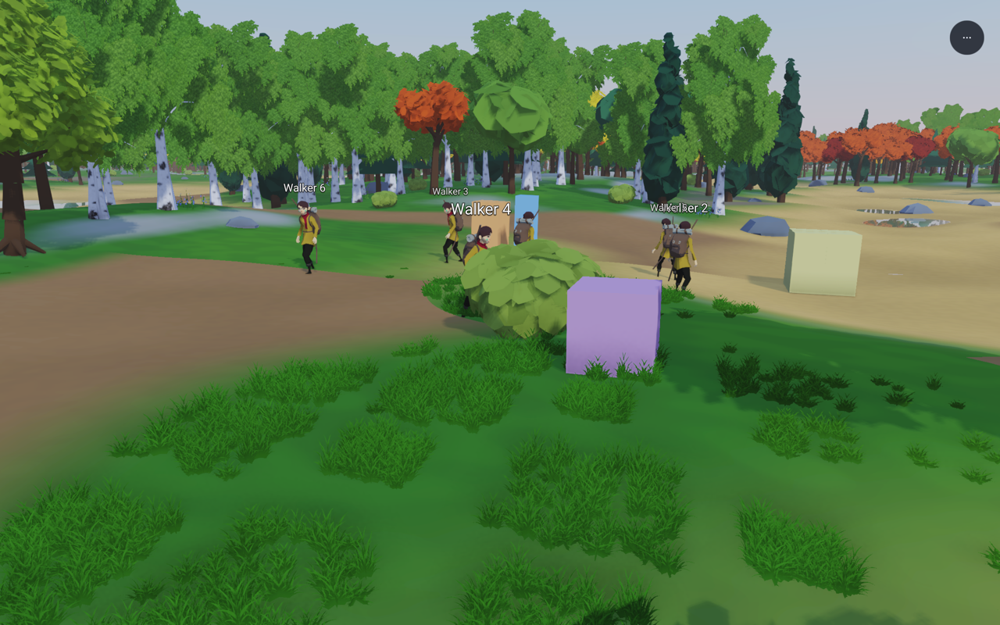 |

The private [comparison presentation](../../../peli_ideoita/environmentReferenceStudy/recoveryReview/index.html#grass-patches)
places these beside G01, G02 and G03, and contains all eight continuous clips.
The first candidate retained too much even scatter. The selected version gathers
roots in unequal 1.6 m groups while preserving open sectors and the candidate
budget. This changes which roots survive the masks: it does not guarantee an
identical visible count. The forest clearing has 1,363 before and 1,421 after.

## Shared implementation

- `grass_field.wgsl` owns the world-cell hashing, fine grouping, broad patch
  field and ground colour. `grass_compute.wgsl` uses its positions and then
  applies the existing biome, water/beach, road and obstacle tests. No root is
  moved after those tests. Width, density, patch coverage and the 65,536-record
  limit are unchanged. A zero `clusterStrength` retains uniform placement, height
  and colour; the examples use 1. Grouping is independent of the camera and tile origin.
- Ground colour darkens gently under fuller patches and becomes warmer in
  open areas. The tuft material uses that same base colour and eases the dark
  texture into the ground at its root. No extra emission or postprocess blur
  was added. The existing alpha cutoff, coverage-preserving mips, lighting and
  forward/deferred paths remain in use.
- `grassMeadowSettings` holds the common walker/grove tuning. Ground pipelines
  receive their app's patch scale and coverage as explicit constants. Walkers
  still pass their own island/forest biome constants, including the forward
  terrain path. The grove keeps its authored height mesh and scene field; it
  now draws through the shared terrain pipeline, with a toon override preserving
  its prior lighting mode. It has no copied terrain shader.
- `grove_path.wgsl` is the one authored path mask used by both grass rejection
  and ground paint. Its existing 20 cm edge transition is a material blend,
  not a blur of the rendered grass. The masks and rock/trunk circles are retained.
- `grass_motion.wgsl` replaces the regular large sine fronts with two advected
  noise scales. The app's shared wind vector supplies direction and strength.
  Roots remain fixed; the upper tuft leans with a small separate tip flutter.
  Current and previous positions use the same response for motion vectors.
  No physics system or per-tuft entity was added.

The GPU instance buffer remains 11 MiB. There is one indirect grass draw, the
same 18 vertices per tuft and the same 512 px image with ten mip levels. The
new ground/placement calculations add shader arithmetic, not texture layers or
new grass storage. The grove replaces three ground/path draws with one terrain
draw and owns the ground mesh handle on its app resource. Normal play does not
perform the optional study readback or save frames.

## Motion and distance evidence

Each clip records 180 consecutive frames at 30 fixed steps per second: a 12 m
straight camera walk, at a fixed 1.7 m world height. Both apps have before/after
clips with wind 0 and 1.5. These are continuous app renders, not interpolated
stills. Full bitmaps remain outside git. The walk traverses the grass grid and
its existing distance-thinning bands; screenshots do not hide distant grass.

The GPU check executes the production field and motion helpers at 64 cells and
times. It checks exact calm, unchanged roots, forward wind response, bounded
movement, continuity in space/time, positive finite colour and the same world
cell reconstructed from a shifted streaming grid. It does not establish visual
quality or test every possible obstacle layout. The contact views and recorded
walks provide the visual evidence alongside it.

| Grove at night | Forest at night |
|---|---|
| 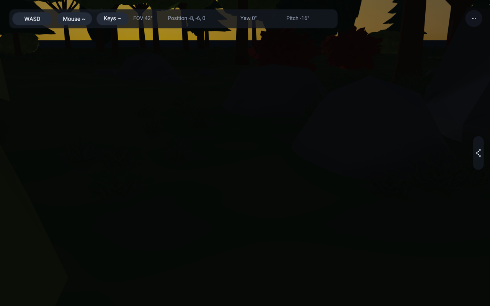 | 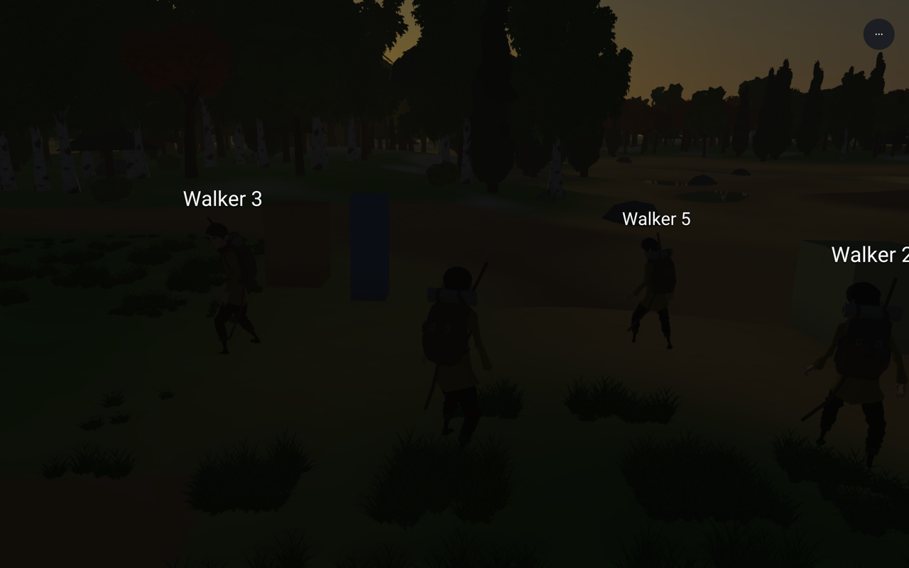 |

Grass receives existing tree shadows and darkens at night. It still does not
cast its own shadow-map shadows. Tuft tips may extend beyond an accepted root's
exclusion footprint; the retained semantics exclude roots, not every alpha pixel.

## Cost

| 143 fixed clearing, same density budget | Before | After |
|---|---:|---:|
| Visible tufts | 1,363 | 1,421 |
| Grass vertices | 24,534 | 25,578 |
| GPU instance storage | 11 MiB | 11 MiB |
| Median total GPU time, excluding first window | 12.980 ms | 12.918 ms |
| Median G-buffer GPU time, excluding first window | 1.639 ms | 1.547 ms |
| Process CPU user / system | 6.11 / 3.66 s | 6.10 / 3.61 s |
| Peak process RSS | 264.2 MiB | 267.0 MiB |

The slight timing differences are too small to establish a speed improvement.
Surviving tuft count rose 4.3% because grouped roots hit the unchanged masks at
different positions; the density setting and candidate allocation did not rise.

The measurements use matching 900-frame forest runs, the same camera and 0.55
density setting, wind 1.5, scale 1, DRS off, a reported 2304 × 1440 scene and
no screenshot readback. GPU times
cover the entire G-buffer or scene, not grass alone. CPU and peak RSS include
startup. The desktop was not isolated, so these short observations are not a
general performance guarantee. The fixed simulation-step frame-time readout is
not used as a CPU benchmark. Full timing windows and resource reports are in
[costs.json](images/grass-patches/costs.json).

## Reproduction and remaining limits

`tools/capture-grass-patches.py OUTPUT --before BEFORE_FOLDER` builds current
binaries and captures the paired views; `--motion` then records the eight clips.
The before folder supplies `before138` and `before143` binaries with the same
CameraStudy hook. `RAE_LANDSCAPE_WALK=1` enables that optional path, and
`RAE_LANDSCAPE_FRAMES=DIR` saves its frames. Both controls are read once at setup.
`tools/measure-grass-patches.py BEFORE143 AFTER143 OUTPUT` performs the matching
cost runs. Every subprocess is bounded and saved window geometry is restored.

The one tuft texture can still repeat. Some crossing planes remain apparent
close up. The broad clearings still need more varied low ground cover and the
references' flowers; changing the whole scene palette or increasing density
would have obscured this comparison. Existing distant thinning is retained,
not replaced with a new grass LOD scheme. Thin tips can still shimmer at range.

Verification: examples 136, 137, 138 and 143 passed (four gates, zero failures).
The `grassPatches` and `surfaceImages` hardware checks passed. Compiler cases
759, 1093 and 1244 passed; format-check-tree, example-copy-gate and
banned-terms-gate passed. Both repeated fixed stills were byte-identical.
The recorded 12 m walks are local grid/transition evidence, not a long-distance
forest streaming stress test.

A final compatibility guard preserves the public zero-clustering setting.
The hardware check covers that uniform mode. Rebuilt selected-mode captures
changed only 329 pixels in 138 and 36 in 143, out of 4,096,000 each; mean channel
differences were 0.0000723 and 0.00000476 out of 255. Tuft counts stayed identical.
[Compatibility evidence](images/grass-patches/compatibility.json) records the
final shader hashes separately from the preserved capture manifests.
