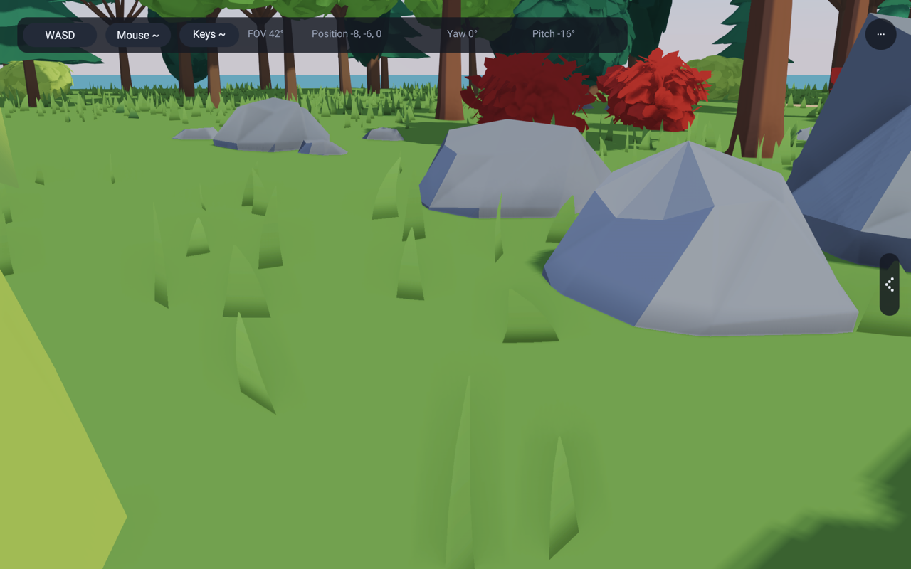
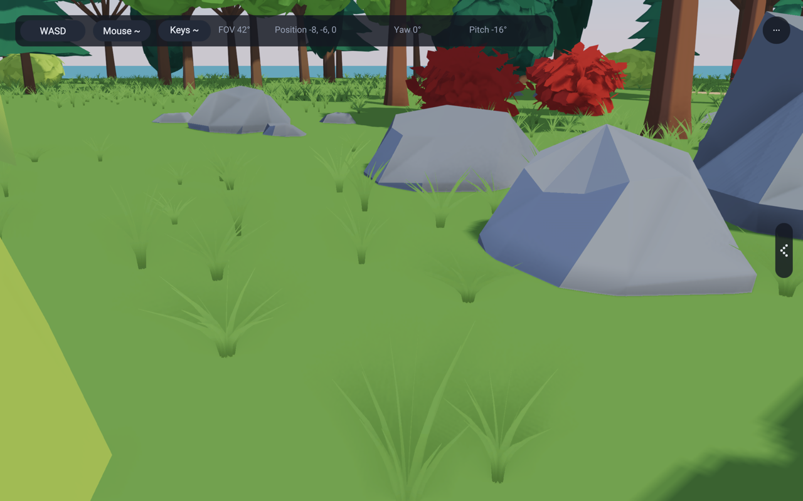
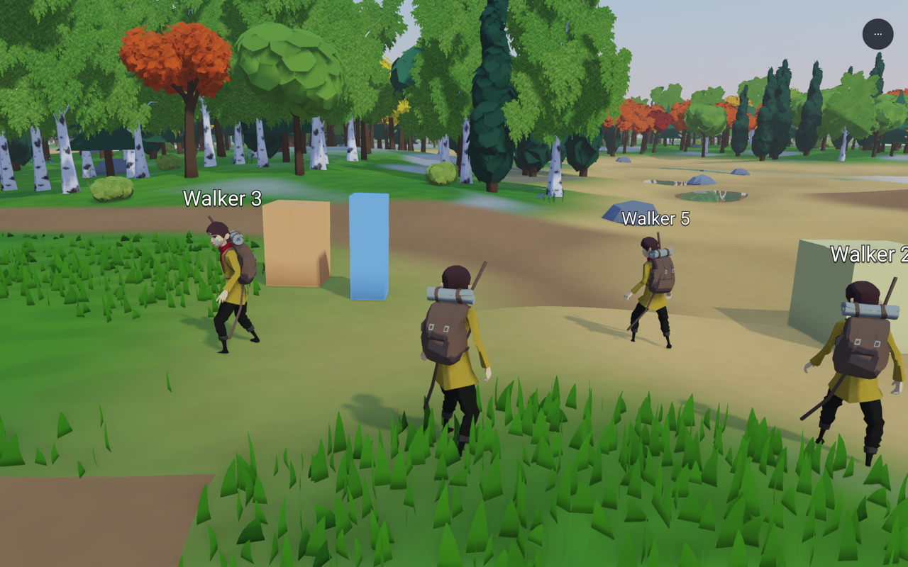
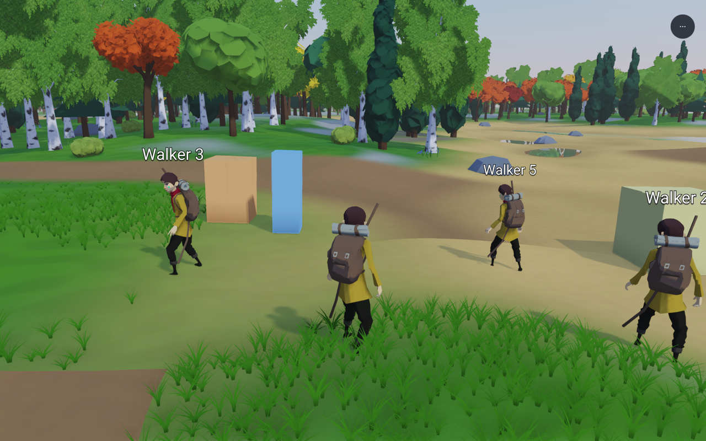
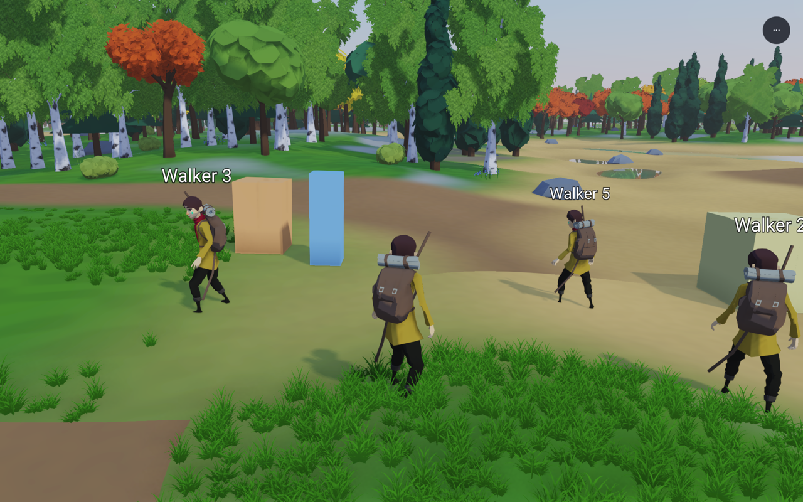
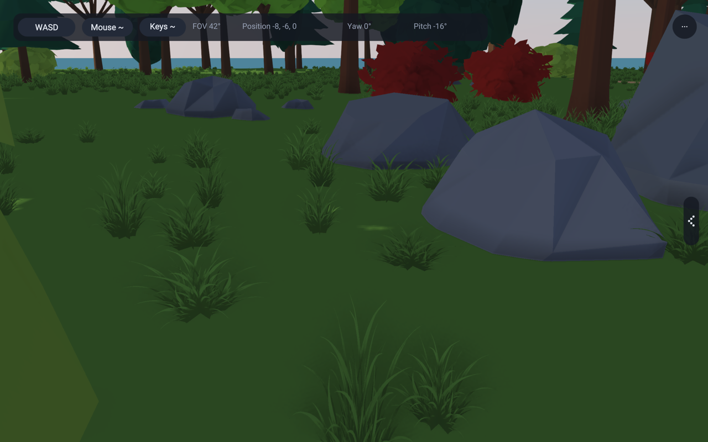
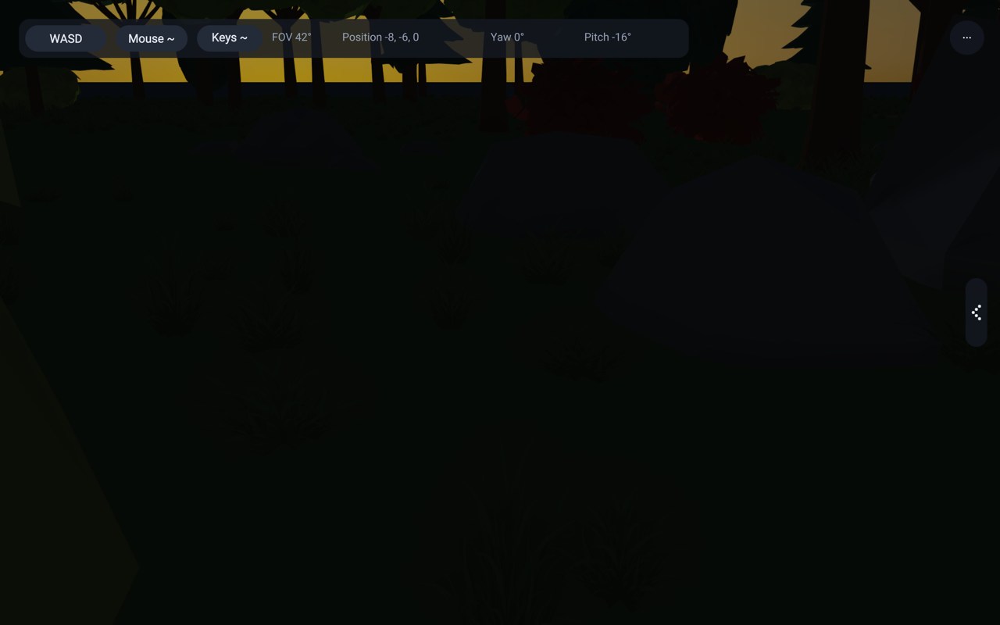
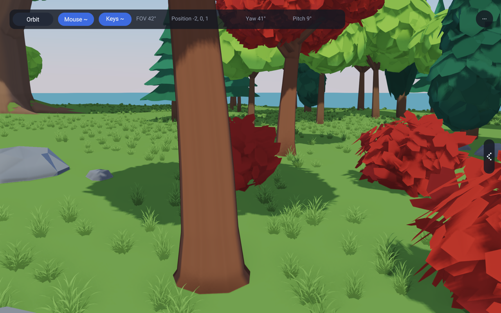

# Near-grass recovery — 26 October 2026

The selected treatment is an original textured tuft on three crossing planes.
The choice follows rendered comparisons in the grove and at walker height.
Both a five-ribbon draft and a refined twelve-ribbon alternative were rendered.
The latter is finer, but its gathered base still looks like a cut strip bundle. The textured tuft has finer curved edges, more connected
bases and quieter internal shading. Density was not raised to make it win.

## Matched alternatives

All current alternatives use the same shared compute output: 2,781 instances
in the close grove view and 1,363 in the forest view. Position, yaw, base height,
width, patch membership, culling, ground colour, wind phase, light and camera
are identical within each app. Both new candidates use the same height envelope
and comparable tuft footprint. Their visible pixel coverage differs,
as it should when judging silhouettes; equal instance counts do not mean equal
overdraw. The current 0.55 height scale produces heights of 0.154–0.396 m before
the existing outer-grid fade. No showcase specimens or terrain were replaced.

| Rejected single ribbon | Twelve curved ribbons | Selected textured tuft |
|---|---|---|
|  |  |  |

| Rejected at walker height | Ribbon candidate | Textured candidate |
|---|---|---|
|  |  |  |

The private [reference presentation](../../../peli_ideoita/environmentReferenceStudy/recoveryReview/index.html#grass-recovery)
places these frames beside G01/G02. Those crops call for fine blades gathered
at grounded bases and broad patches around flowers. This pass improves the
individual tuft. It does not yet reproduce their rich ground composition.

### Pre-queue control

This frame was rendered from the preserved e86992db sources at the same camera,
clock, light and resolution. It retains that revision's original placement and
height distribution; it is a historical control, not the matched experiment.
`RAE_GRASS_SHAPE=control` additionally provides a simple old-style quad on the
current placement. It is not a byte-for-byte reconstruction of the old shader.

## Shared implementation and material

`GrassViewSettings.shape` selects `preQueue`, `rejected`, `ribbons` or `textured`.
The selected default is `textured`; `RAE_GRASS_SHAPE` selects the study modes
without changing the app's settings. The same `GrassCompute` and render shader
serve 136, 137, 138 and 143. There is no example shader fork or new C code.

Each surviving compute instance draws three fixed crossing planes, 18 vertices
and six triangles in one indirect draw. The planes do not turn toward the
camera. Their common root stays at the terrain height and the existing rooted
wind displacement bends the upper portion. The ribbon alternative draws twelve
four-segment ribbons, 288 vertices per instance. The prior single ribbon remains
selectable with its original geometry and shading.

The original [meadowTuft.png](../lib/assets/grass/meadowTuft.png) has connected
lower foliage, unequal curved upper blades and narrow transparent gaps.
[Asset notes](../lib/assets/grass/meadowTuft.md) record its generation prompt and
source. Its restrained luminance modulates the app's grass colour; broad
upward normals avoid lighting every narrow leaf as a separate hard surface.
The existing toon/physical material choice, roughness and sun lighting remain.
There is no emission, light boost, global shadow change or blur.

One owner-held 512 × 512 RGBA sRGB image has ten mip levels, about 1.33 MiB
before driver overhead. SurfaceImages filters in linear light, weights colour
by alpha and preserves coverage at the 0.5 cutoff. Both forward and deferred
paths use the same mask. It is alpha cutout with depth writes, not blended
transparency or alpha-to-coverage. The image/mips/sampler retire with the grass
owner and rebuild with its GPU resources. Unit coverage checks reach the 16px
mip; the coarsest levels cannot retain individual thin tips.

## Light and shadows

| Late light, 17:15 | Night, 23:00 |
|---|---|
|  |  |

The daytime patch crosses a tree-shadow boundary: tufts receive the existing
cascaded shadows. Both the grove and forest night captures darken normally.
The existing grass pass does **not cast into the shadow map**, and this pass
has not added that feature. Darkened lower blades are material shading, not a
claim of new physical self-shadowing. Existing terrain, road, water and obstacle
rejection remains unchanged; the compute shader is untouched. A tuft's tips can
extend beyond its accepted root footprint, as before; stricter footprint-wide
contact clipping belongs with placement tuning.

## Measured cost and limits

| Study | Rejected ribbon | Twelve-ribbon candidate | Textured tuft |
|---|---:|---:|---:|
| Grove visible instances | 2,781 | 2,781 | 2,781 |
| Grove submitted vertices | 66,744 | 800,928 | 50,058 |
| Forest visible instances | 1,363 | 1,363 | 1,363 |
| Forest submitted vertices | 32,712 | 392,544 | 24,534 |

Storage remains bounded to 65,536 records: 11 MiB of instance data, plus the
small existing uniform/indirect/readback buffers. The texture adds about
1.33 MiB. There are no per-leaf entities, material batches or frame allocations.

On this machine, three 600-frame headless forest runs at matching settings
(2304 × 1440 scene rendering) gave
the following values. The actual pre-change binary was retained from 50d461b9,
before this grass change; it does not sample the new image.

| Treatment | G-buffer GPU ms | Total GPU ms | Peak RSS MiB | Process user + system CPU seconds |
|---|---:|---:|---:|---:|
| Actual pre-change binary | 1.468 | 13.915 | 262.11 | 6.94 |
| Twelve-ribbon candidate | 1.564 | 13.978 | 264.19 | 7.00 |
| Textured tuft | 1.542 | 13.883 | 265.00 | 6.95 |

GPU values average the last two reported 60-frame windows, excluding the first
warm-up window. They measure the whole G-buffer/scene, not grass alone. CPU and
RSS include startup and the entire process. The desktop was not isolated; this
is a small matched-cost observation, not evidence of a speedup. The textured
case's G-buffer result is about 0.074 ms above the old binary in these runs.
Larger alpha rectangles shade and discard empty pixels; fewer vertices do not
prove lower fragment cost. The fixed-clock frame-pacer printout is not used as
a CPU benchmark. [Raw summaries](images/grass-recovery/costs.json) retain all
reported windows. Full logs and traces stay outside git.

Measurements used `RAE_HEADLESS_FRAMES=600`, `RAE_FIXED_DT=0.016666667`,
`RAE_WIND=0`, `RAE_GPU_PASS_TIMING=1`, `RAE_FRAME_TIMING=1`,
`RAE_WALKER_HOUR=10`, no screenshot readback, the forest camera in the manifest
and `/usr/bin/time -l`. Each app completed with exit 0.

The first `RAE_PROFILE=1` run wrote its trace and then aborted in profiler
stop/String cleanup. Those trace timings are not used here. The successful
measurements use `RAE_GPU_PASS_TIMING=1` and `/usr/bin/time -l` instead.

## Reproduce and remaining work

Run `python3 tools/capture-grass-recovery.py`; optionally pass `--baseline`
with an extracted e86992db tree. The script builds fresh binaries, preserves
window geometry, uses bounded subprocesses, captures every alternative and
light view, and checks repeated fixed bitmaps. The [manifest](images/grass-recovery/manifest.json)
records source/image hashes, camera settings and 2560 × 1600 source bitmap
sizes. Review images are reduced to 1280 × 800. Repeated fixed bitmaps were
identical in both apps. `RAE_GRASS_REPORT=1` logs the
actual instance and vertex counts once at frame 60; normal play does no such
readback.

The tuft motif still repeats. Very close views can reveal crossed planes, and
thin distant tips can shimmer despite coverage-preserving mips. The grove's
large flat-colour gaps and the forest's strong green saturation are unchanged.
The supplied references have richer patch and ground relationships. Those are
still needed; this is a selected near-grass treatment, not a finished meadow.

## Verification

Cases 759 and 1244 passed. The new case checks a transparent image perimeter,
an opaque connected root, coverage-preserving mips down to 16px, and no black
colour contamination from transparent neighbours. GPU checks `surfaceImages`
and `canopyCoverage` passed; the image check now uploads and retires the grass
asset alongside the existing tree images.

All four 136/137/138/143 example gates passed, including forward rendering,
the grove's fourteen views, the forest's 31,090 instances and the existing
136 live-memory check. These are functional gates, not substitutes for the
visual comparisons above. The tree format check, example-copy gate and
banned-terms gate also passed. No full compiler suite was needed for this bounded
rendering-library change.
