# Bloodgood Japanese maple refinement

**Kind 7 / speciesCrimson remains Acer palmatum ‘Bloodgood’.** The existing
138 specimen stays at (-8.1, 7.5), seed 301, height 4.2 m and width parameter
1.8 m. All ten forest kind numbers and placement probabilities remain unchanged.
Its shared forest height range is deliberately reduced from 4.2–6.8 m to
**3.2–4.8 m** so this small tree sits below the larger maples. Physics height and
culling use the same instance scale.

[North Carolina Extension](https://plants.ces.ncsu.edu/plants/acer-palmatum-bloodgood/)
describes a broad upright rounded habit, spreading branches, multi-trunk forms,
burgundy foliage and thin reddish young stems.
[Oregon State](https://landscapeplants.oregonstate.edu/plants/acer-palmatum-bloodgood)
describes a small round-headed tree with deeply divided reddish-purple leaves.
[Cornell](https://woodyplants.cals.cornell.edu/plant/view?id=9) describes the
architectural layers of Japanese maple branches. These are botanical targets;
T04 guides the relationship of connected crimson, gold and green crown masses.
The supplied art crop is not a botanical identification of this cultivar.

## Matched grove comparison

| Unchanged old generator/material | Selected tree, same seed, size, light and camera |
|---|---|
| 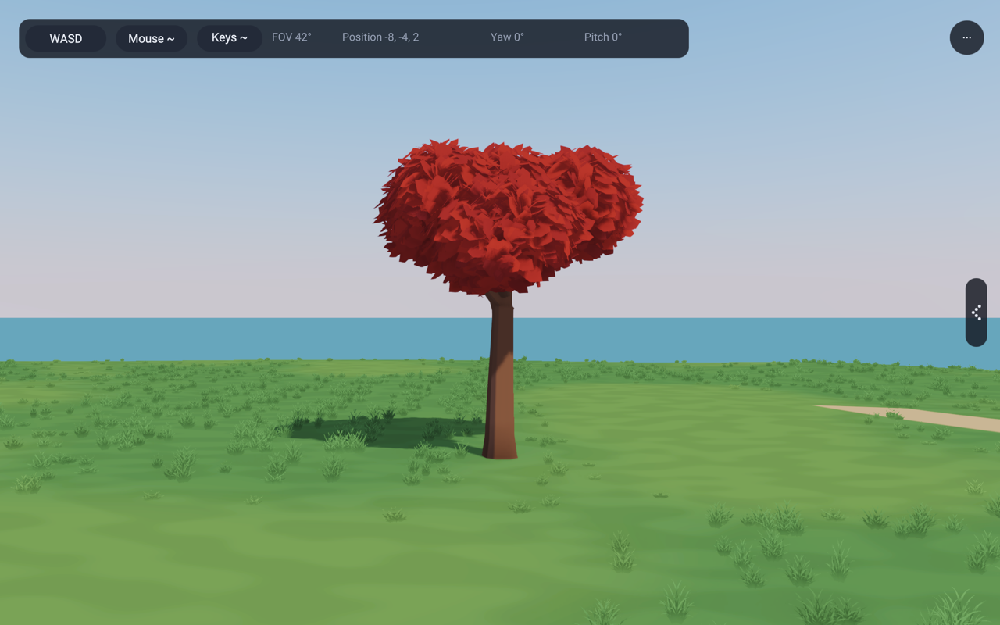 | 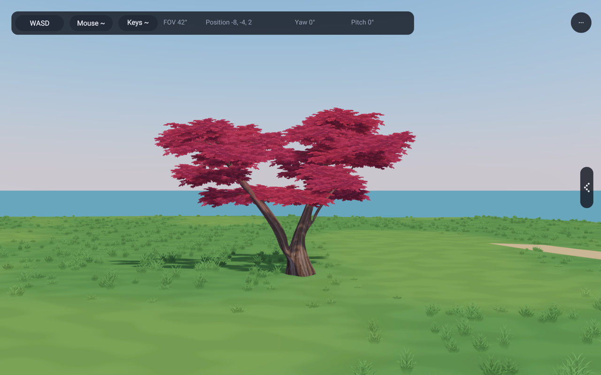 |

The old tree hides its wood behind large separately lit leaf meshes. The new
form has three unequal axes, low rounded branch junctions, arched opposing
shoots and shallow spreading foliage layers. Missing shoots leave deliberate
openings around the wood. Its crown is broader and lower than the red maple;
it is not the same tree recolored.

`procgen/CrownScaffold` assembles the existing curve, tube, joined-opening,
relaxation and surface helpers. It owns no species policy. `JapaneseMaple`
supplies the leader and two primary limb descriptions, then uses the existing
`birchTube`, `BirchTwig` carrier and `addConnectedFoliageSpray` path. No junction,
wind or renderer implementation is copied into the new species.

| Low multi-stem forks | Single-stem option |
|---|---|
| 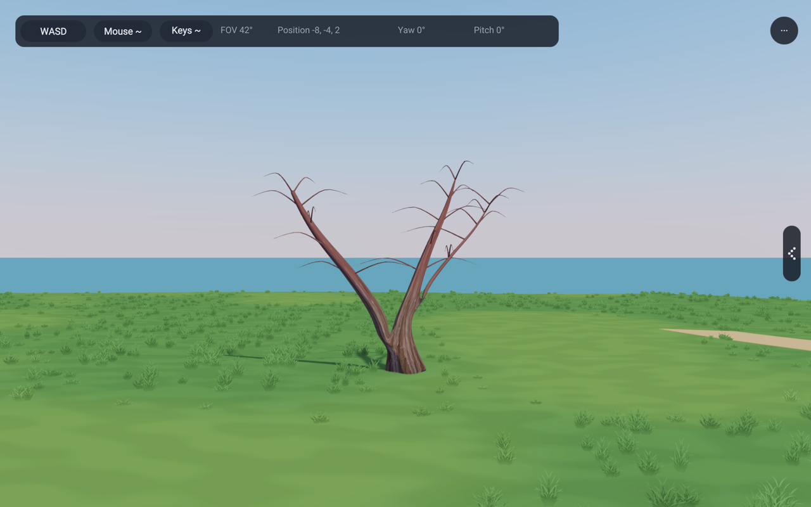 | 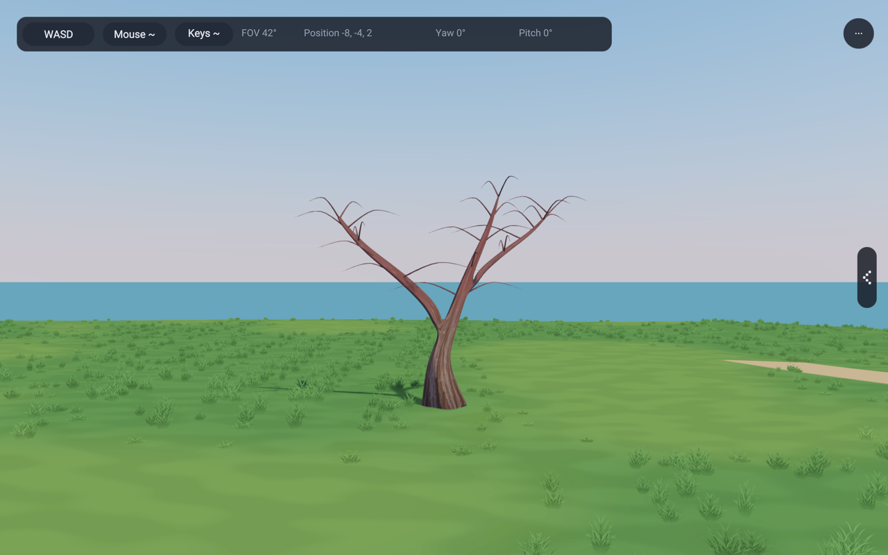 |

Both forms taper continuously and keep primary wood rigid. Twenty-seven curved
shoots carry 81 camera-facing cards. The three cards on each shoot share a
fixed attachment pivot. Broad crown normals stay independent of camera facing.
Three restrained branch tones separate warmer crimson from cooler burgundy.

| Side | Seed 1229, 3.5 m | Seed 2189, 4.8 m |
|---|---|---|
| 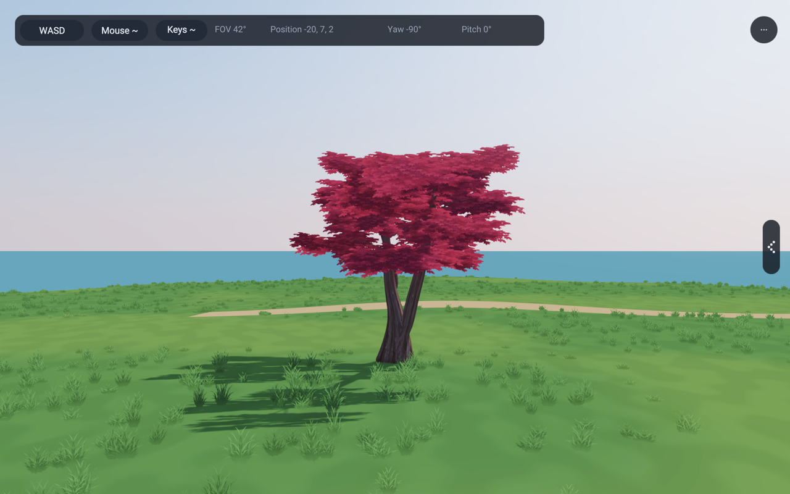 | 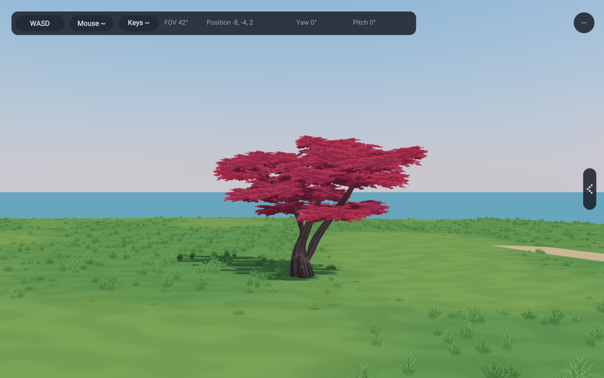 | 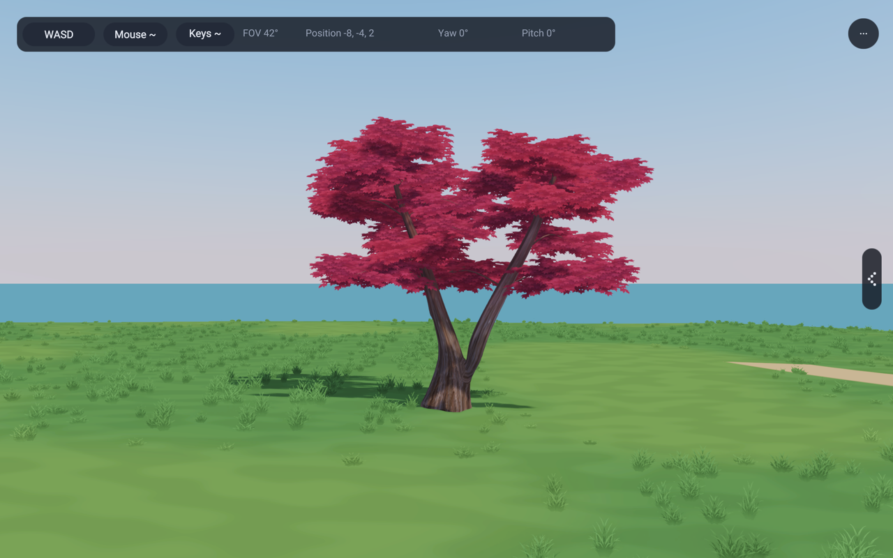 |

## Material and lighting

Original [leaf and bark assets](../lib/assets/trees/japaneseMapleAssets.md) use
the existing surface-image owner. The first spray had too much separate leaf
contrast; a second edit quieted the interior while preserving its alpha edge.
The private presentation retains the first actual render beside the selected
one. Fine palmate edges and broad interiors are the chosen treatment.

The bark's vertical coordinate moves from older gray-brown base texture to
smooth reddish upper wood. The two 512-square images retain the existing mip
chains, alpha cutoff, two-sided foliage, shadow and atlas paths. There is no
emission, exposure change or shadow exemption.

| Close underside | Low-sun backlight | Night |
|---|---|---|
| 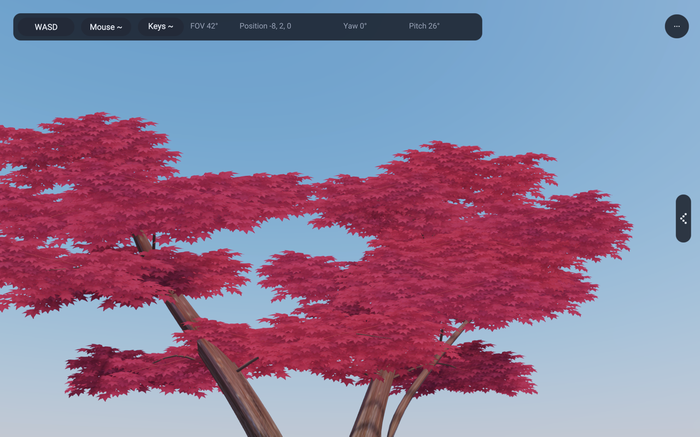 | 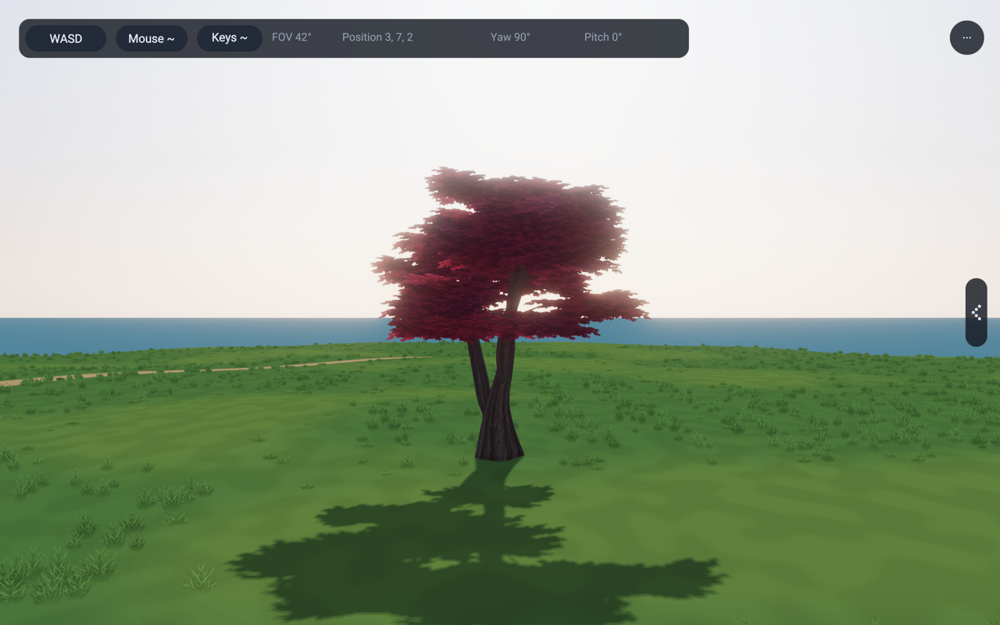 | 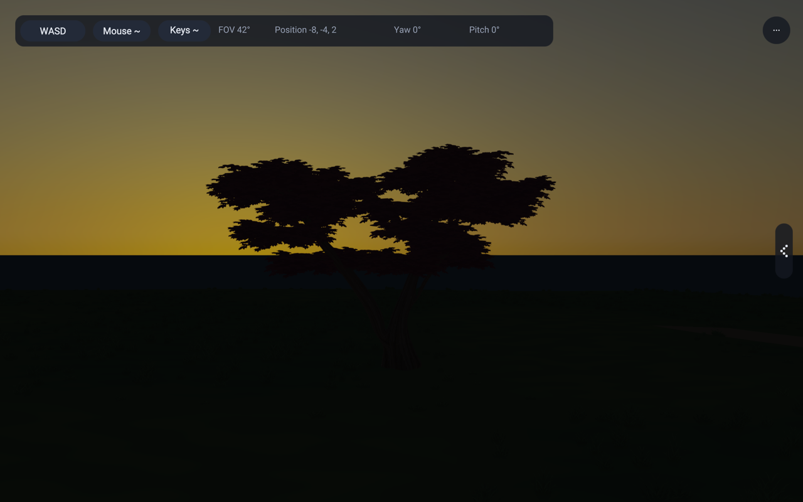 |

The shaded and backlit crown retains burgundy layers and wood openings. At
23:00 it becomes mostly a silhouette with the rest of the unlit scene; this
is not an independently bright tree. Close underside views deliberately show
the remaining card overlap and repeated leaf marks.

## Shared consumers and group color

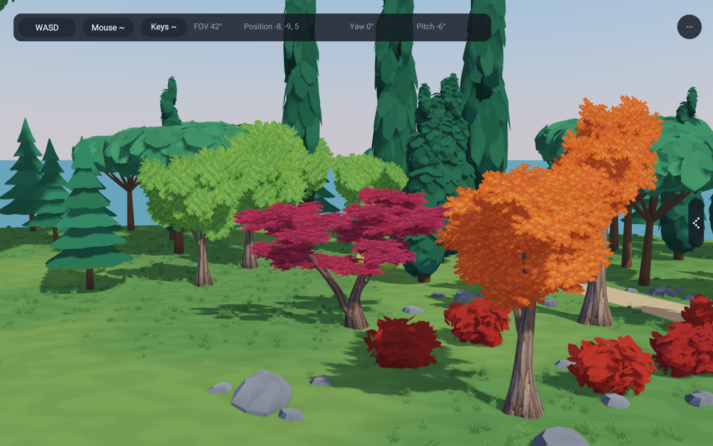

136, 137 and 143 all obtain kind 7 from `GroveTrees`. No placement list is copied,
no per-leaf entity is created, and no sibling gets a separate generator. The
original grove crimson specimen is replaced in place. View 24 names it
“Bloodgood Japanese maple”; previous view numbers and the palm stay intact.

| Previous forest tree | Selected shared tree |
|---|---|
| 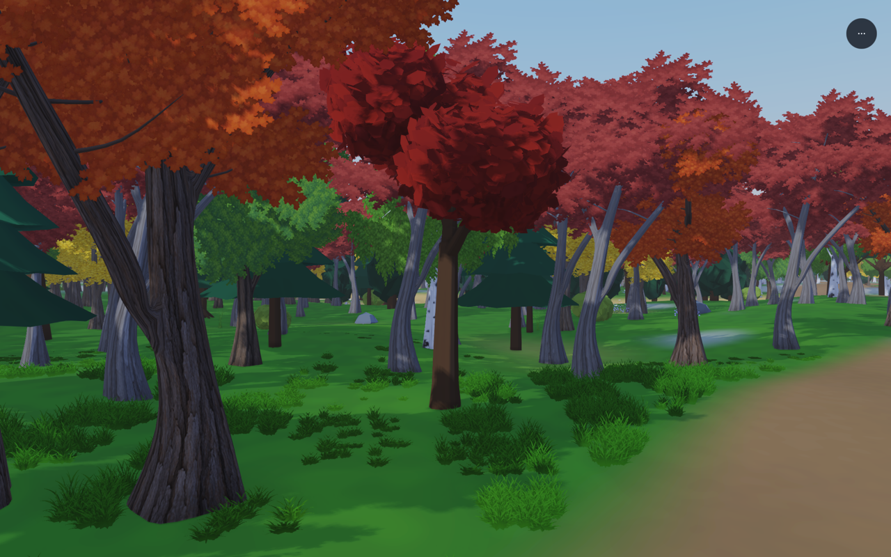 | 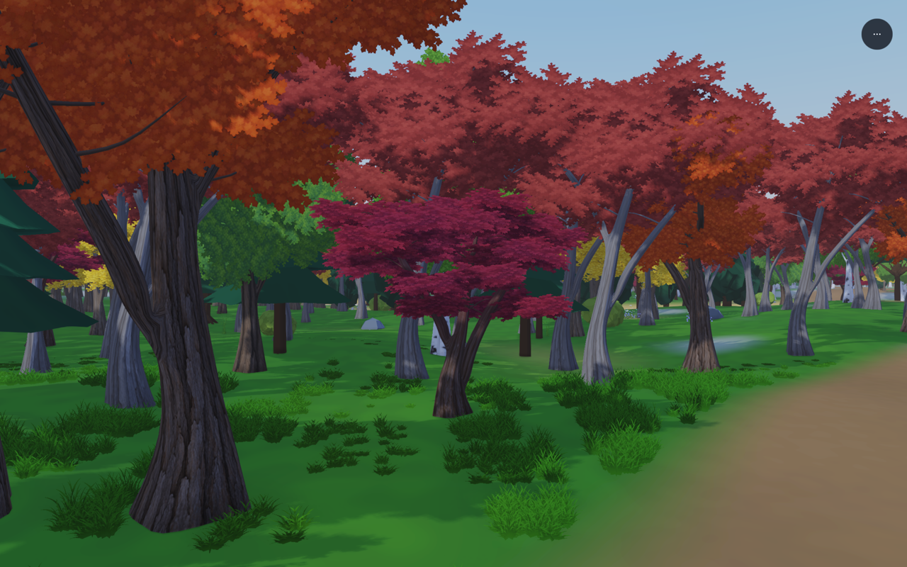 |

These forest frames use the same camera and placement, but **not the same
height**: the new small-tree height range is intentional. The control binary is
from the preceding commit. The target is placement 15708 at
(-3.56293, -26.8207, -0.678052), new scale 0.654613, about 3.60 m high. Its
prototype seed remains 1229. The full forest still contains 31,090 trees.
Neighboring crowns and trunks remain in the comparison.

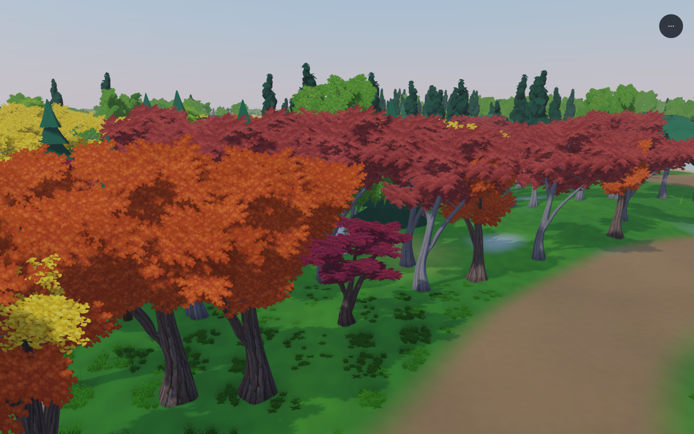

## Cost, bounds and lower detail

The 138 seed-301 specimen uses **4,050 vertices / 6,490 triangles**, including
162 foliage triangles. Its unchanged full-detail grove control uses 98,061
vertices / 130,938 triangles. These are geometry counts, not a GPU-time claim:
alpha overdraw remains a separate cost. Four shared material/mesh parts remain
per species: wood and three foliage tones. Both images with their mip chains
represent about 2.67 MiB of image data before allocation overhead.

Near and middle levels share handles, textures and colors. **The middle mesh
is not reduced.** The far atlas is baked from the actual textured, posed crown;
its muted burgundy color stays distinct from the orange/scarlet species.
The hardware check covers every posed view cell and mip rather than comparing
only an average against unposed cards.

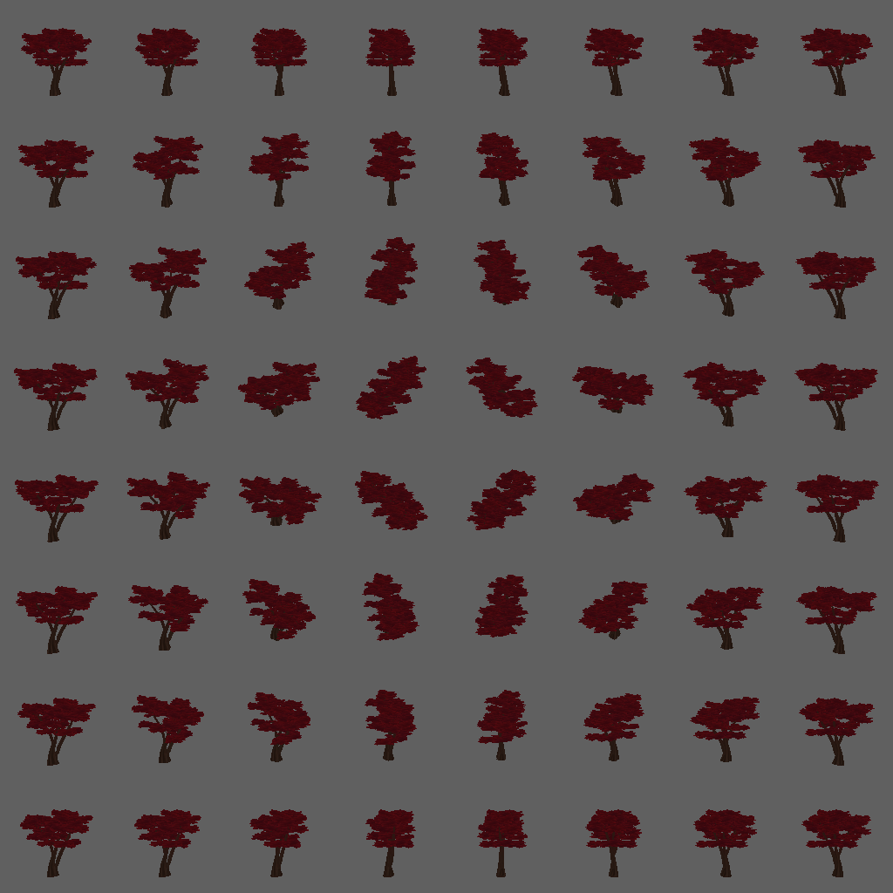

The bound is `max(0.95 * height, 2.25 * width)` around `z = 0.55 * height`.
Tests include the radius of each freely rotating card plus 3% of height for
normal wind, finite vertices, indices, unit normals and rigid wood. A shorter,
wide study exposed the need for the width term; it is not a height-only bound.

## Reproduction and remaining limits

`tools/capture-japanese-maple-studies.py` captures the actual 138 app. The saved
manifest records seed, size, camera, clock, lighting, source/asset hashes and
binary hash. Static studies use 60 frames at 1/60 second, wind zero, Preetham
10:00, exposure 1, deferred toon, cascaded shadows, SSAO, SMAA and bloom.
Low-sun views use 17:15 and night uses 23:00. Review PNGs are 1280 × 800.
The private recovery presentation contains the reference crops, full static
set, forest camera manifest and a six-second 2.5 m walk at wind 1.2.
Start/middle/end motion frames were inspected. That is a sampled motion review,
not proof that every camera path is free of card artifacts.

The new form is more open, layered and species-specific than its control.
It does **not** completely match the quiet reference art. Close views still
show repeated pointed leaves and overlapping cards; some angles flatten the
crown into shelves, and the fork bark stretches. Dark pockets remain under
some overlaps. The forest's surrounding unconverted spruce/cypress forms are
unchanged. These limits remain visible in the published frames.

## Checks run

- Seven focused fixtures importing `app3d/GroveTrees` pass. The new fixture
  covers 70 seeds across both stem forms, repeat generation, three smaller
  height/width studies, card bounds/pivots, valid normals/indices, rigid wood,
  stable kind numbers, smaller forest scales and identical near/middle meshes.
  Run cases also pass their exit allocation check.
- `leafWind`, `surfaceImages` and `impostorBake` hardware checks pass. Both
  ordinary and posed atlas paths include the new bark/leaf layers. Every
  posed view cell and mip is checked for coverage.
- The 136 deferred, 137 forward, 138 grove and 143 forest example gates pass.
  136 includes a live-memory check; 143 retains all 31,090 tree placements.
  The new named grove view and additional lighting studies were rendered
  directly with the capture tool.
- Changed Rae files pass formatting; example-copy gate passes without any new
  allowlist entry. The capture tool parses as Python.

Compiler package version: 0.2.149. No C or shader changes.
