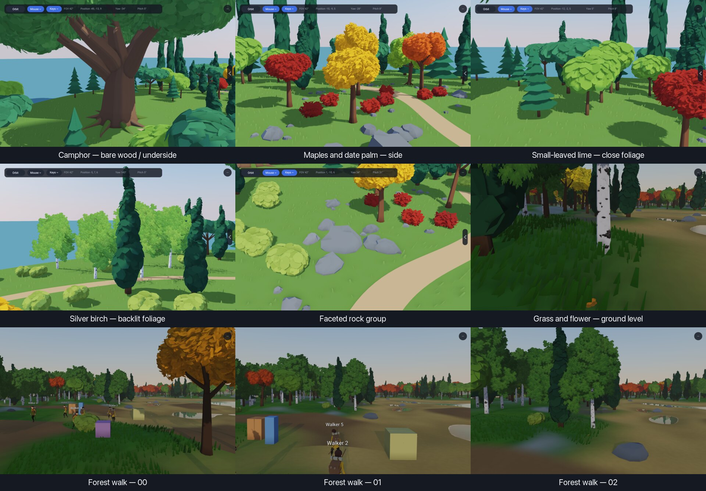
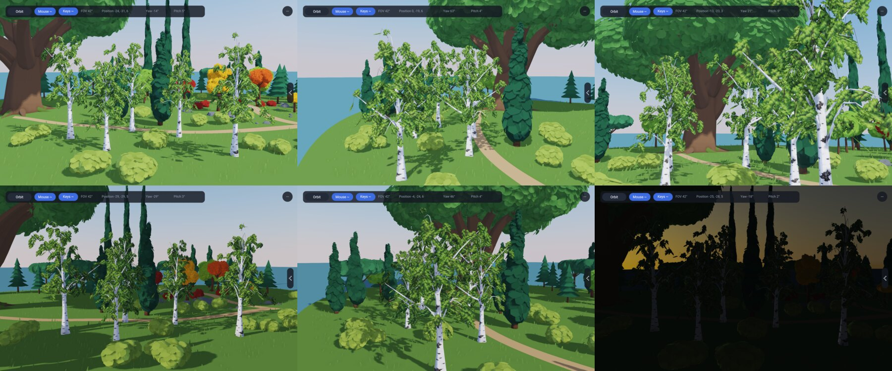

# Landscape comparison views

This is the fixed visual baseline for Autumn Grove (138) and Walker in a Huge
Forest (143). It exists to compare later tree, rock, grass and flower work from
the same viewpoints. It is not an engine benchmark or a claim that the current
art is finished.



The 138 menu's existing app section shows the botanical name and purpose of the
active view. The names match [the species inventory](environment-art-direction.md).
The shared scene chooser has three buttons, while keys 1-9 and
`RAE_GROVE_VIEW` select all nine named views.

## Reproduce the captures

From the repository root:

```sh
tools/capture-landscape-comparisons.sh captures
tools/capture-landscape-comparisons.sh verify
tools/capture-landscape-comparisons.sh metrics
```

The default output is `/tmp/rae-landscape-comparisons`. Set
`RAE_LANDSCAPE_OUTPUT` to use another temporary directory. BMP frames, logs and
repeat captures remain outside git. The script writes `manifest.txt` beside
them, temporarily fixes both windows at 1280 by 800 points, clears saved walker
state for the run, and restores the previous files when it exits. PNGs are
normalized to 1280 by 800 pixels so Retina scale does not change the comparison.

Fixed captures render 60 frames at a fixed 1/60 second step. They therefore
show one simulated second, independent of machine speed. The stability check
captures the camphor-root view twice and the middle forest-walk view twice and
requires each BMP pair to be byte-identical.

## Views and conditions

| Capture | Subject | Existing control | Extra camera state |
|---|---|---|---|
| `138-roots` | Bare camphor wood, roots and foliage underside | `RAE_GROVE_VIEW=roots` | preset |
| `138-trees-side` | Sugar, red and Japanese maples plus date palm | `RAE_GROVE_VIEW=trees` | preset side view |
| `138-foliage-close` | Small-leaved lime crown | `RAE_GROVE_VIEW=fluffy` | preset close view |
| `138-birch-backlit` | Silver birch sprays against the bright sky | `RAE_GROVE_VIEW=birches` | `0 2.5 0.1 0 22 0 0 0 -19 -10 0 0` |
| `138-rocks` | Path-side faceted rock group | `RAE_GROVE_VIEW=rocks` | preset |
| `143-ground-cover` | GPU grass, instanced grass and the orange flower prop | fixed forest start | `1 0 0.24 -0.20 4.2 0 18.0 0.35 0 0 0 0` |
| `143-walk-00` | Forest path start | fixed forest start | `1 0 0.24 -0.06 4.2 0 -18 2.4 0 0 0 0` |
| `143-walk-01` | Forest path middle | fixed forest start | `1 0 0.24 -0.06 4.2 0 -5 2.4 0 0 0 0` |
| `143-walk-02` | Forest path end | fixed forest start | `1 0 0.24 -0.06 4.2 0 8 2.4 0 0 0 0` |

The twelve camera values are the existing `CameraRig.stateString` order: mode,
yaw, orbit pitch, free pitch, distance, free position x/y/z, orbit target x/y,
smooth-mouse flag and smooth-key flag.

Autumn Grove uses Preetham at 10:00, exposure 1.0 and a paused clock. Its fixed
source seeds include the six legacy trees (501, 605, 710, 301, 903 and 217),
fluffy prototypes/placement (73 and 4177), camphor (219), the rock groups listed
in `GroveScene.rae`, and birch's shared prototype (1437). The capture has
63 trees, 21 generated bushes and 7 scarlet shrubs.

The forest uses Preetham on day 298 at 12:00, exposure 1.0, and the current
deterministic placement seeds: density 401, position 811/812, keep 813, yaw 814,
and species 733/977/131. It plants 31,090 trees. Both applications use deferred
rendering, toon materials, cascaded shadows, SSAO, SMAA, bloom, TAA off, GPU
grass and wind. The forest capture also fixes DRS off and runs FFT water.

## Current technical baseline

Measured on 2026-10-25 on a 10-core Apple M1 Max with a 32-core GPU and 64 GB
memory. The hidden windows were 1280 by 800 points; the renderer reported a
2304 by 1440 internal scene for the timed forest run. Compilation was excluded.

| App | G-buffer instances | Resident meshes | Resident indexed triangles | Later frame windows | Settled GPU-pass total | WGPU resources after warm-up |
|---|---:|---:|---:|---|---:|---|
| 138 | 388 | 120 | 1,088,028 | 9.7-10.4 ms; CPU 4.7 ms, GPU wait 4.9-5.6 ms | 11.7-13.2 ms | 369 buffers, 30 textures, 33 views, 72 bind groups, 33 render and 2 compute pipelines |
| 143 | 3,752 | 398 | 814,253 | 18.7-19.5 ms; CPU 5.3-5.8 ms, GPU wait 13.3-14.1 ms | 20.3 ms | 955 buffers, 55 textures, 113 views, 154 then 152 bind groups, 40 render and 11 compute pipelines |

`G-buffer instances` is the renderer's last-frame instance-record count. It is
not a low-level API draw-call count because an instanced batch contributes many
records to one submission. `Resident indexed triangles` sums every indexed mesh
currently stored by the renderer. It excludes procedural GPU grass, water,
fullscreen passes, culled-instance submission and impostor overdraw. These two
numbers are useful for detecting relative changes under the same capture; they
must not be presented as the complete frame workload.

The WGPU reports showed no resource growth after warm-up; 143 released two bind
groups before its final report. GPU totals are the renderer's diagnostic span
sum and include the active render graph, including water and post-processing.
The run used a hidden offscreen window with no input, one app, and ordinary
desktop background load. CPU scheduling, thermal state, driver work and timing
instrumentation affect the result. Use the numbers only as an idle-load
baseline on this machine, not as a portable performance score.

## Bare joined-fork studies

Autumn Grove also has three environment-only views for the shared sculptural
fork primitive. They do not replace the nine landscape baseline frames.

| View | Camera target | Yaw / pitch / distance | Time |
|---|---|---|---|
| `forks-front` | (9.5, -13.0, 6.2) | -0.10 / 0.08 / 27 m | 10:00 |
| `forks-side` | (9.5, -13.0, 6.2) | 1.35 / 0.08 / 27 m | 10:00 |
| `forks-grazing` | (9.5, -13.0, 6.2) | -0.55 / 0.02 / 25 m | 17:15 |

All three use the same 1280 by 800 headless capture settings, neutral rough
wood material, seed 206 for the young fork and seed 907 for the mature fork.
The front and side frames expose the joined openings, taper and unequal branch
angles. The late-day frame exposes frame twists, ring steps and normal seams.

## Silver-birch species studies

The finished species has a separate bounded capture set:

```sh
tools/capture-birch-studies.sh captures
tools/capture-birch-studies.sh verify
```

It records daylight, side, under-crown, warm late-day, cool morning and
moonlit views for the same five seeds and sizes. Full BMP/PNG frames and logs
stay under `/tmp/rae-birch-studies`; the small review contact sheet below is
the committed evidence. Left to right, its top row is daylight, side and
under-crown; the bottom row is warm, cool and night.



## Near-grass treatment

The close-view grass now uses one shared four-segment curved ribbon in 138 and
the three walker renderers. The previous control was a single six-vertex flat
trapezoid. A textured crossed-clump candidate would have softened its outline,
but it added transparent coverage, cutout mip tuning and crossing sheets while
keeping the same stiff centre line. The ribbon was selected because its curve,
taper and shallow transverse bow change the real silhouette and the lighting
without an alpha texture. Alpha cutoff, mip generation and texture-edge shadow
matching therefore do not apply to this path.

Each blade now varies in height, width, lateral curve and a restrained colour
range. Its base darkens over the lower 32 percent, its tip follows the existing
per-app colour scale, and its normal blends the bowed surface normal toward the
sky. This retains broad day and night response without emission or disabled
shadows. Candidate count, density, biome tests, draw count and storage size are
unchanged. The maximum procedural vertex work rises from 393,216 vertices
(65,536 candidates times 6) to 1,572,864 vertices (times 24); compute culling
and density still reduce the submitted instance count. The ribbon adds no
alpha-covered pixels, so the old sheet area remains the conservative overdraw
bound.

Use the existing `143-ground-cover` camera for walker-height review. For 138,
`RAE_GROVE_VIEW=grass` is the low meadow/contact view. The current four-segment
silhouette can still show a small elbow under an extreme grazing close-up;
increasing density or blur is not an accepted fix.

## Grass patches and contacts

Patch membership now comes from two seeded Perlin bands in world metres. The
8.5 m Autumn Grove and 7.5 m walker scales make connected tufts and empty ground
rather than a per-blade checker. `patchCoverage` controls the broad occupied
share; `densityScale` still thins candidates inside it; `bladeVariation` only
changes width, height, lean and colour. Camera movement changes neither the
lattice seed nor the patch coordinates.

The app surface remains authoritative. Autumn Grove uses its authored island,
path and exact rock/trunk circles. The walkers pass their actual `BiomeConfig`
as shader constants, so water, beach, rock and road decisions match their
terrain. A bounded list of at most 512 nearby world-space circles removes grass
under the walker forests' real `PropField` trunks and streamed rock transforms.
The list is rebuilt from spatially queried nearby props, stored in one reused
8,196-byte GPU buffer and never grows with the 143 forest. Its circles remain
fixed in world space when the terrain window moves.

This treatment follows G01 by leaving paths and visible ground between dark
patches, G02 by keeping within-patch scale and colour variation restrained, and
G03 by retaining the existing distance thinning instead of extending close
detail into the far forest. The terrain ground colour and each grass root read
the same per-app value. Review the 138 grass view and `143-ground-cover` at the
forest edge, then orbit to a path, shore, rock group and trunk base. A future
ground-flower task owns the larger warm/cool accents; this pass does not add
them by increasing grass density.

The post-change fixed metrics run kept 143's settled median at 19 ms and its
GPU-pass total at 19.6–20.7 ms, compared with the earlier 18.7–19.5 ms frame
window and 20.3 ms pass total. CPU time remained 5.8–5.9 ms. The walker gained
one buffer (955 to 956) for the 8,196-byte obstacle field; counts stayed at 956
buffers and 154 bind groups at frames 240 and 360, then the usual two bind
groups retired by frame 480. Autumn Grove stayed at 413 buffers from frame 0
through frame 720 and 72 bind groups after warm-up. These are idle-load samples
on the same machine, not a portable benchmark; they show bounded resources and
no accumulating upload objects.

## Grass wind and forest density

Grass now reads the same `WindVector` as tree foliage. Its broad fronts are two
world-space bands travelling along the wind direction. A front bends adjacent
tufts together; a smaller cross-wind phase affects only the blade tip. Both
offsets are multiplied by rooted height terms, so the lower vertices do not
move. `RAE_WIND=0` is fully still, while `RAE_WIND=1.25` is the fixed breezy
review setting. The implementation does not use a physics body, per-blade CPU
state or a moving camera coordinate.

The candidate grid remains fixed at 65,536 records. Inside each existing patch,
distance thinning begins at 32 percent of the visible radius and reaches 22
percent at the walker edge (18 percent in the wider 138 field). Surviving far
ribbons widen by 1.25–1.28 rather than extending the near density. Patch shape,
terrain colour, roads and obstacle circles are unchanged. This keeps G03's
quiet distant ground while retaining G01/G02 detail near the walker.

Run `tools/capture-landscape-comparisons.sh grass` for paired calm/breezy 138
orbits, paired 143 ground-cover views, the three fixed forest-walk positions and
a night view. The inspected frames showed a stable root line, coherent local
lean, no camera-relative swimming at the three walk positions, and ordinary
dark material response at hour 23.

Matched 143 runs at the same camera, density and 2365 by 1440 scene measured
19–20 ms median frames for calm and 20 ms for breezy. Settled G-buffer windows
were 2.84–3.21 ms calm and 2.67–2.76 ms breezy, so the extra vertex arithmetic
was below run-to-run noise. CPU process time was 5.37 s calm and 5.27 s breezy
over the eight-second samples. Maximum resident size was 268.8 MB calm and
267.0 MB breezy. Both runs held 956 buffers and 154 bind groups through frames
120–480; the usual two bind groups retired later. The default-wind 138 run held
413 buffers and 72 bind groups through frame 840. These are idle-load samples
on one machine, with shader caches and the hidden-window compositor still in
the timing; they are useful for regressions, not a portable benchmark.
