# Landscape recovery review — 25 October 2026

The first landscape series did not meet the supplied art references. The birch
regressed visibly. The task routing was wrong: all landscape art work belongs at
**difficulty 5 (6 Astra)**, as requested. The queue header had even
claimed all tasks should be difficulty 4. That instruction is removed. The 26
unstarted landscape tasks already had local difficulty-5 corrections when this
review began; those corrections are preserved, not credited as newly discovered.

## Preserve the work; recover selectively

`recovery/landscape-before-review-20261025` preserves `b37f95bd`, including all ten
landscape commits. `e86992db` is the pre-implementation reference/queue baseline.
The branch `recovery/landscape-original-plan-20261025` preserves that baseline.
It was extracted outside the working checkout to render the original appearance.
No branch history was reset, no queue file was stashed, and no work was pushed.

Keep the inventory, stable species numbers, capture controls, shared resource
owners, useful geometry checks, biome settings and exclusions. Their existence
does not justify retaining failed art. Reopen the eight visual implementation
outcomes and replace their acceptance claims with explicit recovery work. Do not
propagate the rejected birch or flower treatment into the remaining species.

## Birch: original, regression, first repair

All three frames below were newly rendered for this review at the same camera,
1280 × 800 output, Preetham 10:00, exposure 1, fixed 60 frames at 1/60 second and
wind disabled. Deferred toon rendering, cascaded shadows, SSAO, SMAA and bloom
remain on. The original scene uses its original shared seed 1437 and instance
scales; the rejected and repaired scenes use the exact same newer five seeds,
heights, transforms, scaffold and materials. Therefore the latter pair isolates
the foliage repair. The original is a historical appearance comparison, not a
controlled geometry experiment. Screenshots are actual app output, not mockups.

### Before the landscape implementation

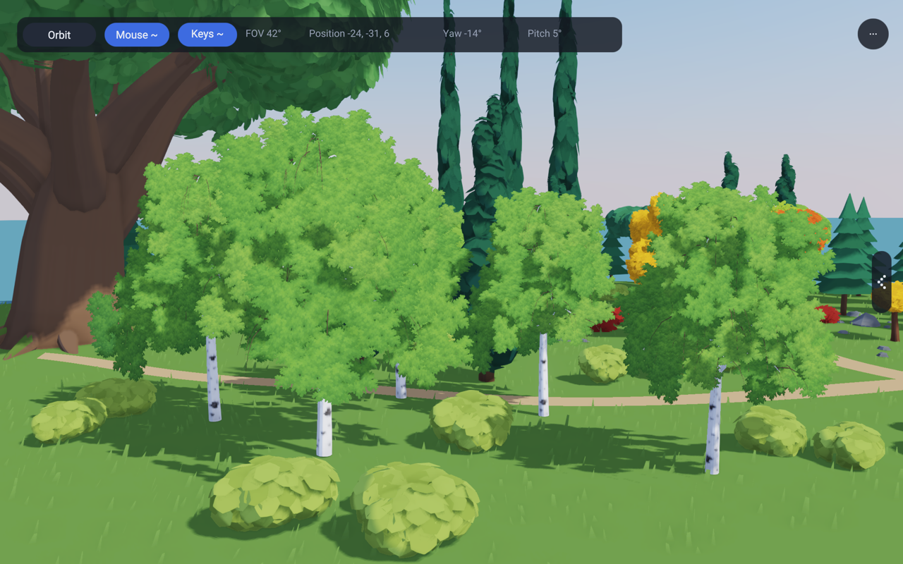

Full crowns and fine edges are substantially better than the rejected series,
although rounded clumps and dark interiors were already unresolved.

### Rejected implementation

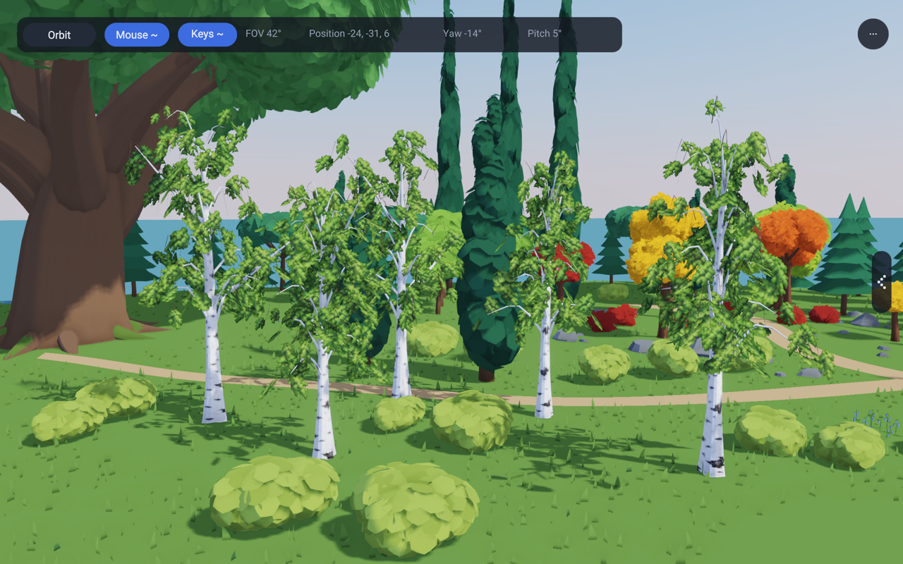

Two to three smaller cards per spray, a heavily shaped four-cell atlas and a mix
of branch-plane/camera-facing orientations fragmented the crown and exposed too
much white scaffold. Changed tree sizes and seeds obscured that loss in the
previous comparisons.

### First recovery candidate, not a finished species

Recovered the original fine-edge `birchLeaves.png` from `e86992db`. Each spray
now uses four or five unequal overlapping camera-facing cards with full-image
UVs. The centres remain attached to the same twigs; crown normals and fixed wind
pivots remain independent of camera orientation. No emission, global exposure,
shadow disable or new renderer path was added. The newer wood and bark are left
unchanged so the foliage repair can be judged separately.

This restores much of the lost crown coverage. It still has visible clumps,
dark pockets, conspicuous branch fragments and repetitive leaf marks. It is a
recovery control for further work, not the desired reference quality. More cards
also mean more alpha overdraw; this is a deliberate quality recovery, not a
performance improvement. Do not copy this candidate unchanged to other species.

## Reference comparison

The private image presentation is at
`/Users/jonas/Documents/my_own_stuff/peli_ideoita/environmentReferenceStudy/recoveryReview/index.html`.
It contains front/side/under-crown views for all three versions and the actual
T04/T05/T07/T10 crops alongside them. Private source images remain outside git.

T04/T05 establish connected large crown shapes with small irregular leaf edges;
lighting describes the crown, rather than each leaf or round card group. T07
shows purposeful open sectors and sculptural exposed wood. T10 adds irregular
branch-supported depth. They are art references, not botanical evidence that
those trees are silver birch. Match their visual organization without changing
the birch into another species. G02 establishes ground-cover grouping and a
soft relationship between small plants and the ground, not isolated angular
blades scattered over one flat colour.

The presentation also includes the previously committed flower and fork study
frames, clearly labelled as historical evidence. Their upright thin stalks,
small geometric heads, angular grass and long pointed wood explain why passing
geometry and nonblank-image checks did not meet the task.

## Curved fork recovery

The two bare study objects now use `procgen/CurvedFork`, separately from all
species. `procgen/SculpturalFork.rae` and the old reference PNGs are unchanged.
Set `RAE_FORK_CONTROL=1` to render the old mesh in the same scene. The comparison
changes geometry only: young seed 206, mature seed 907, the original placements,
unit scale, neutral rough material, camera, sky, exposure and effects stay fixed.

### Matched front, side and grazing-light views

| View | Preserved rejected control | Curved recovery |
|---|---|---|
| Front, 10:00 | 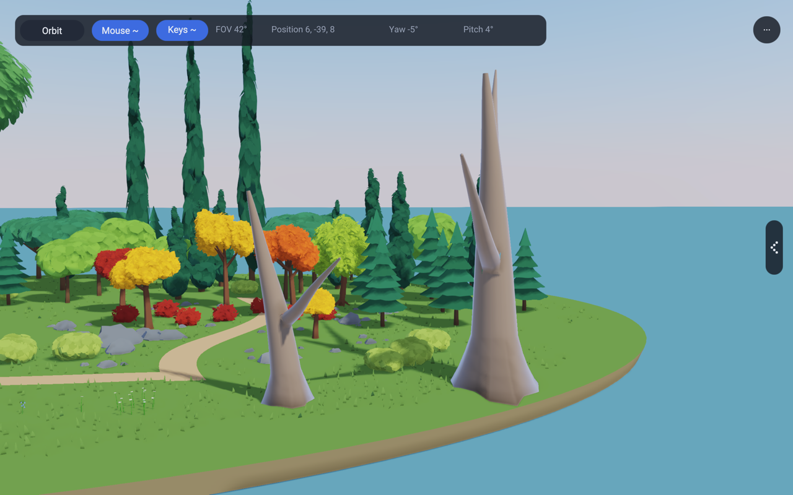 | 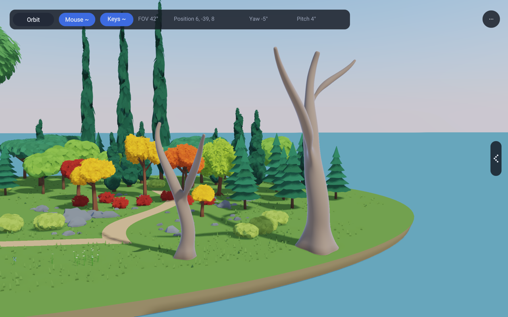 |
| Side, 10:00 |  | 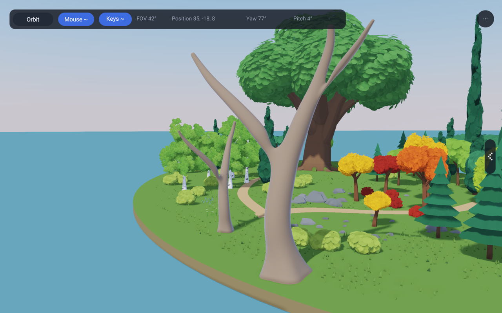 |
| Grazing, 17:15 | 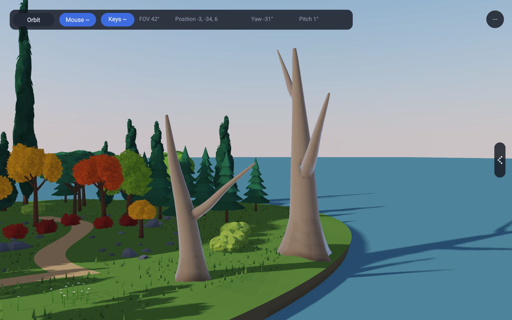 | 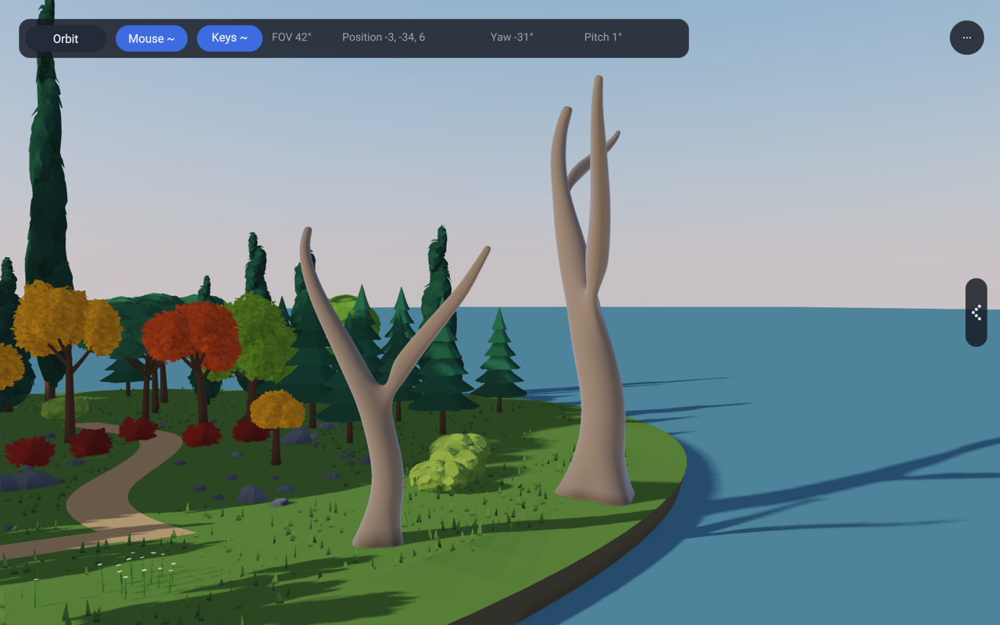 |

The private [HTML presentation](../../../peli_ideoita/environmentReferenceStudy/recoveryReview/index.html#fork-recovery)
puts these same frames next to the actual T02/T06/T07/T09 crops. T02 and T09
inform the long changing lean and smooth trunk flow. T06 and T07 inform unequal
branch directions and heights. The recovered shoulders now emerge gradually;
the visible cuff in the first recovery attempts was rejected and corrected.
The side view is particularly useful: it shows the connected crotch without
foliage hiding it. The low-sun frame shows a continuous surface rather than the
old ring steps and pointed cones. Roots flare below the ground instead of ending
on its surface. No wind deformation is attached to the wood.

### Implementation and cost

`CurvedFork` constructs the two seeded scaffolds with the existing curve and
transported-frame helpers. `CurvedForkBranch` carries the opening's angular
coordinates along each child, and uses consistent triangle winding through the
join. `ForkSurface` relaxes the shoulder of the connected control cage, runs two
bounded Loop-subdivision passes, and derives normals from the welded surface.
The texture seam is split afterwards with matching normals. Tips and crotches
receive separate planar charts to avoid cylindrical-UV singularities; unused
vertices are compacted. The rest of the tubes retain longitudinal UVs.

| Mesh | Preserved control | Recovery |
|---|---:|---:|
| Young | 266 vertices / 518 triangles | 6,256 vertices / 11,552 triangles |
| Mature | 327 vertices / 640 triangles | 8,041 vertices / 14,656 triangles |

In the three matched capture runs, generation of both recovered meshes took
**2.360–2.548 ms** on this machine. This is startup generation, not work repeated
per frame. The manifest records each control timing too. Desktop background load
was present; these are observations, not a rendering-performance benchmark.
The extra triangles are an explicit cost of this close-view study, not a budget
for thousands of forest instances. No renderer or shader was changed.

### Reproduce and verify

Run `python3 tools/capture-fork-recovery.py`. It uses the three existing camera
presets, 60 fixed steps at 1/60 second, wind off, a 1280 × 800 point window,
1280 × 800 review PNGs, and a timeout on each app run. It restores the saved
window geometry and leaves full bitmaps/logs outside git. The committed
[capture manifest](images/fork-recovery/manifest.json) records source hashes,
seeds, transforms, camera, light, counts, timing and image hashes.

Fixture 1242 checks both ages over four seeds, including a negative seed:
repeatable vertex/index arrays, finite positions/UVs, nondegenerate outward
faces, unit normals, stable transported frames, bounds, buried bases, rigid wood,
closed two-face edges with opposite winding, texture-wrap continuity and equal
normals at split texture vertices. Fixtures 1142 and 1235 protect the preserved
fork/Camphor and current birch consumers. These checks establish mesh correctness;
they do not establish reference-quality art.

Final checks passed: cases 1242/1142/1235; all 14 Autumn Grove example views;
format-check-tree (1,815 files); example-copy and banned-terms gates. All six
comparison frames were inspected, their image/source hashes checked, and the
private presentation's local links verified.

### Remaining limits before species use

This is a primary-fork proof, not a finished tree. The ends are rounded scaffold
terminations; species work must continue them into smaller branches. The current
root flare is deliberately simple, with no long exposed surface-root network.
The plain material makes the shape readable but proves no finished bark paint;
separate UV charts still need intentional bark treatment at their boundaries.
The references have richer branching, species-specific proportion and mature
surface character. No forest generator, lower-detail silhouette or atlas is
changed here. Judge these comparison images before adopting the primitive in a
species; do not treat a passing test or this queue outcome as that art approval.

## All 36 landscape tasks

These decisions concern every task in the landscape series. Unrelated completed
compiler/editor tasks are not reopened. Original IDs and technical completion
notes remain in QUEUE.md; rejected visual outcomes are retained as superseded `[postponed]` records
and have separate runnable `[ ]` difficulty-5 recovery tasks. The remaining 26 tasks retain
their IDs and receive the relevant recovery prerequisites.

| Task | Previous state | Decision | Required change |
|---|---|---|---|
| #57936867 Landscape species inventory | Previously marked done | Keep inventory | Stable numeric identities and the old-slot mapping remain useful. Botanical labels are targets, not a claim that the existing models resemble those species. |
| #72617739 Landscape comparison views | Previously marked done | Keep capture controls; correct evidence | A reproducible frame is useful, but it is not a visual acceptance test. The later birch change altered seeds, sizes and scaffold, preventing a controlled foliage comparison. Require an unchanged study specimen as well as the showcase. |
| #33428161 Shared sculptural tree forks | Previously marked done | Reopen visual work | Joined topology and frame tests are useful. The study still shows straight pointed limbs, thin stretched junctions and abrupt root forms. Prove a curved fork against T02/T06/T07/T09 before any further rollout. |
| #77839584 Birch foliage technique prototype | Previously marked done | Reject chosen visual treatment | The smaller hybrid cards and shaded four-cell atlas exposed the scaffold and broke the crown into small harsh masses. Restore the earlier full-image fine-edge texture as a control; compare one branch and one whole crown before choosing again. |
| #14470240 Finish silver birch | Previously marked done | Reject finished claim | The complete birch is visibly worse than its pre-queue control. This repair restores coverage only; clumps, dark pockets, branch visibility, bark and motion still need a full species pass. |
| #85557127 Grass close-up overhaul | Previously marked done | Reopen visual work | In the inspected frames the grass still reads as separate angular blades on flat ground. The textured alternative was dismissed in prose; a rendered comparison of both candidates is required. |
| #94765846 Grass patches and ground blending | Previously marked done | Retain tested placement; reopen appearance | Keep per-app biome settings, stable seeds and obstacle exclusions. Broad sparse gaps currently expose flat ground and make isolated spikes stronger. Reassess together with the new near grass treatment. |
| #40763640 Grass wind and forest density | Previously marked done | Reassess after grass recovery | Retain bounded storage and rooted interactions. No still image proves convincing motion; compare matched continuous calm/breeze walking clips after the silhouette is fixed. |
| #96591544 Meadow daisy flower prototype | Previously marked done | Reopen flower art | Shared batches and ownership are useful. Thin nearly straight stalks and sparse small discs do not make a convincing meadow. Rebuild one close plant and a compact patch before another species uses it as a reference. |
| #76414314 Bellflower family | Previously marked done | Reopen flower art | The bells are botanically distinguishable, but tiny geometric heads and upright sticks are not the soft patch composition in G02. Preserve batching; revisit scale, stem curves, leaves and head shading. |
| #87183597 Buttercup family | Unstarted | Hold behind flower recovery | Do not extend the rejected daisy/bellflower appearance to a third species. Start only after a reviewed plant-and-patch comparison. |
| #46350604 Flower meadows and species patches | Unstarted | Hold behind grass and flower recovery | Patch composition depends on the recovered assets. Require one small mixed patch first; do not populate the entire forest to judge it. |
| #80837875 Small-leaved lime refinement | Unstarted | Keep scope; replace prerequisite | Use a reviewed crown treatment and sculptural wood recovery, not the rejected birch recipe. Compare coherent oval silhouette and fine perimeter to T04/T07. |
| #48605089 Sugar maple autumn-orange refinement | Unstarted | Keep scope; replace prerequisite | Do one orange specimen before rollout; require broad crown colour groups and fine edges against T04/T05, not a recoloured birch. |
| #28246202 Red maple scarlet refinement | Unstarted | Keep after orange maple | Retain distinct scaffold and rounded crown. Compare the two maple species together at identical scale/light so differences are visible. |
| #21954987 Golden Globe ginkgo autumn-gold refinement | Unstarted | Keep distinct kind 6 | Keep the explicit showcase/forest mismatch correction. Add the named existing kind without deleting or recolouring the palm; use reviewed foliage. |
| #56427211 Bloodgood Japanese maple crimson refinement | Unstarted | Keep after maple recovery | Require readable burgundy masses in shade and backlight, not dark balls. Keep a distinct smaller spreading silhouette. |
| #55057148 Norway spruce layered foliage refinement | Unstarted | Keep species-specific prototype | A spruce does not inherit birch cards automatically. Compare layered branch-supported needle sprays to current skirts before changing six specimens. |
| #30757695 Mediterranean cypress refinement | Unstarted | Preserve successful slender control | This is a refinement, not permission to replace the narrow silhouette. Keep the pre-queue specimen in every comparison and reject thicker or lumpy results. |
| #43408695 Stone pine refinement | Unstarted | Keep; wait for wood and foliage review | Prove the exposed scaffold and parasol underside first. Branch-constrained pine sprays may differ from birch; choose by orbit evidence. |
| #73266889 Date palm frond refinement | Unstarted | Keep distinct frond approach | The named palm mismatch needs real pinnate fronds. Do not force the birch crown technique onto it; compare one lit frond then one apex crown. |
| #31529936 Camphor tree sculptural specimen refinement | Unstarted | Keep single specimen; wait for wood review | Keep height and placement. Prove a sheltered under-canopy space and sweeping primary branches before replacing its expansive crown. |
| #61690381 Common hazel shrubs | Unstarted | Keep after foliage recovery | Compare one multi-stem shrub next to a rock; avoid replacing leaf polygons with repeated card balls. |
| #83500006 Woodland fern ground cover | Unstarted | Delay new plant until ground cover works | A fern is not the repair for failed grass/flowers. Use a reviewed ground-cover material and one curved frond proof first. |
| #17691144 Forest foliage wind coherence | Unstarted | Keep final integration; require earlier local motion | Each species must already pass its own orbit/motion check. This task tunes spatial coherence across a stand; it must not defer basic wind quality until the end. |
| #53338503 Rock shape and material foundation | Unstarted | Keep independent prototype | One directional wedge, plain and mossed, with the actual R01/R02 crop beside it. Do not replace all rocks before seeing the first. |
| #81194269 Mossy wedge outcrops | Unstarted | Keep after rock review | Approve broad faces and a quiet upper moss cap before multiplying seeds; no uniformly outlined green stones. |
| #54599145 Layered grey rock shelves | Unstarted | Keep distinct shelves | Require recognizable long unequal strata and recesses from R03; do not count stretched wedges as another family. |
| #84622055 Fractured blocks and rubble | Unstarted | Keep distinct fracture family | Require a few readable major breaks and believable rubble scale; do not add noisy triangles as detail. |
| #22082117 Rock groups across streamed terrain | Unstarted | Keep after rock and ground review | Stream only the reviewed families; retain collision, grass exclusions and deterministic placement. |
| #58576313 Shared cloud layer foundation | Unstarted | Keep independent layer prototype | Compare one lit group against C01-C03 before general presets. No ray-marching expansion or global exposure workaround. |
| #45432443 Quiet rounded cloud composition | Unstarted | Keep after cloud review | Judge sky opening, large form and quiet bases against C03 at identical sun/exposure. |
| #57043632 Broken cloud-bank composition | Unstarted | Keep same implementation | Different composition on the reviewed layer; require a horizon view and moving-camera proof. |
| #13791278 Autumn Grove final landscape composition | Unstarted | Keep last art composition | Do not label finished while any earlier visual rejection remains. Use small successful groups to compose the whole scene. |
| #27142161 Huge Forest landscape integration and scale | Unstarted | Keep after grove review | Use the same assets, then test scale and transitions. Preserve near quality; performance is not permission for global density cuts. |
| #91339952 Landscape series final verification | Unstarted | Keep final verification; strengthen sign-off | Publish baseline/result/reference side by side and unresolved failures. Automated tests demonstrate correctness, not style or approval. |

## Recovery sequence

1. **Sculptural fork visual recovery:** retain the useful topology/frame work;
   replace the pointed straight visual study with one convincing young/mature fork.
2. **Silver birch crown recovery:** use the original and this recovery as
   controls, prove one branch and one complete crown, then review wood separately.
3. **Near-grass visual recovery:** actually render both textured tufts and curved
   ribbons under matched conditions before choosing the shared treatment.
4. **Grass patch and motion recovery:** integrate the selected near grass with
   ground colour, retained exclusions and continuous calm/breeze walking captures.
5. **Oxeye daisy visual recovery:** rebuild one plant and small patch before the
   shared flower framework is considered an art reference.
6. **Harebell visual recovery:** keep its different growth/head shape and batching;
   redo the plant art after the daisy/ground-cover comparison.

These are bounded replacements for the rejected outcomes, not extra species.
The remaining species, rock and cloud tasks keep their original IDs. Only tasks
that consume a rejected foundation gain the corresponding recovery prerequisite.
The initial `failed` markers unnecessarily stopped queue progression. They are
now superseded `[postponed]` records with links to the six runnable `[ ]`
recovery tasks. Formal dependencies point to those replacements. Start at
#64669660 (Sculptural fork visual recovery), followed by #87803692 (Silver birch
crown recovery). The comparison report remains the visual control for the work.

## Acceptance from now on

1. Keep an unchanged control specimen. Match seed, physical dimensions, camera,
   light, exposure, resolution and wind phase; show any intentional differences.
2. Render the candidate next to that control and the named reference crops.
   Reject the candidate when its mass, silhouette, edge scale or lighting is
   worse, even if every automated check passes.
3. Prove one branch/clump and one complete plant before shared rollout. Motion,
   underside, shadow and night checks are part of that prototype, not work left
   for the final series task.
4. Record an honest visual verdict and remaining defects. A model assignment,
   fixture count or regenerated reference is never a substitute for the images.

## Verification of this recovery

Passed with explicit timeouts:

- `run_cases.sh 1235_birch 1228_tree_levels_cover_alike 1232_wind`: 3/3.
- `surfaceImages`, `leafWind`, `impostorBake` hardware checks: 3/3.
- Example gates 136, 137, 138, 143: 4/4, including the fourteen grove inspection
  views and the 31,090-tree forest.
- `format-check-tree.sh`: 1,811 canonical files; example-copy and banned-terms
  gates passed.
- Repeated repaired front BMP: byte-identical. Additional rear/backlit and night
  captures inspected and included in the private presentation. Foreground
  cypresses partly obscure the rear view. A continuous orbit/walk review remains
  necessary before accepting the species; this repair does not claim it.

These verify compatibility and the specified technical properties. They do not
establish the desired appearance. No full compiler suite was needed for this
bounded generator/asset change under the repository's narrow-check rules.

The birch fixture previously used repository-relative
asset paths and failed when run from the official runner's compiler directory.
It now resolves those images through RAE_STDLIB. Geometry, pivots, conservative
bounds, alpha coverage and mip checks remain active; the old four-cell atlas
assertions are replaced by the recovered full-image UV/coverage contract.

## Silver-birch crown recovery — 26 October 2026

The new candidate keeps the newer wood, bark, all twig curves, seeds and tree
transforms unchanged. It changes the foliage mesh and its albedo cutout only.
The shared `birchLeaves` entry and forest image loader use the same candidate
as Autumn Grove; 136, 137 and 143 therefore receive the same generated crown.
No renderer, lighting shader, global exposure or shadow setting was changed.
This is a crown recovery, not a claim that the whole birch now matches the art
references or that the current bark and wood are finished.

### Matched alternatives

The three studies use seed 1437, height 7.1 m, rotation zero and the same 46
populated twigs. The branch study isolates twig 8 from that exact tree. The
other grove objects are omitted in **all** controlled studies so they cannot
hide the crown during an orbit. Ground, camera, sun, exposure and wind phase
are identical between alternatives. The normal grove composition is unchanged.
The historical pre-queue and rejected frames above remain separate evidence:
their different scaffolds prevent treating them as controlled geometry trials.

| Alternative | Image | Geometry and lighting |
|---|---|---|
| Control | Original fine-edge image | Original four/five cards per twig; original normals |
| Texture only | New `birchSpray.png` | Exact control geometry and normals |
| Connected candidate | Same new image | Three unequal overlapping layers along the same twig, smooth broad crown normals |

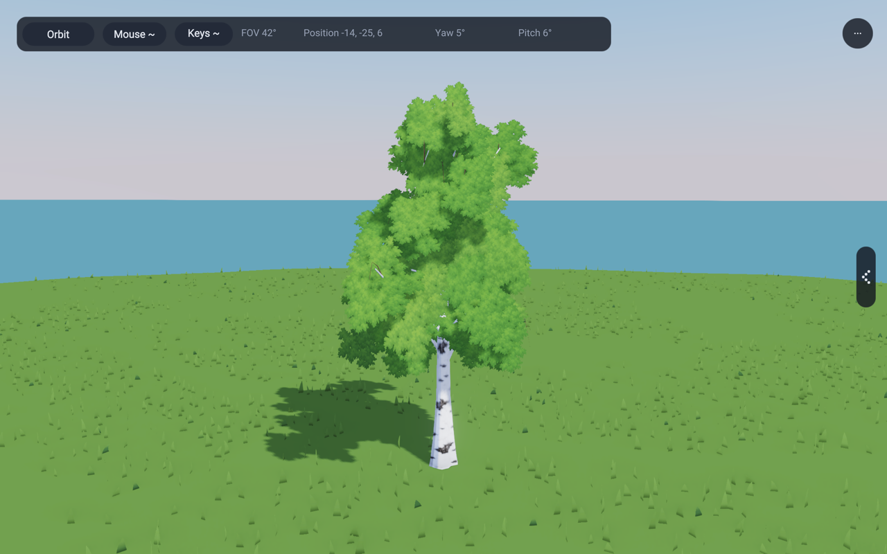

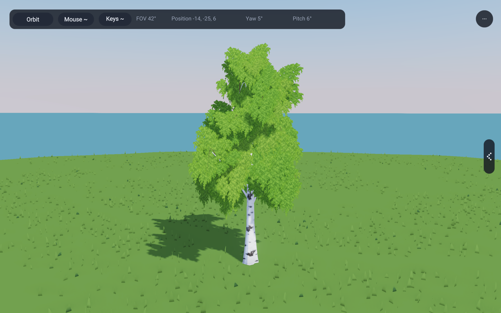

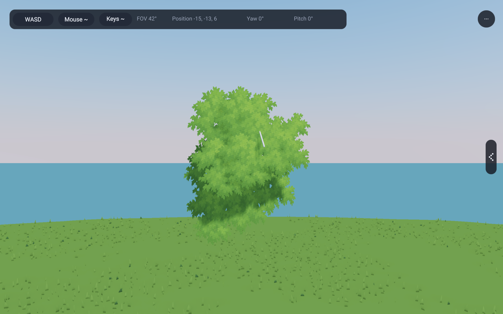

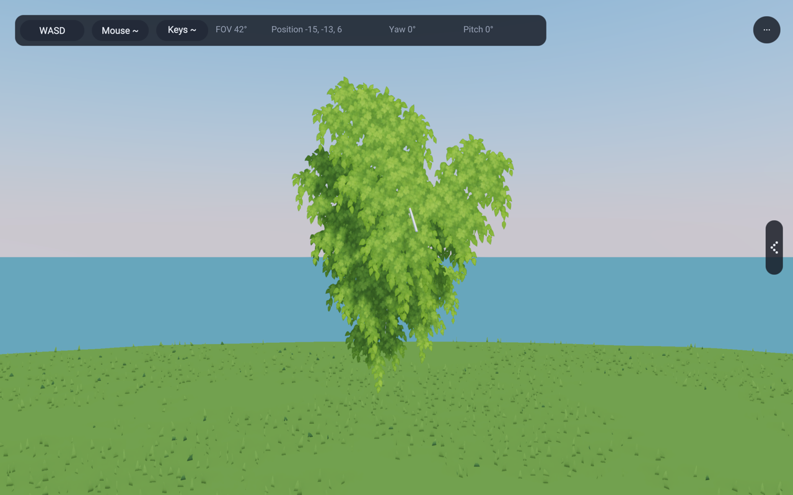

The original card helper remains unchanged. The candidate uses a new bounded
helper in `procgen/FoliageCards`: three card centres follow the supporting twig,
with unequal size and lateral offset. Their normals describe the larger crown
and vary smoothly across each card. The quads face the camera; their centres,
lighting normals and wind attachments stay with the tree. The existing rigid
rotation around the twig pivot remains; primary wood has no wind metadata.

The texture uses an asymmetric connected silhouette, small pointed edge leaves,
and restrained interior variation. Two earlier texture attempts were rejected:
one made repetitive feather-like chains, and an almost flat version looked
like a solid cutout. A physical-material trial was also rejected for its pale
colour shift. The selected version keeps the same toon material as the control,
including emission zero, ordinary sun/ambient light and cascaded shadows.

### Lighting and movement

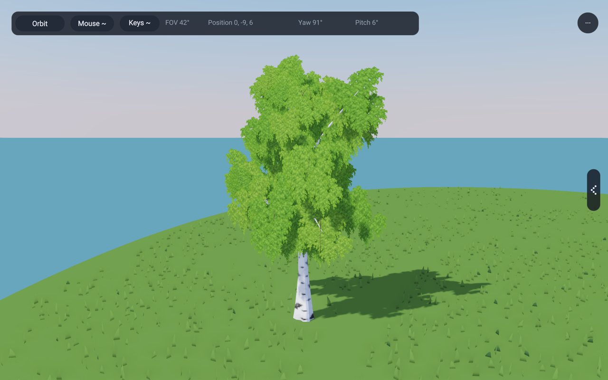

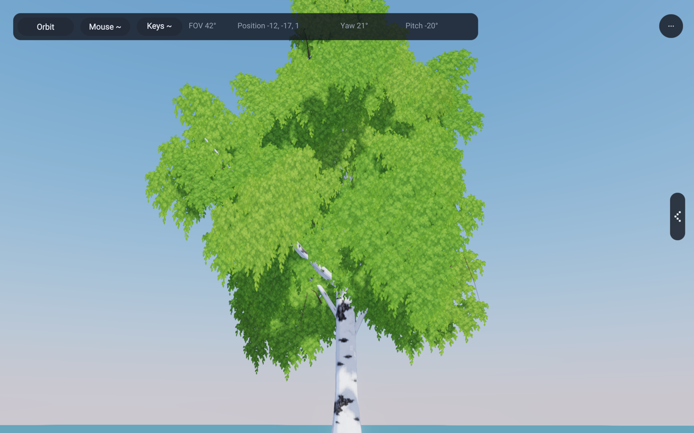

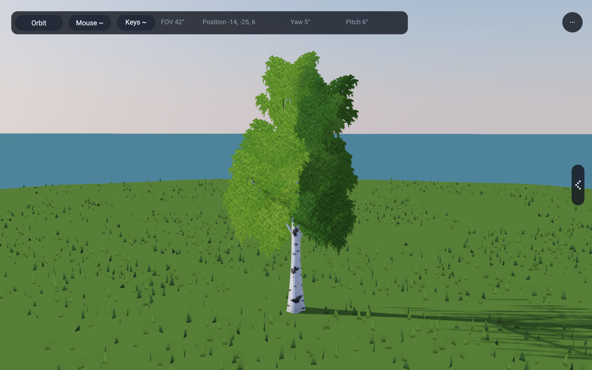

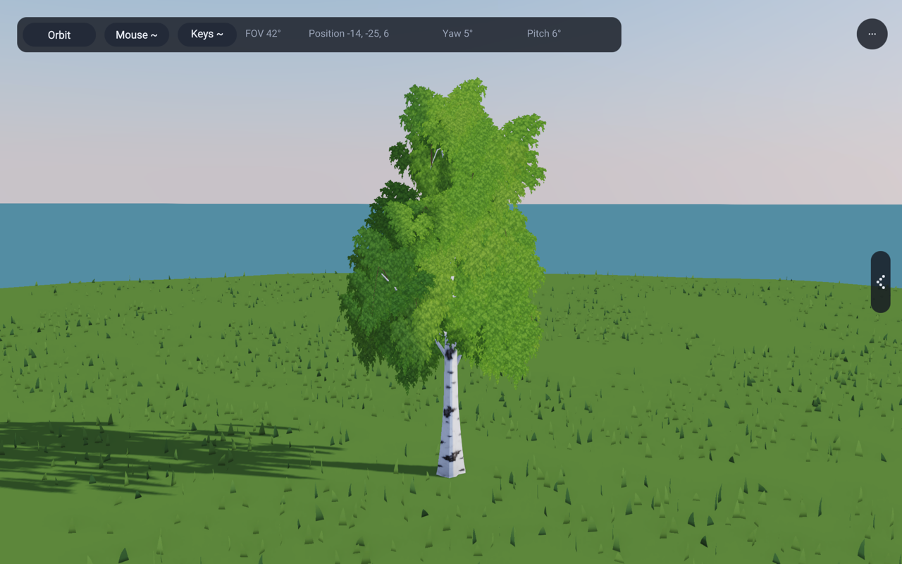

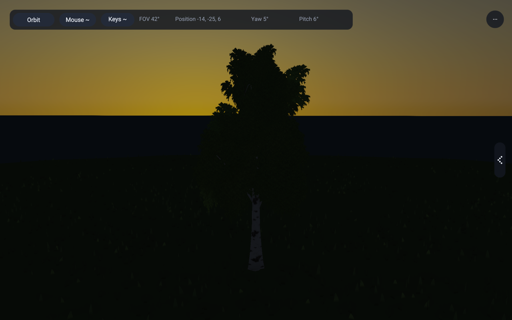

`tools/capture-birch-recovery.py --motion` records matched control and candidate 180-frame
orbits and 180-frame approaches at 30 fixed steps per second, wind strength 1.
The approach holds the camera 1.7 m above the ground. These are continuous
camera paths, not three independently started screenshots. The script changes
the existing screenshot destination each frame; it adds no renderer readback
path. Movies and full frames remain outside git and are linked in the private
recovery presentation. The optional capture state is owned by the showcase.

### Cost and reproducibility

For seed 1437 there are 46 populated sprays: **207 → 138 cards**,
**828 → 552 vertices**, and **414 → 276 triangles**. Four checked seeds produce
135–147 candidate cards. There are still three leaf materials, one shared leaf
image and shared immutable mesh prototypes. Fewer larger cards do not establish
lower fragment cost: transparent area and overlap still matter. No forest GPU
speedup is claimed from these geometry counts.

Run `python3 tools/capture-birch-recovery.py --motion`. It builds one temporary
binary, captures the alternatives and lighting views with explicit timeouts,
checks two fixed front bitmaps for exact equality, and restores window geometry.
The [manifest](images/birch-crown-recovery/manifest.json) records the source and
image hashes, seed, height, camera fields, light, resolution and fixed clock.
`RAE_BIRCH_STYLE=control|texture|connected` selects the comparison in 138;
`RAE_BIRCH_STUDY=tree|branch` selects its subject. These controls do not change
which trees appear in a normal app run.

### Remaining defects and limits

The candidate reduces the round puff repetition, but does not eliminate all
clumps. Individual cards remain identifiable close to an isolated spray, and
one mirrored texture still repeats. There are still dark interior pockets and
occasional exposed white branch fragments. T04/T05 have more deliberate large
colour masses and richer fine silhouettes; T07 has a more readable woody
scaffold. The crown comparison does not establish finished bark, improved forks
on this species, or a new lower-detail mesh. Those were deliberately held fixed.
The far atlas uses the new mesh and image through the existing baker; it is
still a static pose and cannot reproduce moving twig detail. Do not copy this
birch silhouette unchanged to other species or treat passing geometry tests as
approval of their art direction.

### Verification and atlas evidence

Cases 1235, 1243 and 1228 passed. The new case compares the preserved and
candidate sprays across four seeds, including a negative seed: populated twig
identity, deterministic vertices, fixed wind pivots, valid indices, unit
normals and conservative card bounds. The image check covers opaque interior,
transparent borders and the existing alpha mip rules.

GPU checks `surfaceImages`, `leafWind`, `impostorBake` and `canopyCoverage`
passed. The atlas check previously exported the deliberately unposed 32-byte
control. It now also exports the production 64-byte camera-facing birch and
checks every view cell, so a healthy whole-layer average cannot hide a missing
crown in some directions. All 64 cells passed; all four posed mip levels stay
within the existing 3% coverage tolerance.

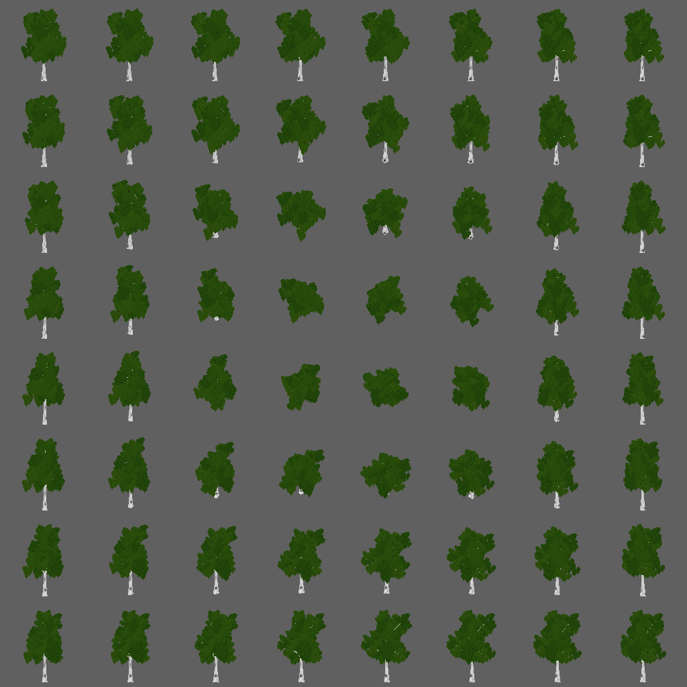

The 136, 137, 138 and 143 example gates passed. This includes the forward
billboard path, 14 grove inspection views, and 31,090 forest placements in 829
canopy clusters. The 136 gate also checks live memory growth. These gates are
functional checks, not proof of visual quality. Format-check-tree passed for
1,817 files; example-copy and banned-terms gates passed. The repeated fixed
front captures are byte-identical. No full compiler suite was needed for this
bounded generator/example change.

### Unchanged grove and shared consumers

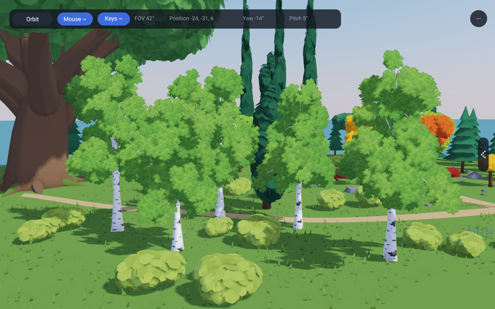

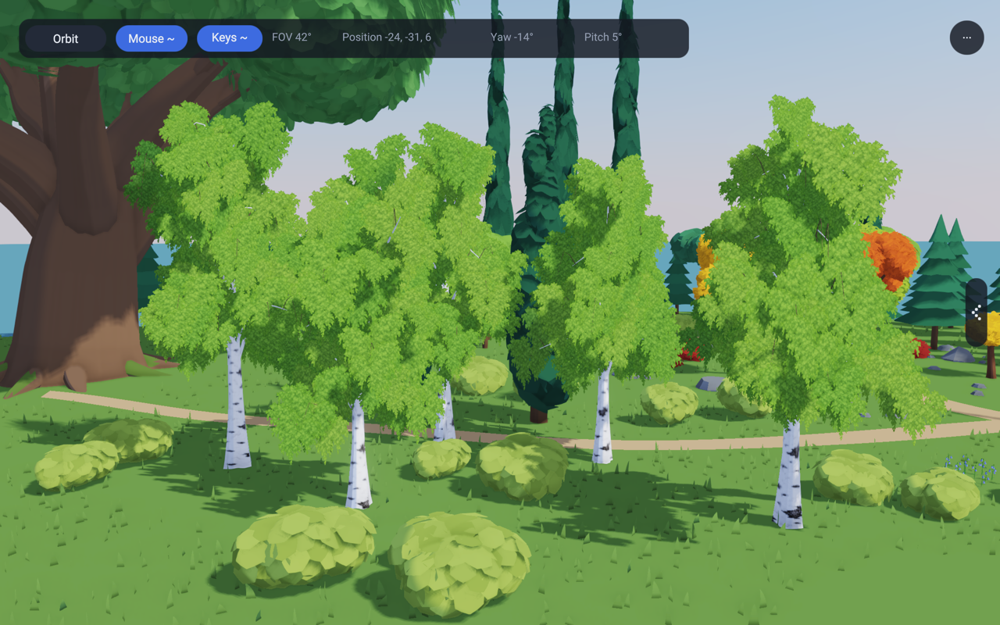

The five original showcase seeds, heights and placements remain unchanged.
These views use the existing birches camera preset, the same fixed clock and
wind zero. The private presentation also includes actual 136 deferred and 137
forward starts, plus near and far 143 forest views. The forest views establish
integration in context; they are not an isolated same-tree measurement of a
mesh-to-atlas transition. Close card layering and dark pockets remain visible.

## Near-grass recovery

The textured tuft is now selected after matched renders of the old single
ribbon, a twelve-ribbon clump and an original three-plane cutout. Read the
[grass comparison](grass-recovery.md) for the close grove and walker-height
frames, pre-queue control, alpha/mip rules, lighting checks and measured cost.
The private presentation places those same captures beside G01/G02.

This pass leaves placement and terrain unchanged. Flat ground gaps, repeated
motifs and close crossed-plane visibility remain explicit limitations. Passing
the rendering gates does not mean the meadow now matches the references.

## Ground-cover and motion recovery

[Grass patch recovery](grass-patch-recovery.md) records paired forest-edge,
clearing and path-contact captures, with shared ground/tuft colour and uneven
root groups. The private presentation includes calm/breezy continuous walks in
both apps. It records matching density settings, surviving counts, cost and
remaining limits; this is not a claim that the wider meadow art is complete.

## Oxeye daisy recovery

The [daisy comparison](daisy-recovery.md) shows the unchanged rejected plant,
curved-stem candidate, grouped patch, side/low-sun/night views and shared forest
integration. The private presentation places these actual renders beside G01/G02
and credited botanical photographs. Mesh costs and remaining art limits are
recorded explicitly; this does not approve the whole meadow or the harebell.

## Harebell recovery

The [harebell comparison](harebell-recovery.md) keeps the unchanged angular
control beside the recovered curved stem and soft open bells. It includes
matched close/side/low-sun/night, sparse patch and walker-height views. The
private presentation includes G02, a credited botanical photograph and actual
continuous wind captures. Two shared batches remain; the added surface cost
and remaining fine-stem/flower-detail limitations are recorded explicitly.

## Small-leaved lime refinement

[The lime comparison](lime-refinement.md) records the next species using the
recovered joined forks and connected foliage sprays. Forest kind 0 and its
placements remain unchanged. The original opaque tree is preserved as the
control; the report and private presentation show matched full/bare trees,
three seed/size pairs, side/underside, warm/night and actual 143 forest views.

The new lime has original bark and leaf assets. Close card overlap, repeated
leaf marks and regular bark ridges remain visible. Its middle level shares the
near mesh, with the resulting geometry cost stated explicitly. Six geometry
fixtures, three targeted hardware checks and all four consuming example gates
pass; these checks do not establish a complete match to the reference art.

## Sugar maple autumn-orange refinement

[The maple comparison](sugar-maple-refinement.md) records the unchanged opaque
control and the new kind-4 ascending scaffold, original copper foliage cutout
and grey-brown bark. It includes three seed/height studies, bare/side/underside,
backlit/night and matched forest captures beside T04–T07 in the private report.
Existing maple slots and placements remain distinct.

Five narrow geometry fixtures, three hardware checks and all four consuming
example gates pass. The report states geometry and resource counts, the larger
rotating-card bound and the shared near/middle mesh trade-off. Repeated close
leaf motifs, dark overlaps and limited internal sky gaps remain visible; passing
the checks does not establish a complete match to the reference art.

## Red maple scarlet refinement

[The red-maple comparison](red-maple-refinement.md) shows the unchanged kind-5
control, a lighter joined scaffold and the selected muted-scarlet textured
crown. Its 27 broad sprays make a more open rounded form than the sugar maple.
The private presentation includes T04/T06/T07, matched bare/full trees, three
seeds, multiple forest angles, night and a six-second breezy walk.

Seven narrow fixtures, three hardware checks and all four consuming example
gates pass. The report records the wider tested card bound, geometry/resource
counts and limitations: repeated close leaf marks, dark overlaps, painted bark
relief and a shared near/middle mesh. Kind numbers and placements are unchanged.

## Golden Globe ginkgo refinement

Shared kind 6 now has a spreading joined branch fan, alternate short shoots,
original golden fan-leaf cutout and grey-brown bark. The new named 138 inspection
preserves the green date palm and all older fixed specimens. The original gold
control, first candidate, selected front/side/underside, multiple seeds, night,
actual forest group and posed atlas appear in the private recovery presentation
beside T04/T05/T07. [The ginkgo report](ginkgo-refinement.md) records the matched
conditions, shared consumers, costs and remaining close-card/bark limits.

## Bloodgood Japanese maple refinement

[The Japanese-maple comparison](japanese-maple-refinement.md) preserves the
old crimson control and shows the selected layered burgundy crown, original
quiet leaf texture and reddish bark. Low joined stems and an explicit
single-stem option reuse the shared fork and foliage paths. The original grove
specimen remains in place; stable forest kind 7 uses a smaller 3.2–4.8 m range.

Matched grove views, three seeds/sizes, bare wood, backlight/night, actual forest
controls and a breezy walk appear beside T04 in the private presentation.
Remaining close-card patterns, shelf-like angles, dark overlaps and unreduced
middle geometry are stated explicitly rather than hidden by the test results.
