# Small-leaved lime refinement

The existing broadleaf is **small-leaved lime, Tilia cordata**, still forest
kind 0 (`speciesBroadleaf`). No species numbers, placement probabilities, tree
counts or instance scales changed. The old opaque generator remains available
as `fluffyLeavesControl` / `fluffyWoodControl` for exact geometry comparisons.

## Visual direction and result

The [botanical description and photographs from North Carolina Extension](https://plants.ces.ncsu.edu/plants/tilia-cordata/)
support an oval crown, small heart-shaped serrated green leaves and gray-brown
bark that develops dark furrows. The game preset represents a young/small
specimen at the existing 4.8–7.2 m forest scale, not the species' eventual mature
height. Supplied T04/T07 guide the connected crown and small perimeter leaves;
T02/T06/T09 guide the exposed unequal wood.

The replacement has a leaning stem, two joined unequal primary forks and
ascending lateral sprays. Three overlapping camera-facing layers per spray
use the recovered crown-normal lighting path. The lime has its own original
cutout and bark texture. Mirroring, quarter-turns and unequal sizes break the
single downward-pointing shape of the borrowed birch texture tried first.
Two lower sectors remain without foliage to expose wood. The crown fills an
uneven oval rather than seven spherical patch shells.

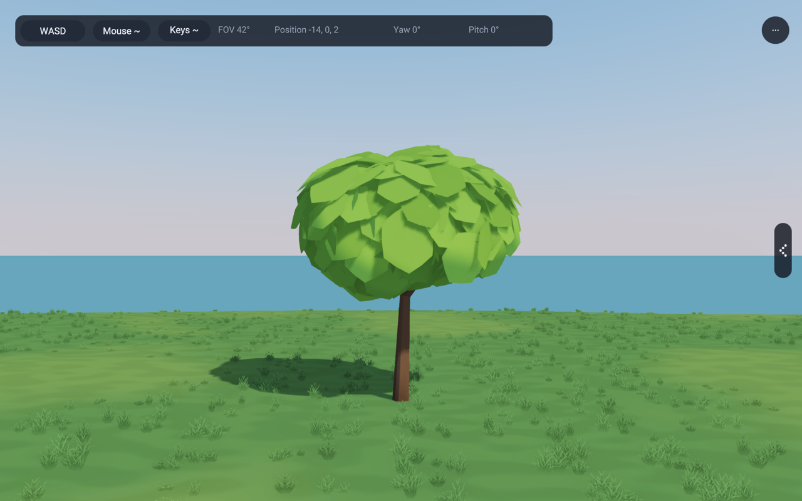
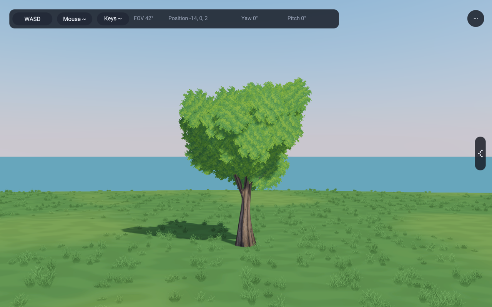
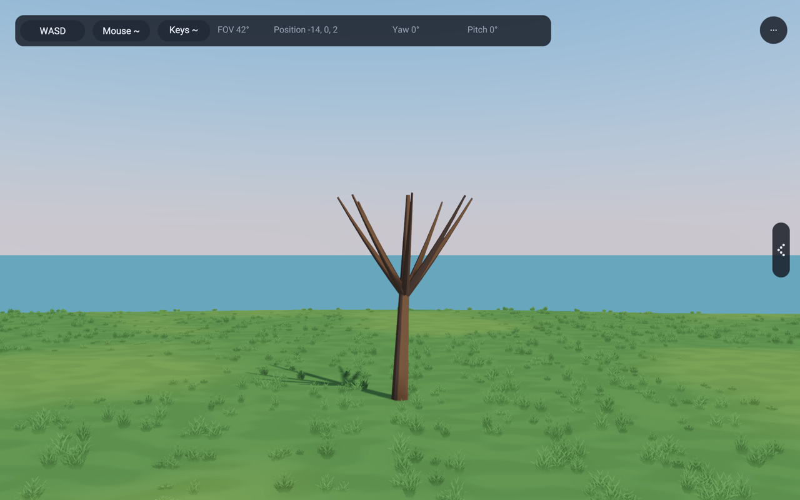
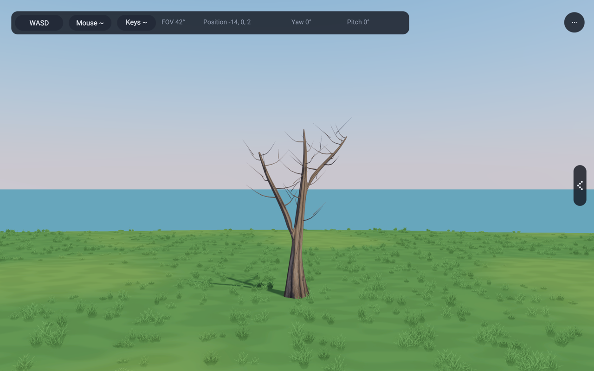

These are actual renders. This is an improvement, not a claim of matching the
reference art completely. Close views still reveal overlapping cards and some
repeated painted leaves. Deep interior pockets can be dark. The scaffold has
only two primary junctions; small twig attachments are ordinary tapered tubes,
not individually joined/subdivided junctions. The bark's vertical ridges are
more regular than an old natural lime's. The three presented seeds differ in
lean, fork orientation, branch sweep and sprays; forests still share seed 73
with instance scale/yaw variation, as before.

## Additional views

| Side | Below the crown |
|---|---|
| 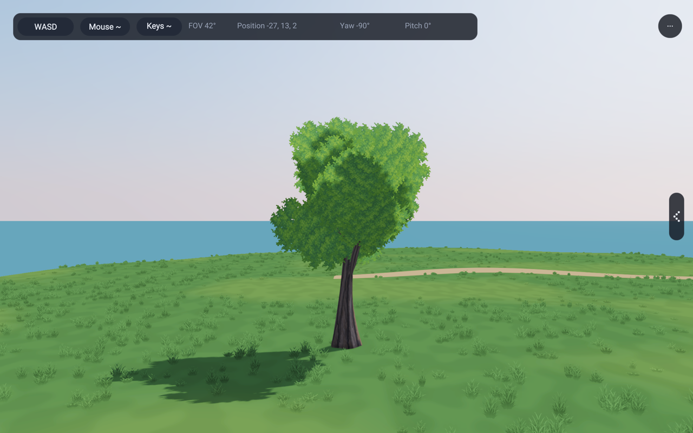 | 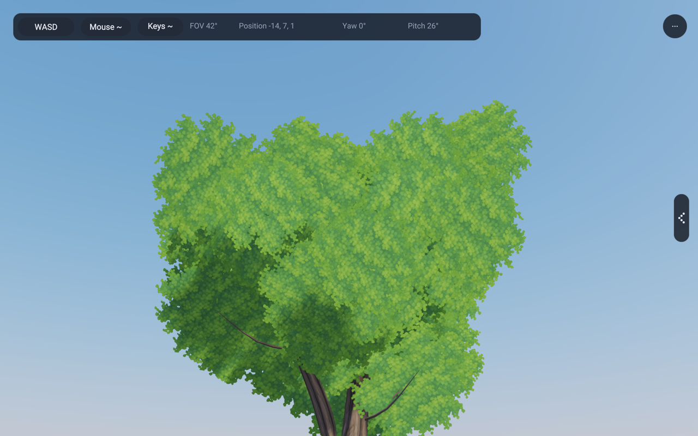 |

| Seed 311, 5.8 m | Seed 827, 6.5 m |
|---|---|
| 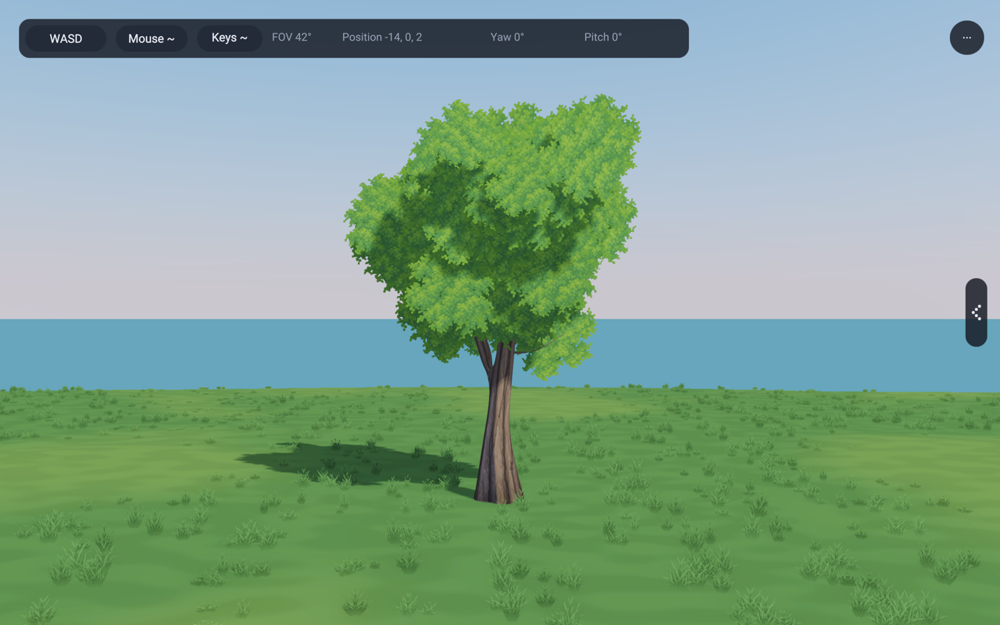 | 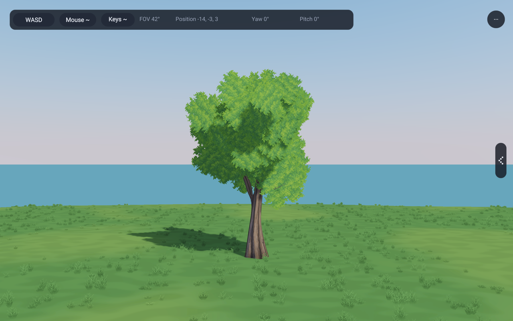 |

| Unchanged grove placement | Night, seed 73 |
|---|---|
| 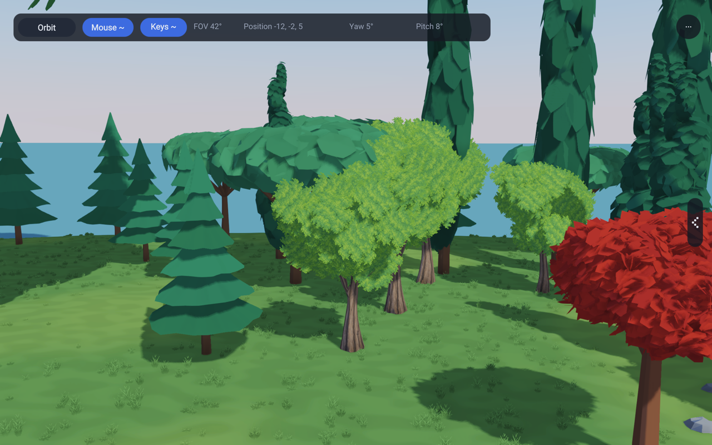 | 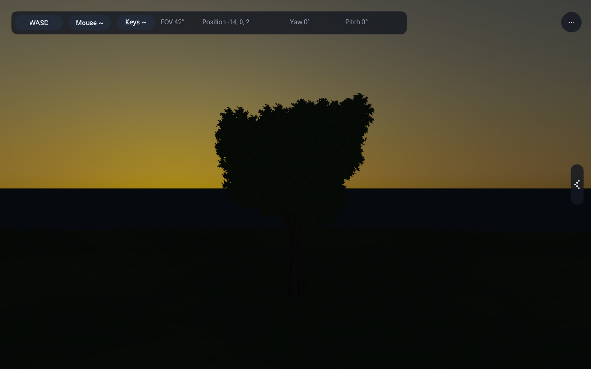 |

Bare versions of the additional seeds and the warm-light twin are in the
private HTML presentation beside the reference crops.

## Shared implementation and cost

`procgen/Lime.rae` reuses the transported curves, open trunk patches, joined
branch shoulders, junction relaxation and surface subdivision from the recovered
fork helpers. One subdivision pass keeps the rounded emergence without the
unnecessary geometry of two passes. Roots extend below ground; wood carries no
wind stream. Leaves keep twig-root pivots and the shared directional wind.

For seed 73, the full tree has **3,717 vertices / 5,638 triangles**:
3,273 wood vertices and 5,416 wood triangles, plus 444 foliage vertices and
222 foliage triangles. There are 39 supporting sprays, 37 with leaves. This is
four mesh/material parts (wood plus three foliage tones), shared across all
instances. Generation happens during resource setup, not while walking.

136, 137 and 143 load the two image layers once through the existing renderer
image owner. Near and middle levels share the same four handles. The old
opaque middle crown would have changed silhouette and material abruptly, so it
is not used for lime. **There is no reduced middle lime mesh yet.** The far
impostor is baked from the actual textured near tree; existing distances,
instance limits, cleanup and forest kind count remain unchanged. The additional
alpha sampling trades some fragment cost for much smaller foliage geometry;
triangle count alone is not a GPU performance measurement. The old near tree
was 8,484 triangles; its middle tree was 2,772. The new complete near tree is
about 34% smaller, but sharing it in the middle range increases middle-range
geometry. That trade-off is explicit; the reduced middle mesh remains future
work, not a hidden claim of improved performance at every distance.

The existing kind-0 radius 0.70, centered at local z=0.55, contains the tested
rotating-card envelope plus 0.03 local wind allowance across six seeds. The
check uses each card center and half diagonal, not just its unrotated vertices.

## Reproduction

Run `python3 tools/capture-lime-studies.py /tmp/rae-lime-review`. Each child has
an explicit timeout. It builds once, then records camera, seed, height, light,
clock, source hashes and image hashes in its manifest. The optional `--binary`
argument reuses a known build; the manifest includes its hash. Images are
1280 × 800, 60 frames at 1/60 s, wind 0, Preetham 10:00, exposure 1, deferred
toon shading, CSM, SSAO, SMAA and bloom. Warm/night captures use 17:15/23:00.

The normal `fluffy` view remains the planted group. `RAE_LIME_ISOLATE=1` removes
occluders while keeping its first specimen at (-14, 13, 0).
`RAE_LIME_CONTROL=1` restores the old geometry and material;
`RAE_LIME_BARE=1` shows its scaffold. `RAE_LIME_SEED` and `RAE_LIME_HEIGHT` are
study inputs, not new species slots. Height only changes the isolated
specimen. The normal grove and all forest prototypes remain seed 73.

The private recovery presentation contains the full before/candidate/reference
set, side and underneath views, three seed/size pairs, and forest views. The
botanical form photo is by Isidre Blanc (CC BY-SA 3.0); the bark photo is by
Graham Cole (CC BY-SA 2.0), both via the linked plant profile. They are comparison
references, not production textures. Asset prompts and provenance are in
[the asset note](../lib/assets/trees/limeAssets.md).

## Forest comparison cameras

The forest images keep its actual placements, including other species. The
near lime is kind 0, placement 15573 at approximately (-7.89954, -31.2998,
-0.712072), height 5.57849 m. The underside camera looks up through the real
neighboring canopy. The distant group is an elevated context view; it is not
an isolated mesh-to-impostor transition measurement.

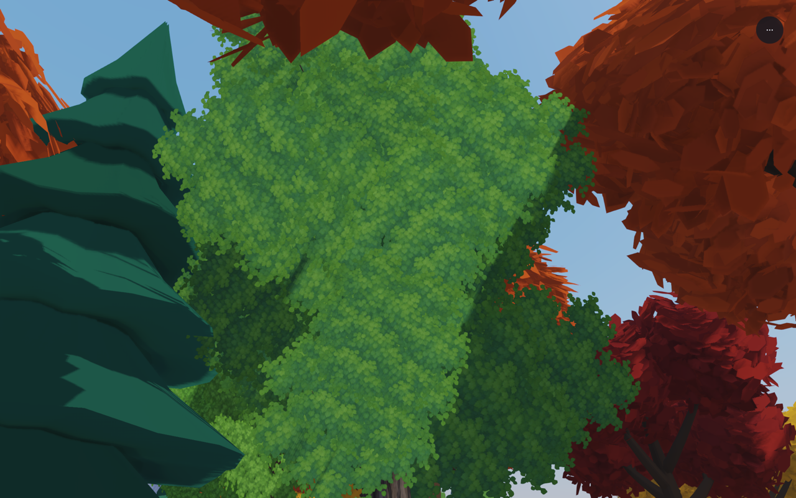
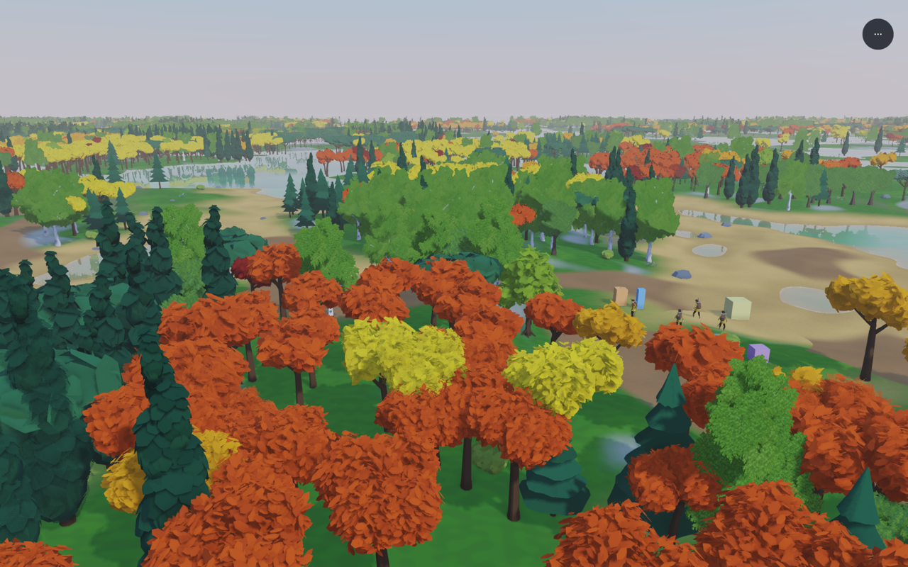

For 143, use the existing `RAE_CAMERA_AT` override with the same 60-frame,
1/60-second clock, wind 0 and hour 10 as the grove study:

| View | Camera's twelve values |
|---|---|
| Underneath | `1 0 0 0.55 10 -7.9 -35.5 0.9 0 0 0 0` |
| Distant group | `1 0 0 -0.28 10 -22 -46 16 0 0 0 0` |

For example, with the window set to 1280 × 800:

```sh
RAE_UI_HEADLESS=1 RAE_HEADLESS_FRAMES=60 RAE_FIXED_DT=0.016666667 \
RAE_WIND=0 RAE_WALKER_HOUR=10 RAE_DRS=off RAE_RENDER_SCALE=1 \
RAE_CAMERA_AT='1 0 0 0.55 10 -7.9 -35.5 0.9 0 0 0 0' \
RAE_GPU2D_SCREENSHOT=/tmp/lime-forest.bmp \
perl -e 'alarm shift; exec @ARGV' 180 compiler/bin/rae run \
  --project examples/143_walker_forest examples/143_walker_forest/Main.rae
```

The private presentation includes the night twin at hour 23 and the exact
forest capture manifest. No trees were moved or hidden for these forest views.

## Validation

- Six narrow fixtures pass: 1141 (unchanged opaque control), 1228 (level coverage),
  1235 (birch), 1242 (curved fork), 1243 (recovery crown), and 1245 (lime).
  The lime case checks six seeds, finite vertices, valid indices, unit normals,
  deterministic wood, rigid wood, shared twig pivots and rotating-card bounds.
- Hardware checks `leafWind`, `surfaceImages` and `impostorBake` pass. The atlas
  check now includes the actual lime texture and posed cards, every view cell,
  and mip coverage within 3% of the base level.
- Example gates 136, 137, 138 and 143 pass, including forward rendering, shadows,
  the forest's bounded pools and the walker memory check.
- Example-copy and banned-terms gates pass. No compiler/runtime/core change
  required the full compiler suite.

The final forest captures retain 31,090 trees and 829 canopy clusters. Resource
report at frame 0: 954 buffers, 56 textures, 114 texture views and 150 bind groups.
These are whole-app counts, not a measured GPU speedup. No isolated CPU/GPU
performance claim is made for this refinement.
