# Red maple scarlet refinement

**Kind 5 / speciesRed remains red maple, Acer rubrum**, scarlet preset. Its
forest seed is still 1021. Autumn Grove keeps its original seed 605, height
5.8 m, width 1.8 m and position (4.2, 4, 0). No kind numbers, other maple
presets, placement probabilities or forest instance scales change.

## Shape and colour

[Oregon State University](https://landscapeplants.oregonstate.edu/plants/acer-rubrum)
describes an irregular rounded crown, ascending branches and usually three-lobed
serrated leaves. [North Carolina Extension](https://plants.ces.ncsu.edu/plants/acer-rubrum/)
describes smooth light-grey young bark and older bark divided into vertical
plates. Those features guide this small game-tree preset; it does not represent
the species' maximum mature height. T04/T06/T07 guide connected colour groups,
small leaf edges, visible forks and intentional openings, rather than species
identification.

The new `procgen/RedMaple` generator makes a leaning light stem, two unequal
joined ascending primary limbs and 27 broad lateral sprays. Three omitted lower
shoots open windows around the wood. The rounded crown is lower and more open
than sugar maple's denser 39-spray oval. Both reuse the recovered curve/junction
and card helpers; their scaffold proportions and shoot arrangement are distinct.

| Unchanged old tree | New tree, same specimen, camera and light |
|---|---|
| 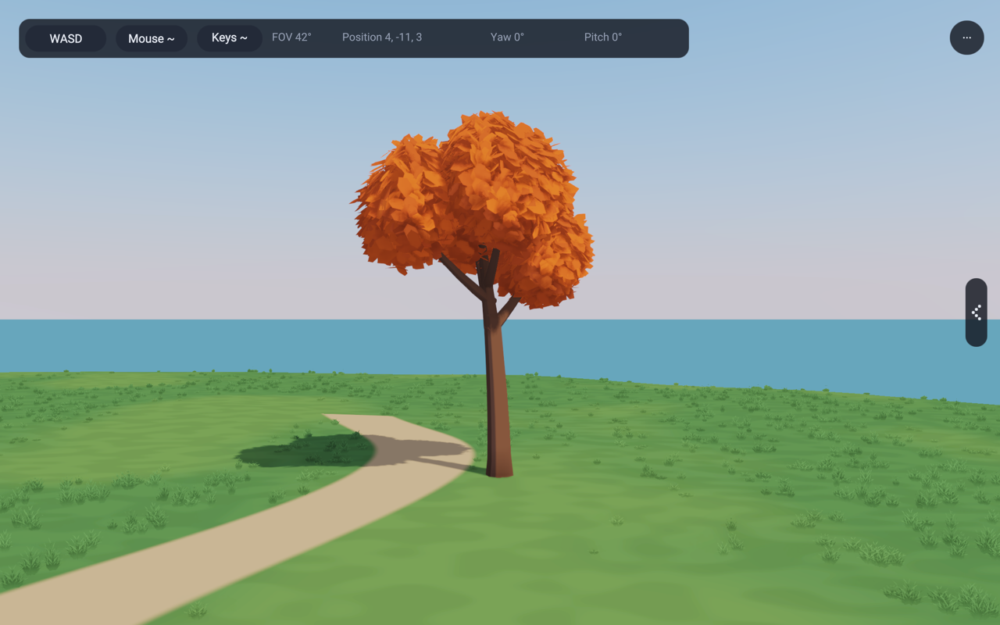 | 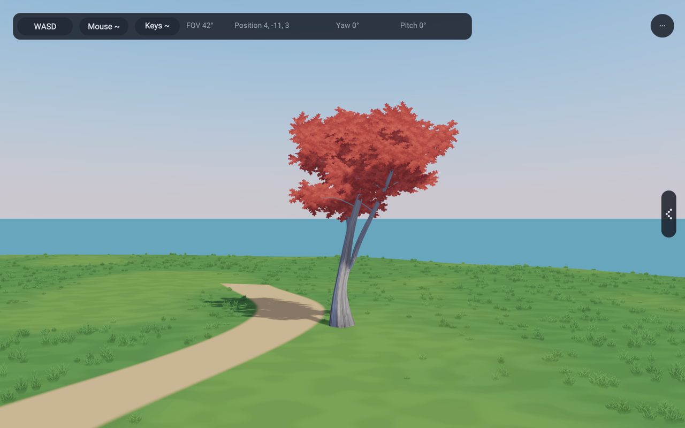 |

The old preset appears orange-red under this lighting; the control preserves
that material as well as its geometry. The first new texture was too saturated.
The selected revision reduces saturation toward dusty scarlet/brick and quiets
internal leaf marks. No lighting or exposure change supplies that difference.
Original small three-lobed edge leaves define a connected cutout; broad crown
normals light the sprays rather than individual polygon leaves.

| Bare scaffold | Side |
|---|---|
| 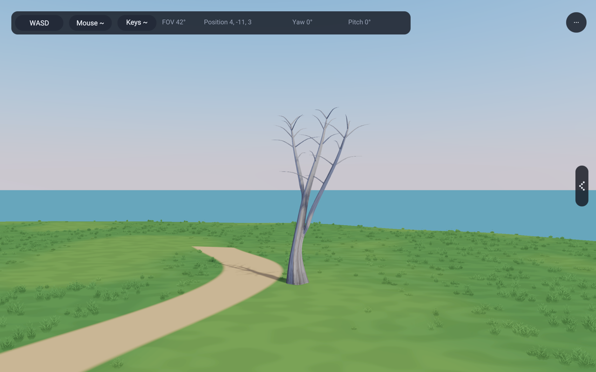 | 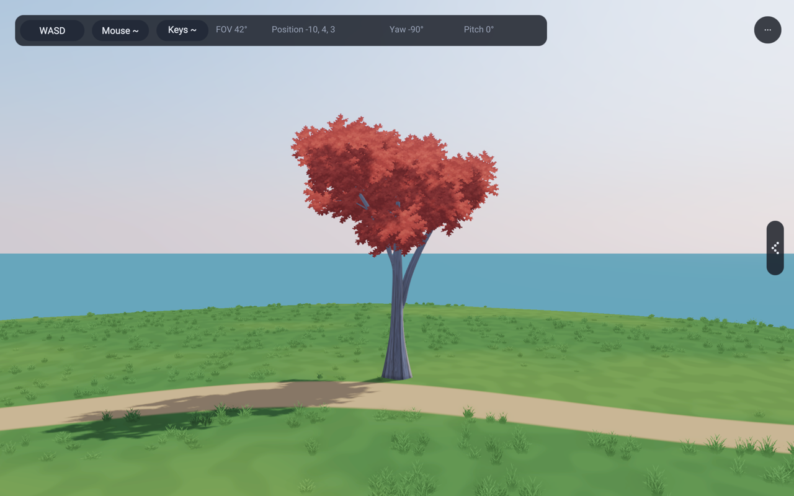 |

| Seed 311, height 4.5 m | Seed 1021, height 5.5 m |
|---|---|
| 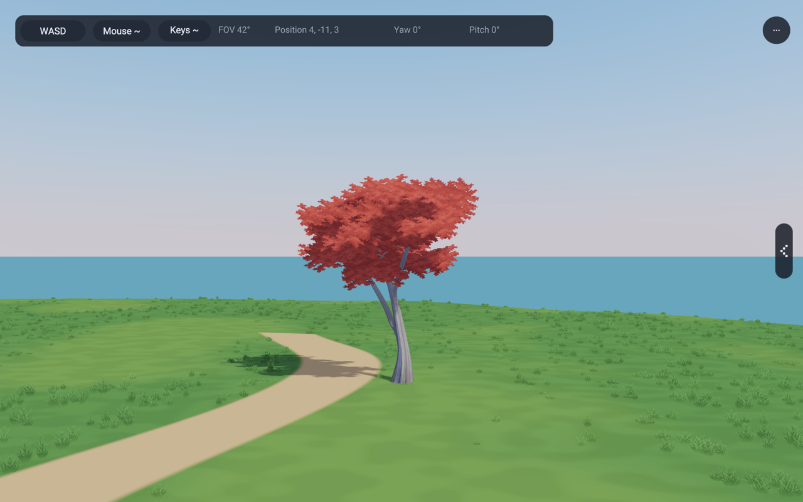 | 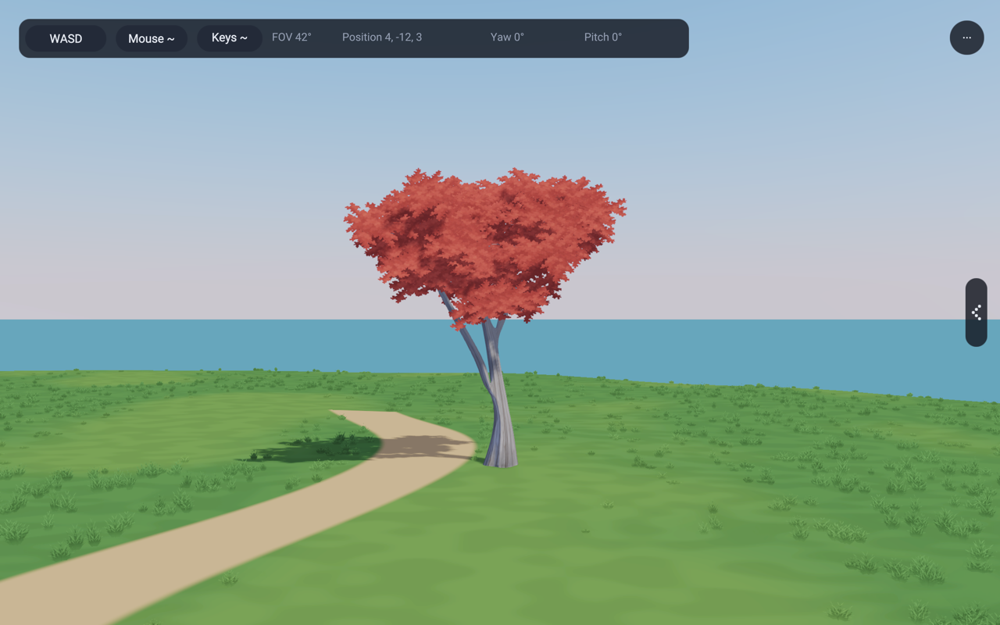 |

All isolated studies use width 1.8 m. The actual shared forest prototype uses
height 5.5 m and width 2 m, then existing per-instance scaling and yaw. No
showcase specimen was changed to make its comparison more favourable.

## Material and motion

The original bark texture has a one-way age gradient: older shallow ridges at
the base, smoother grey above. Bark V coordinates stay in [0.03, 0.97] according
to tree height, so the rough base does not repeat up each young twig. The primary
forks use shared joined surfaces; secondary shoots remain tapered curved tubes.
Wood has no wind stream and stays rigid. All three cards within a spray share
its twig-root pivot and the production directional wind.

Foliage uses the existing alpha-cutout material, coverage-preserving mip chain,
two-sided lighting and posed shadow/atlas conventions. No emission, global
shadow disable or species shader was added. Both textures load through the
existing renderer image owner. [Asset provenance and prompts](../lib/assets/trees/redMapleAssets.md)
record the built-in generation and selected files.

| Under the crown | Low sun behind the tree |
|---|---|
| 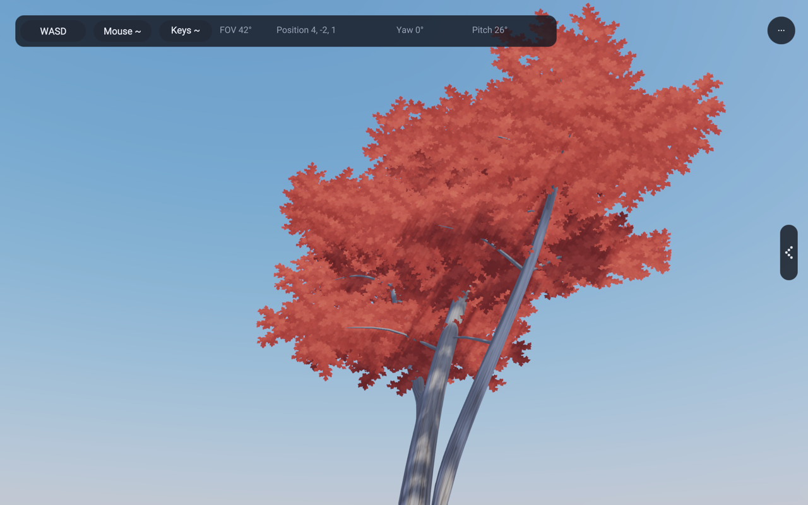 | 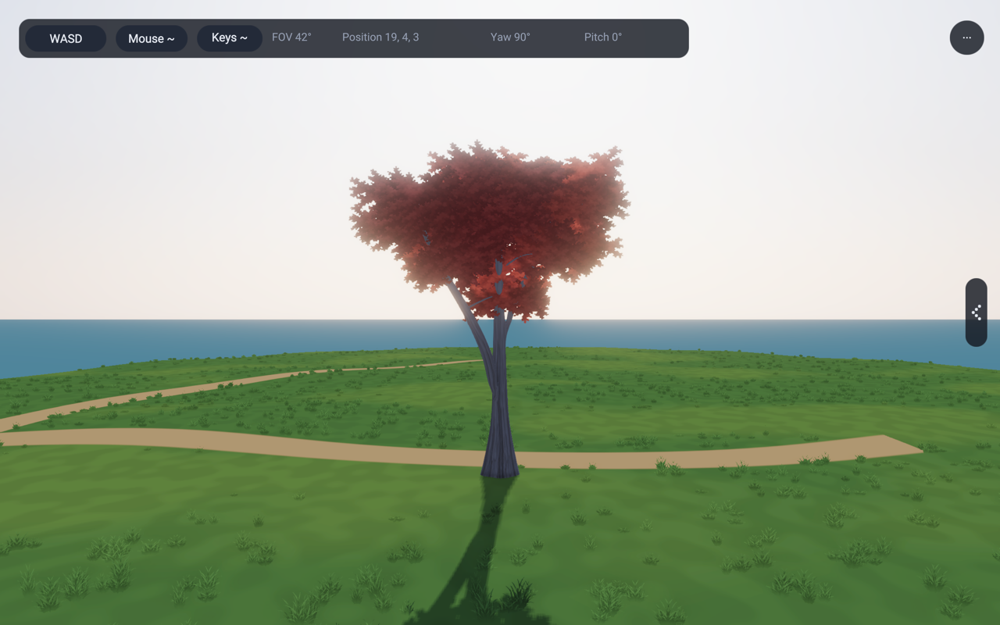 |

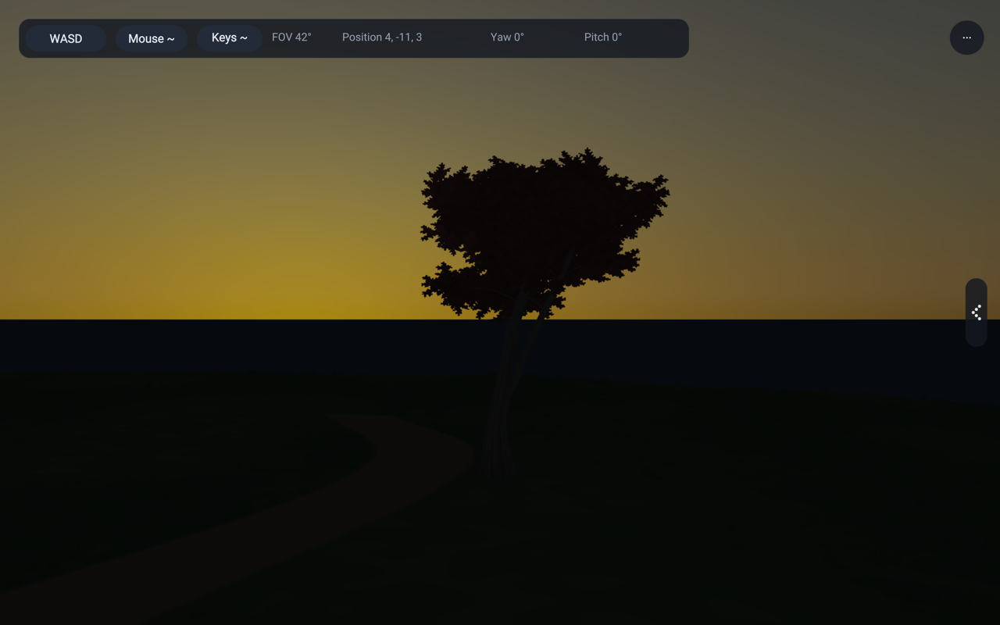

The private presentation includes a six-second walking capture at wind strength
1.2. Sampled frames show moving sprays with stable primary wood and attachments.
The hardware wind test also checks fixed pivots, dimensions, normals and exact
calm at 64 times/views. A sampled-frame review is not a full temporal artifact
measurement: small card overlaps and repeated marks remain visible close up.

## Shared forest and cost

136, 137 and 143 use the same kind-5 generator and textures through
`app3d/GroveTrees`. Four shared mesh/material parts remain: wood plus three
foliage tones. All foliage tones share the same cutout. Near and middle levels
share handles; **there is no reduced middle red-maple mesh yet**. The far
impostor is baked from the actual textured camera-facing tree. Existing forest
limits and cleanup ownership remain in place.

For seed 1021, height 5.5 m and width 2 m:

| Mesh | Vertices | Triangles |
|---|---:|---:|
| Old near, 500-leaf input | 39,561 | 52,938 |
| Old middle, 110-leaf input | 9,141 | 12,378 |
| Old full showcase, 1,250-leaf input | 98,061 | 130,938 |
| New near/middle | 3,672 | 5,842 |

The new total has 3,348 wood vertices / 5,680 wood triangles and 324 foliage
vertices / 162 foliage triangles (81 cards). Geometry is created at setup,
not per frame. Alpha sampling and overlap add fragment work; these counts are
not an isolated GPU timing result or a claim of a proportional speedup.

The tested rotating-card envelope, including half diagonals and a 0.03-height
wind allowance, reached 4.65946 m at seed 5407 (height 5.5 m). Kind 5 now uses
radius 0.86 × height, centred at z=0.55 × height, instead of the old 0.65.
The permanent check covers six named seeds plus 64 seeded cases. Other species'
bounds are unchanged.

At the matched forest front camera, old/new resource reports at frame 0 are
950/944 buffers, both 56 textures, 114 texture views and 151 bind groups.
Sharing three middle foliage meshes removes six buffers. The two image layers
occupy the existing array: unchanged texture-object counts do not mean zero
extra image memory. These are whole-app counts, not isolated cost measurements.
The forest still contains 31,090 trees and 829 canopy clusters.

| Old forest | New forest, same camera and placements |
|---|---|
| 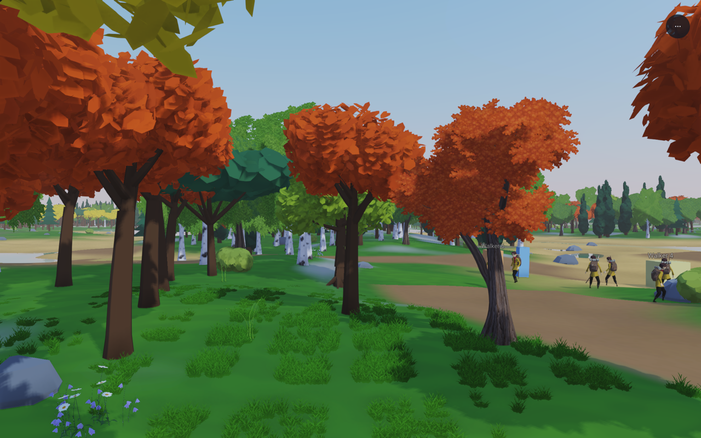 | 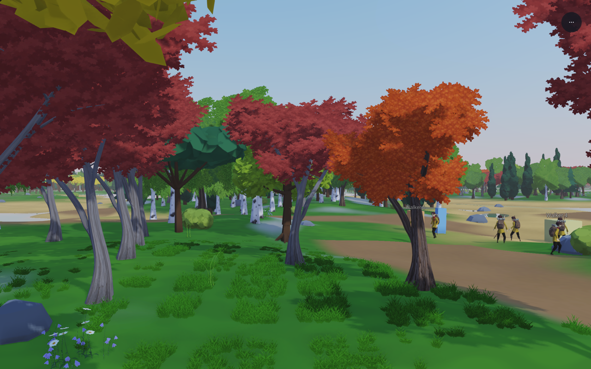 |

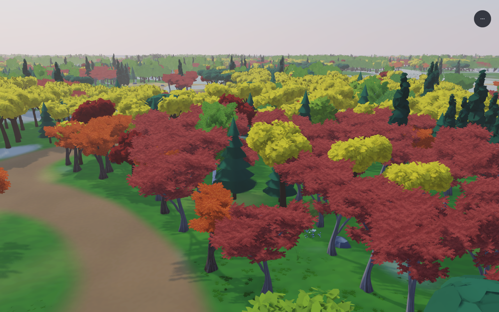

The camera looks toward kind-5 placement 16389 at
(-15.907, -10.7103, -0.0711835), scale 0.902363, height about 4.963 m.
Neighbouring trees are retained. The private report includes side, underside,
low-sun, night and unchanged old group views. Some side views are occluded by
near neighbours; they show forest context, not an isolated silhouette test.

## Reproduction

`python3 tools/capture-red-maple-studies.py /tmp/rae-red-maple-review` builds
once and saves fixed renders and a manifest outside git. `--binary` reuses a
known build; `--view front --wind 1.2 --motion` records the fixed walking clip.
Every child has a timeout. The manifest records source-at-capture, asset and binary hashes,
seed, width, height, camera, clock, wind, exposure/effects and image hashes.
For a reused binary, current source hashes describe the checkout at capture
time; its binary hash identifies the actual executable.

Static views use 60 frames at 1/60 s, wind 0, 1280 × 800 review images, Preetham
10:00, exposure 1, deferred toon shading, CSM, SSAO, SMAA and bloom. Warm/backlit
views use 17:15; night uses 23:00. Motion uses 180 frames at 1/30 s and 2.5 m
travel through the existing `CameraStudy` controls. Large BMP sequences and
recordings remain outside git.

`RAE_RED_MAPLE_ISOLATE=1` keeps the actual grove tree and ground, removing
occluders. `RAE_RED_MAPLE_CONTROL=1` selects its unchanged old geometry/material;
`RAE_RED_MAPLE_BARE=1` suppresses its leaves. `RAE_RED_MAPLE_SEED` and
`RAE_RED_MAPLE_HEIGHT` only affect the isolated study. The normal grove is
unchanged in placement and counts.

Forest camera overrides (`RAE_CAMERA_AT`, same clock/light settings):

| View | Twelve camera values |
|---|---|
| Front | `1 0 0 0 10 -15.907 -23 2.4 0 0 0 0` |
| Side | `1 -1.5707963 0 0 10 -28.2 -10.71 2.4 0 0 0 0` |
| Underneath | `1 0 0 0.55 10 -15.907 -15.7 0.8 0 0 0 0` |
| Group | `1 3.14159265 0 -0.30 10 -15 4 12 0 0 0 0` |
| Backlit, hour 17.25 | `1 1.5707963 0 0 10 -3.6 -10.71 2.4 0 0 0 0` |

Night repeats front at hour 23. The forest control uses a preserved binary from
before this change, whose hash is recorded with the candidate in the private
manifest. All comparison screenshots are actual application output.

## Remaining limits and validation

The crown still has recognizable cutout motifs close up, dark overlaps from
some angles and a simplified paired-shoot rhythm. The bark is painted albedo,
not physical ridged geometry; its vertical transition simplifies natural age
variation. The group uses one shared seed with yaw/scale variation. The existing
atlas transition is not a new continuous morph, and the middle mesh is not
reduced. This is a species refinement, not a claim of matching the reference
art completely.

Geometry fixtures 1228, 1235, 1242, 1243, 1245, 1246 and 1247 pass. The new fixture
checks fixed mapping, finite vertices, valid indices, unit normals, deterministic
wood, rigid wood, shared anchors, bark coordinates and rotating-card bounds.
Hardware checks `leafWind`, `surfaceImages` and `impostorBake` pass, including
red-maple posed atlas view cells and mip coverage. All four example gates pass:
136 deferred walker, 137 forward walker, 138 grove and 143 huge forest. They
retain the existing memory, pool and scene checks. Version 0.2.147 records the
library addition; no compiler/runtime implementation or shared shader changed.
