# Norway spruce refinement

**Kind 3 / speciesSpruce remains Norway spruce, Picea abies.** The six fixed
138 specimens retain their positions, seed 73 and heights of 6, 6.7 and 7.4 m,
two of each. Shared walkers retain their 5.5–8.5 m range and placement mapping.
This is a normal-sized tree, not the giant specimen reserved for another study.

[Oregon State](https://landscapeplants.oregonstate.edu/plants/picea-abies)
describes the pyramidal habit and drooping secondary branches.
[North Carolina Extension](https://plants.ces.ncsu.edu/plants/picea-abies/)
describes pendulous older branches and flaky bark scales. These guide the
scaffold and needle sprays. The private T04/T05/T07 crops guide quiet lighting,
connected masses and readable wood; they are not identifications of this species.

## Actual before and after

| Original skirts and material | Selected sprays, same specimens and capture settings |
|---|---|
| 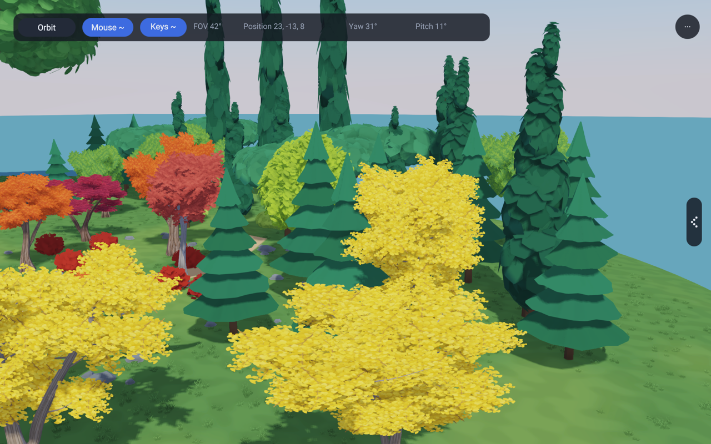 | 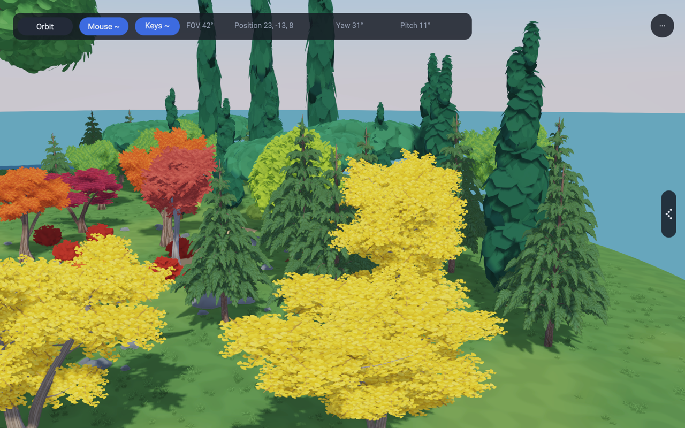 |

The old six closed skirts made continuous dark horizontal bands. The selected
tree retains the layered growth but breaks each layer into six unequal boughs.
Nine whorls taper towards the leader; shorter sectors and staggered heights
leave gaps. Each curved bough rises before its tip hangs. Four smaller hanging
sprays continue its sides. Seven short upright shoots connect the upper crown.

The original generator is preserved in `procgen/SpruceControl`; the unchanged
old material and trunk are available with `RAE_SPRUCE_CONTROL=1` in 138.
The private recovery presentation also keeps the rejected intermediate renders:
solid bough volumes still looked like broad leaves, and cutting holes into
those volumes exposed too much scaffold. Quieting the texture helped, but the
selected open strips gave the better needle-spray silhouette.

| Close | Side | Below crown |
|---|---|---|
| 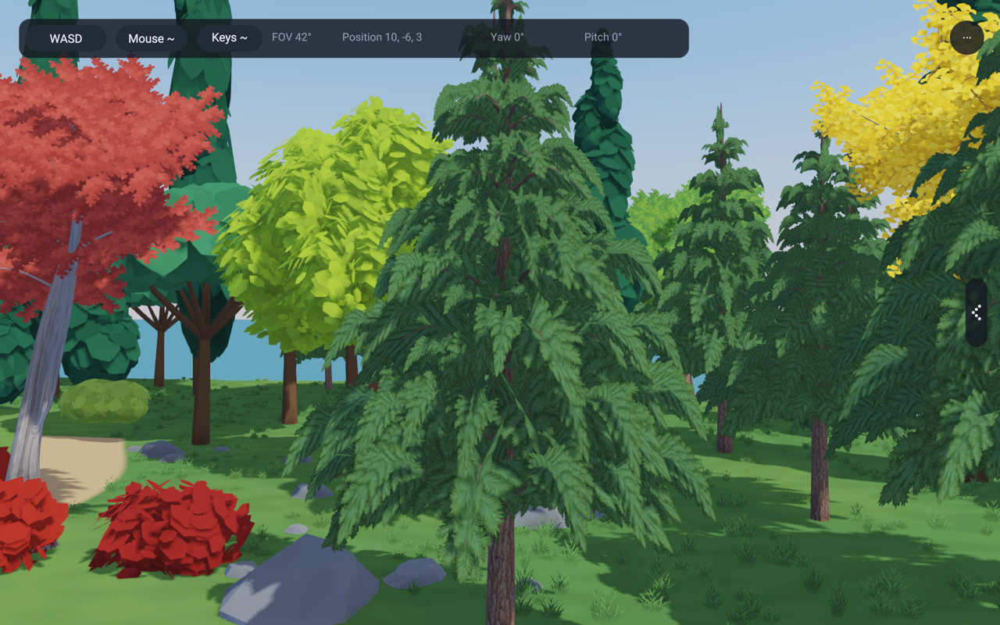 | 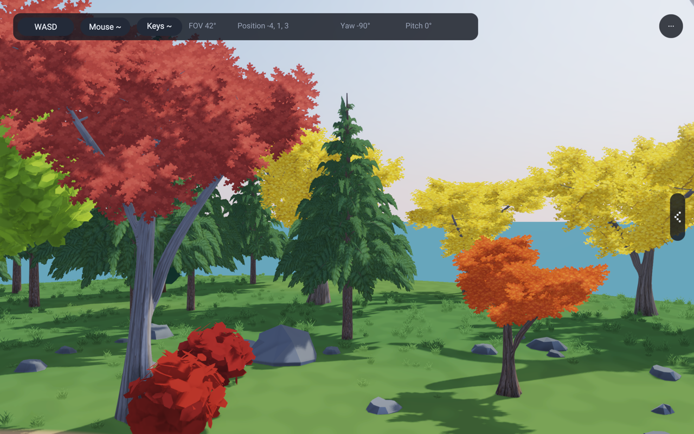 | 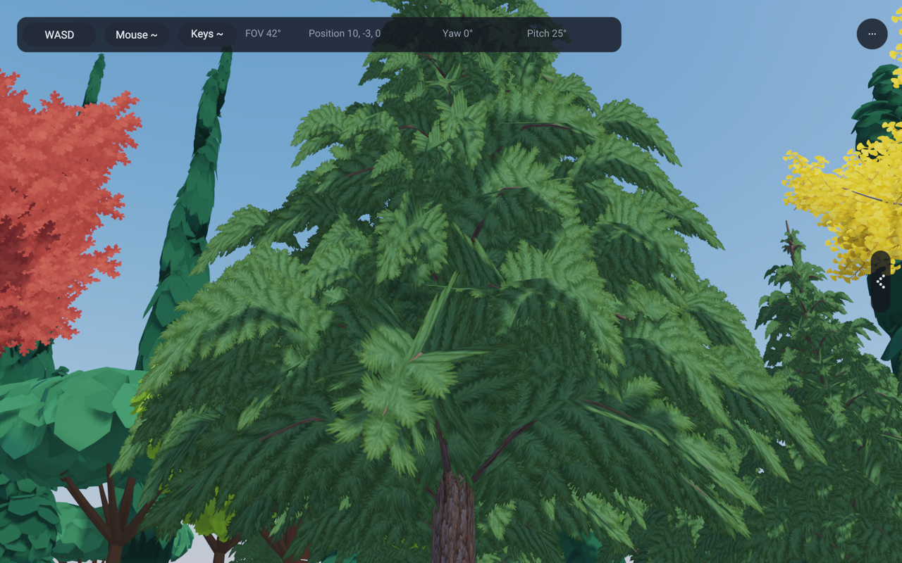 |

## Shared geometry and material

Each spray has three intersecting, curved five-ring strips. These stay fixed
to the branch instead of turning towards the camera. An original 512 × 512
RGBA needle texture supplies the fine edge; its interior contrast was reduced
after rendering the first candidate. Normals describe the broad bough surface,
not every painted needle. There is no emission or shadow exemption, and no
global lighting, exposure or renderer change.

The existing surface-image path supplies linear-light, coverage-preserving
mips and the same 0.5 alpha cutoff for colour, shadow and atlas passes. The
sprays use the existing two-sided foliage lighting. Original grey-brown bark
albedo wraps the rigid tapered stem and primary boughs, using the existing
`BirchTwig` curve and `birchTube` helper. Vertical repetition prevents a small
patch of bark being stretched over the whole stem. Texture provenance is in
[spruceAssets.md](../lib/assets/trees/spruceAssets.md).

| Rigid wood | Isolated late-afternoon backlight | Night, ordinary grove |
|---|---|---|
| 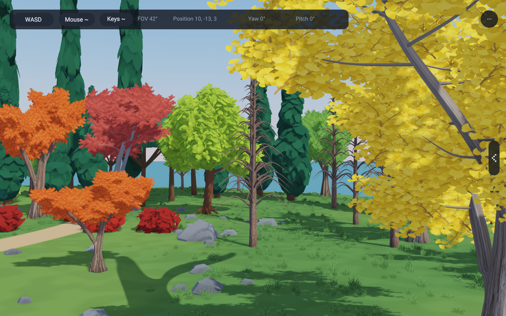 | 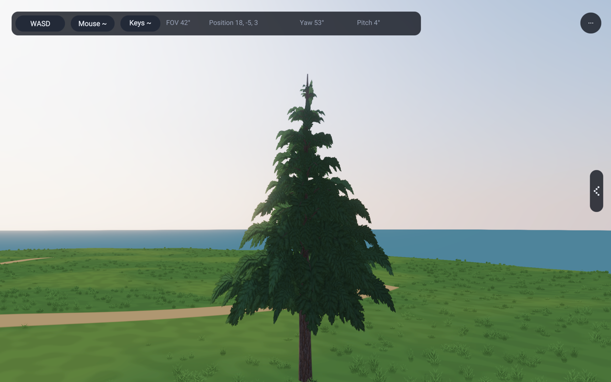 | 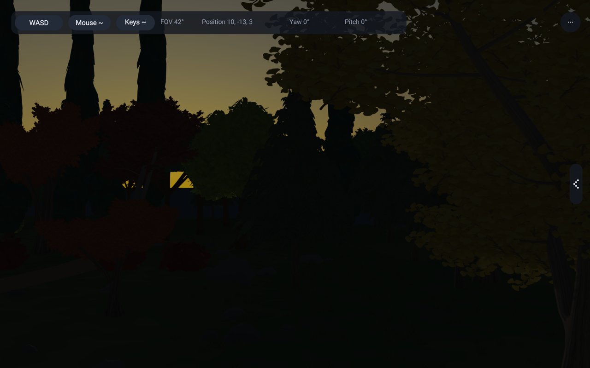 |

Primary sprays use flexibility 0.10; smaller hanging sprays use 0.32. Each
30-vertex spray shares one fixed pivot. Wood carries no wind data. The shared
wind path also drives the shadow pass. A six-second breezy forward walk is in
the private presentation; sampled frames at the start, middle and end show
stable wood and restrained foliage motion. This inspection is not a guarantee
that all temporal aliasing is eliminated.

## Seeds, forest and costs

| Seed 1229 | Seed 2189 |
|---|---|
|  | 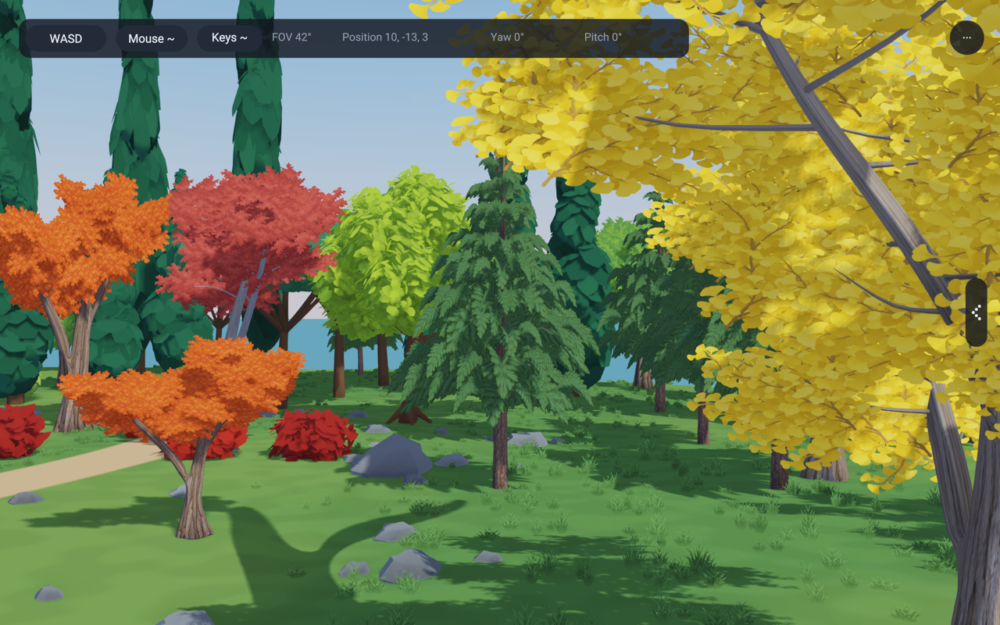 |

| Existing 143 stand, old prototype | Same stand and placements, selected prototype |
|---|---|
| 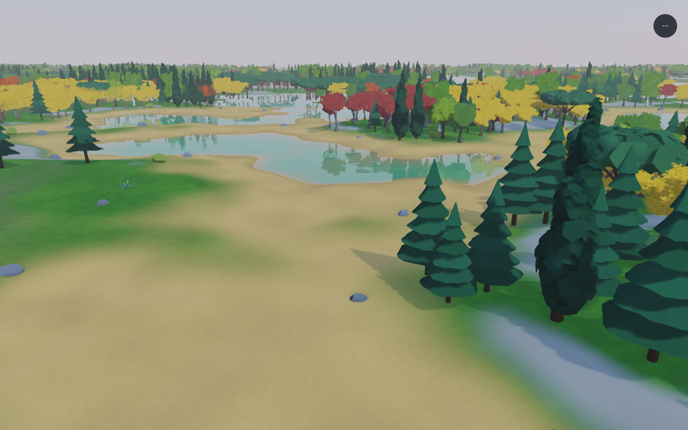 | 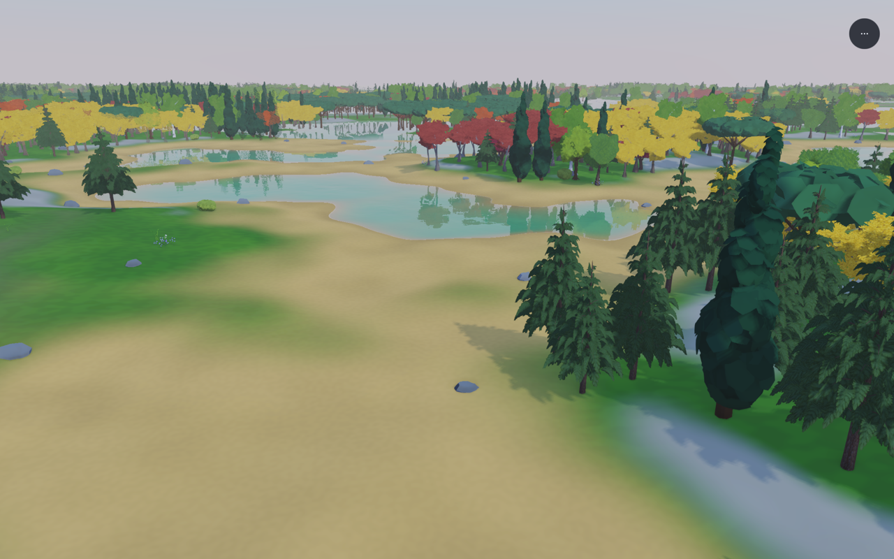 |

| Actual forest tree, old | Same tree, selected | Same tree at night |
|---|---|---|
| 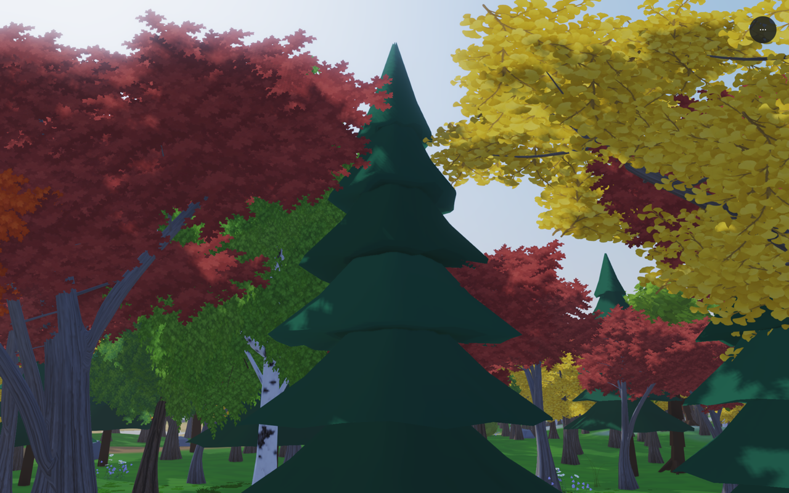 | 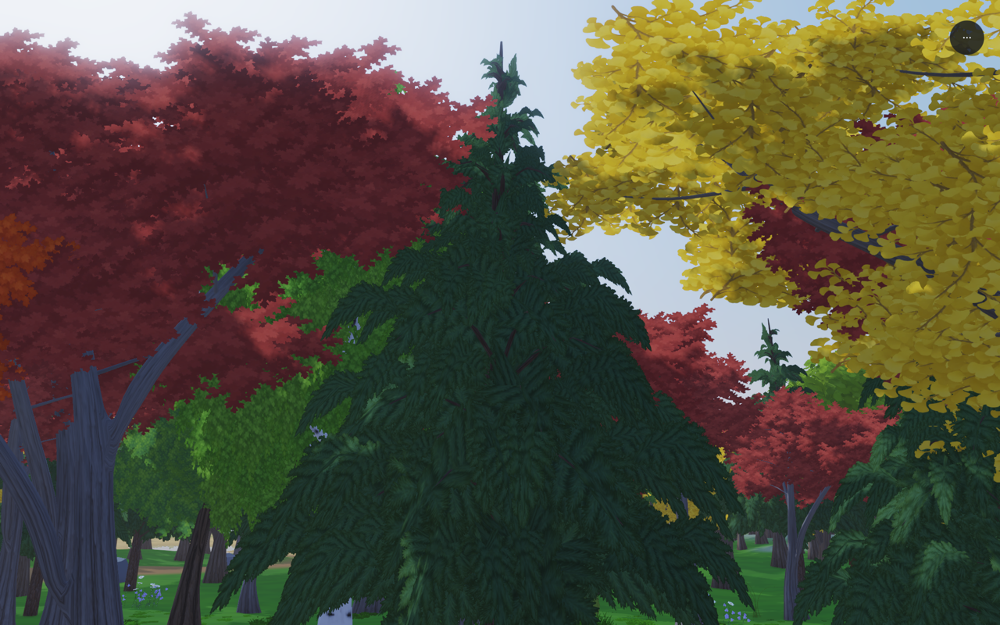 | 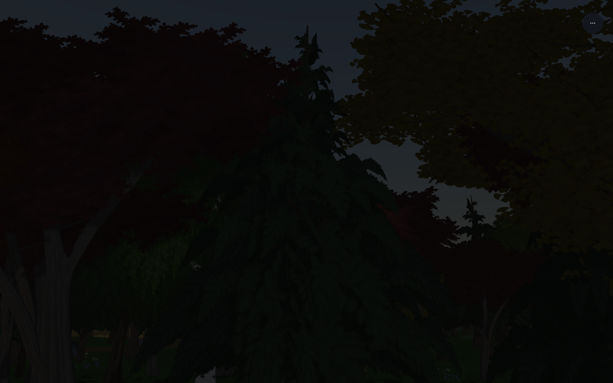 |

143 still contains 31,090 trees. The stand capture uses its existing spruce-rich
block (-2, 1), without replacing neighbours or increasing instance counts.
136, 137 and 143 load the same shared kind-3 meshes and texture layers.

| Prototype cost | Selected |
|---|---:|
| Rigid wood vertices / triangles | 4,097 / 6,360 |
| Foliage vertices / triangles | 8,310 / 6,648 |
| Total vertices / triangles | 12,407 / 13,008 |
| Original total triangles | 2,454 |
| Mesh vertex/index payload, calculated | 819,040 bytes |
| Two 512 RGBA images including full mips, calculated | about 2.67 MiB |
| Shared uploaded parts | 4: wood and three foliage tones |

There is no entity, mesh upload or material per bough. Near and middle LODs
share the same four mesh handles. This deliberately preserves the new outline
but **does not reduce middle-distance geometry**; it is a real cost increase.
The existing far atlas is baked from the same textured prototype. These payload
figures exclude renderer allocation overhead and the shared atlas; they are
not CPU/GPU timing measurements or a performance benchmark.

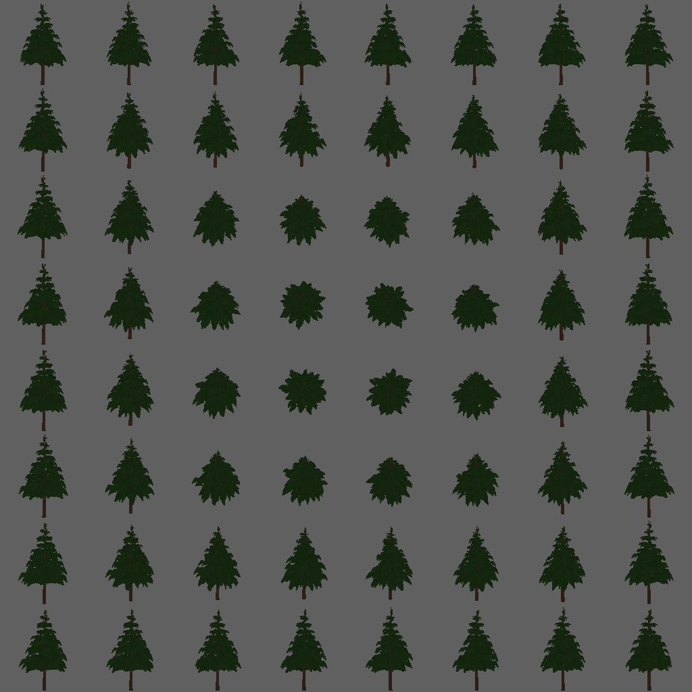

## Reproduction and verification

`python3 tools/capture-spruce-studies.py /tmp/spruce-study` renders the fixed
grove views. Add `--view front --motion` for the short walk, or `--binary` to
reuse a compiled capture binary. Static captures use 60 frames at 1/60 s,
wind zero, exposure 1 and a 1280 × 800 window. The saved PNGs are 1280 × 800
downsamples of the display's screenshot. Normal views use 10:00, backlight
17:15 and night 23:00. Existing deferred toon, CSM, SSAO, SMAA and bloom remain
enabled. Backlight isolates the original first 6 m specimen so neighbouring
crowns do not obscure it; this is explicitly not a matched full-scene pair.

[Grove settings and hashes](images/spruce-refinement/manifest.json),
[isolated capture](images/spruce-refinement/backlit-manifest.json),
[forest settings](images/spruce-refinement/forest-manifest.json) and
[stand settings](images/spruce-refinement/stand-manifest.json) record the
camera and clock values. Large frame sequences and recordings stay outside git.

Passed:

- Nine targeted compiler fixtures: the eight importing `app3d/GroveTrees`,
  plus `1141_fluffy_foliage`. The new `1250_spruce` checks 32 seeds, finite
  vertices, valid indices, unit normals, UV ranges, deterministic levels,
  fixed spray pivots, rigid wood and the existing bound with wind allowance.
- Hardware checks `leafWind`, `surfaceImages`, `impostorBake`, including spruce
  images in ordinary and posed atlas subjects. The example gates below exercise
  shadowed deferred and forward rendering with the shared foliage path.
- Example gates 136, 137, 138 and 143, including their existing resource and
  runtime checks. The named `Spruces.png` was refreshed after visual inspection.

## Remaining visual limits

The result is a substantial improvement over the continuous skirt bands, but
it does not yet reproduce the botanical reference's very fine hanging twigs.
Close views reveal repeating feather-like texture motifs and some flattened
crossing strips. Dense branch overlaps still form dark pockets. Bark is
painted relief and the thin branch attachments are separate tubes, not fully
blended collars. Wind is intentionally restrained. A future middle LOD should
reduce geometry while keeping this branch-supported silhouette; it must not
silently return to the old cones.
