# Sugar maple autumn-orange refinement

Forest **kind 4 / speciesOrange** remains the autumn-orange sugar maple,
*Acer saccharum*. The other maple kinds, placement probabilities, instance
scales and tree counts are unchanged. The old opaque broadleaf generator
remains available as the comparison control.

## Direction and actual result

[North Carolina Extension](https://plants.ces.ncsu.edu/plants/acer-saccharum/)
describes a dense spreading crown and five-lobed leaves with variable autumn
colour. [Oregon State University](https://landscapeplants.oregonstate.edu/plants/acer-saccharum)
shows ascending branches, an upright oval form and bark with irregular long
plates. This preset uses copper/orange within that range. Its game-scale
specimens do not represent the species' eventual mature height.

T04–T07 guide connected foliage masses, small edge leaves, visible wood and
quiet lighting. The private recovery presentation places the actual renders
beside those reference crops; their pixels are not production assets.

The new Rae generator has its own leaning leader, two unequal ascending joined
forks and opposite lateral shoots. Thirty-nine supporting sprays carry three
overlapping cards each, with shared crown normals and twig pivots. Their reach
builds a spreading oval; omitted lower shoots expose the forks. This is its
own scaffold and original five-lobed cutout, using the shared recovered card
helpers rather than the birch generator or birch texture.

| Unchanged old plant | Refined plant, matched seed 501, height, placement, camera and light |
|---|---|
| 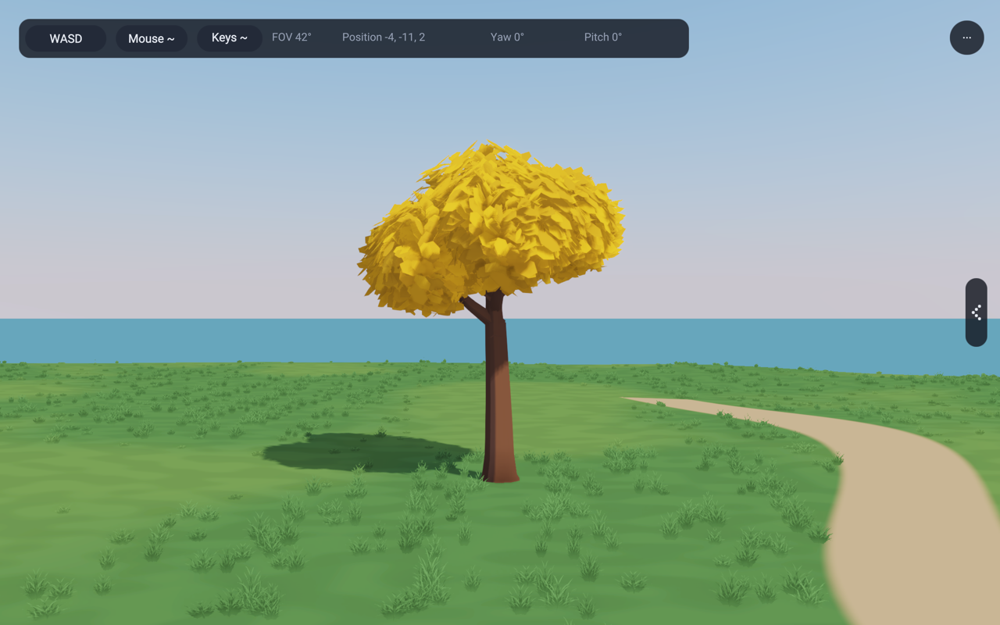 | 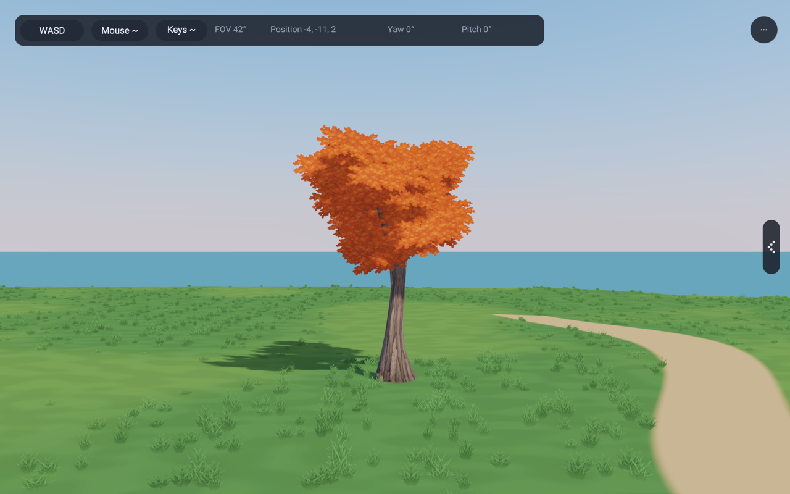 |

The first candidate was too narrow. After widening its lateral shoots, two
texture revisions reduced bright internal leaf marks. The selected asset has
quieter copper interiors and fine alpha edges. The private presentation keeps
those rejected candidate images as well as the unchanged old control.

| Joined wood from the side | Seed 710, height 6.4 m |
|---|---|
| 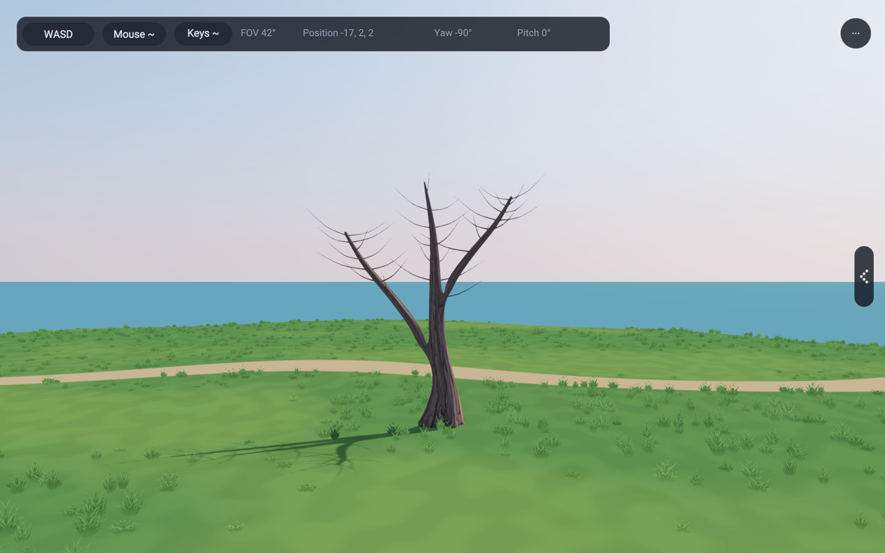 | 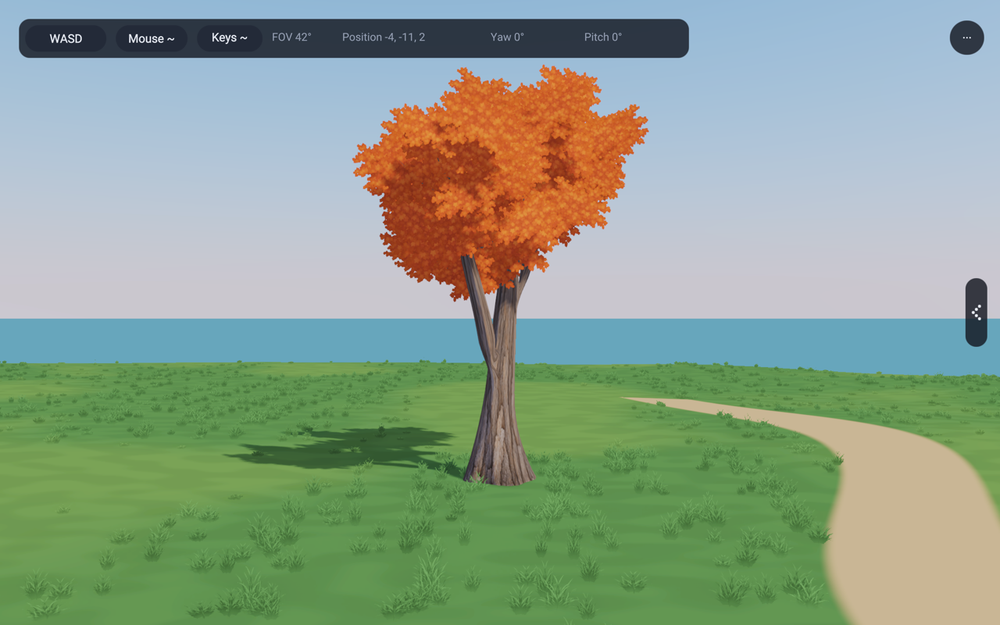 |

| Seed 917, height 5.5 m | Low sun behind the tree |
|---|---|
| 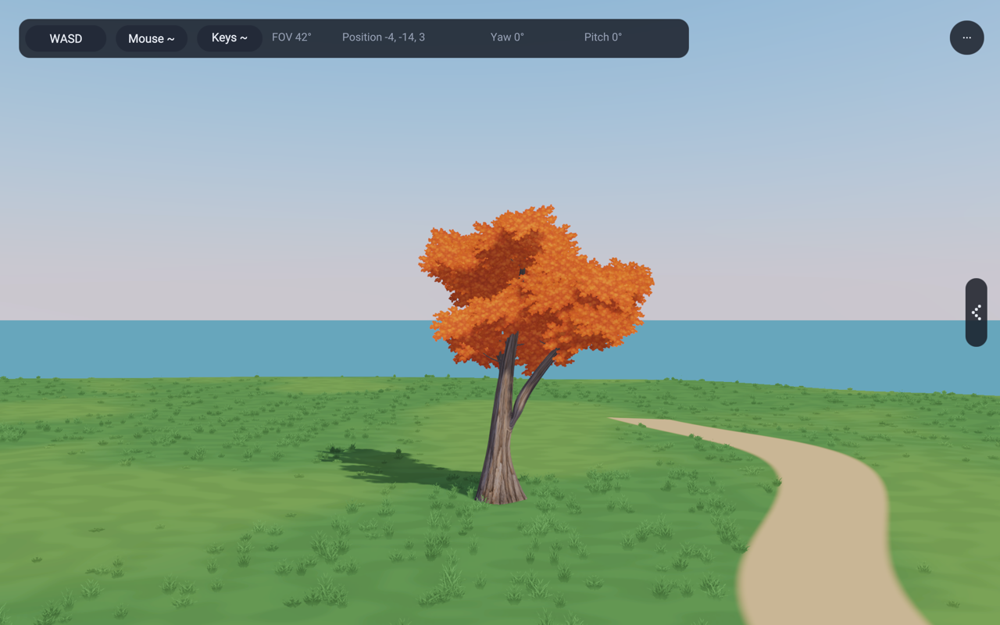 | 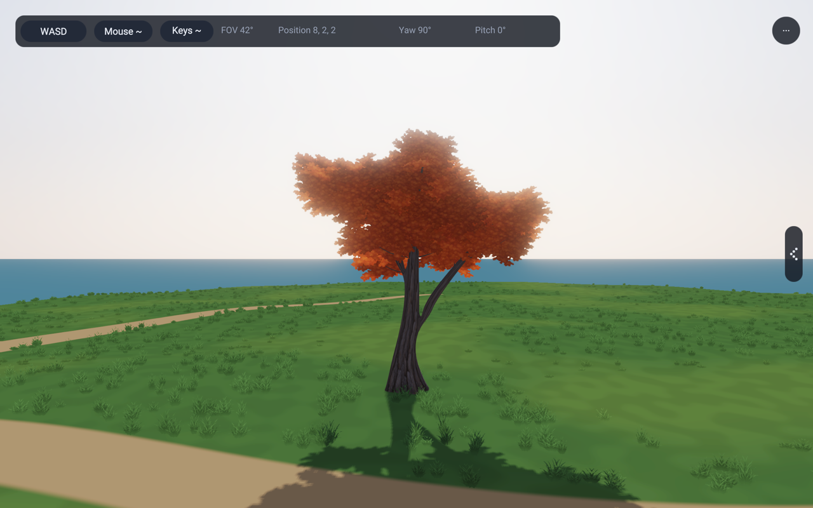 |

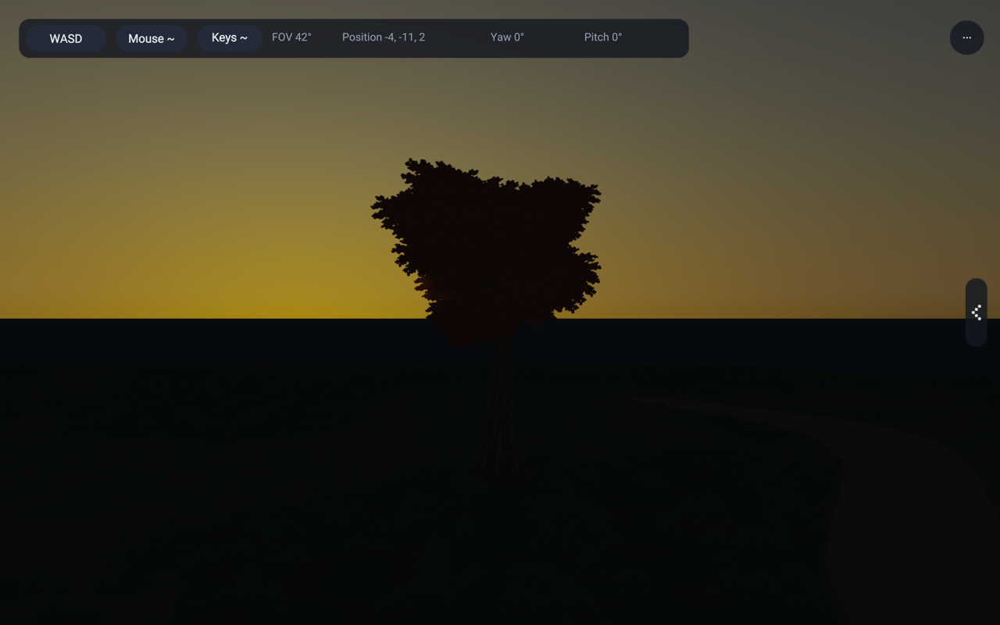

The result still has limits. Close underside views reveal repeated leaf motifs
and dark card overlaps. Some branches retain layered horizontal shapes. Small
shoots are ordinary tapered tubes, not individually joined forks. Painted bark
relief is more regular than natural plates. The crown is dense and its internal
sky gaps are modest from some directions. These are visible limitations, not
claims of a complete match to the reference art.

## Shared consumers and cost

`procgen/SugarMaple.rae` uses the recovered curve, junction and subdivision
helpers. Wood stays rigid; foliage keeps the existing anchored directional wind,
alpha cutoff, coverage-preserving mips, two-sided lighting and shadow path.
There is no emission, shadow exemption or species-specific shader.

136, 137 and 143 all obtain kind 4 through `app3d/GroveTrees.rae`. They load two
image layers through the existing renderer owner and share four mesh/material
parts per prototype. The three foliage tones share one texture. The far atlas
is baked from the actual textured, camera-facing tree. Near and middle levels
share handles; **a reduced middle maple mesh is not implemented**.

Measured geometry for forest seed 917, height 5.5 m, width 2 m:

| Representation | Vertices | Triangles |
|---|---:|---:|
| Old near, leaf-count input 500 | 39,561 | 52,938 |
| Old middle, leaf-count input 110 | 9,141 | 12,378 |
| Old full showcase, leaf-count input 1,250 | 98,061 | 130,938 |
| New near and middle | 4,575 | 7,066 |

The new total contains 4,107 wood vertices / 6,832 wood triangles, plus
468 foliage vertices / 234 foliage triangles (117 cards). Generation runs at
resource setup, not while walking. Alpha texture sampling and overlap add
fragment work, so these geometry reductions are not a measured GPU speedup.
No isolated CPU/GPU timing claim is made.

Kind 4's culling radius changes from 0.65 to 0.75 times reference height,
centred at z=0.55 times height. The old bound clipped the rotating-card envelope
for some seeds. Six tested seeds fit the new envelope, including each card's
half diagonal and a 0.03-height wind allowance. Other kinds retain their bounds.

The actual forest remains 31,090 trees and 829 canopy clusters. At frame 0 it
reports 948 buffers, 56 textures, 114 texture views and 150 bind groups; the old
control reports 954 buffers with the same other counts. Six buffers disappear
because three middle foliage meshes now share their near-level handles.
The two new albedo layers use the existing image array; unchanged texture-object
counts do not mean unchanged texture memory. Existing owners release resources.

## Actual forest comparison

No trees were moved or hidden in these forest captures. The nearest selected
kind-4 tree is placement 16390 at (4.96948, -9.3631, -1.11022), scale 1.16366,
height 6.40013 m. Forests retain seed 917 with their existing yaw/scale variation.
The old forest binary was preserved before this task's changes.

| Old forest | Refined forest, same camera and placements |
|---|---|
| 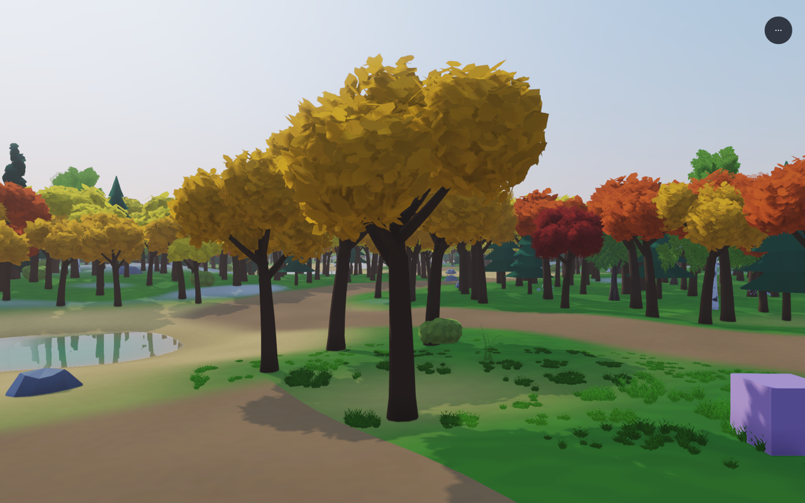 | 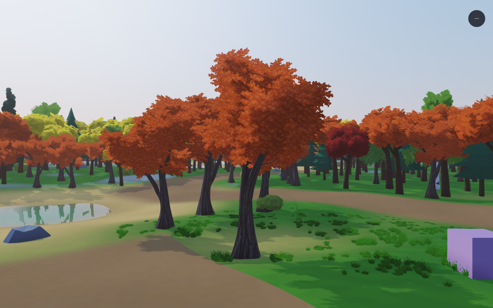 |

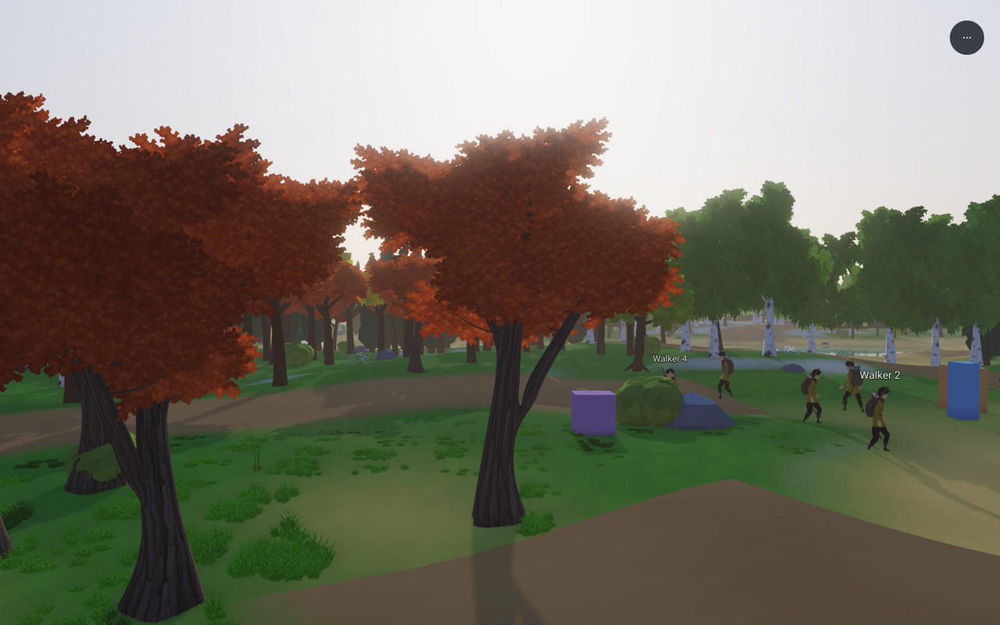
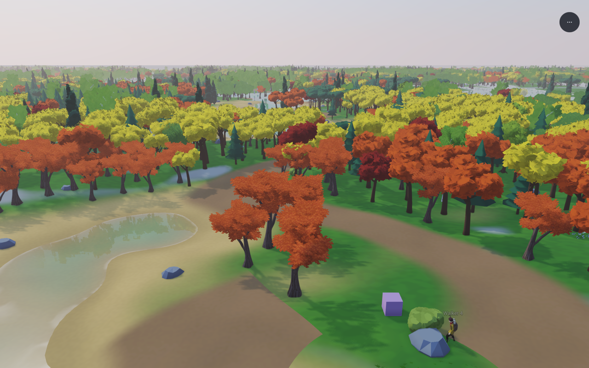

The large, coarse orange/red forms still visible in the group include other
maple presets. They intentionally remain distinct and unchanged by this task.
The elevated group view is context, not a measured atlas-transition sequence.

## Reproduce the captures

Run `python3 tools/capture-maple-studies.py /tmp/rae-maple-review`. Each child
has a timeout. It builds once and records source, asset and binary hashes,
camera, seed, height, clock, effects and image hashes. `--binary` reuses a known
build and `--view` selects one view. Output stays outside git.

The grove studies use 60 frames at 1/60 second, wind 0, 1280 × 800 review images,
Preetham sky, exposure 1, deferred toon shading, CSM, SSAO, SMAA and bloom.
Day is 10:00, warm/backlit 17:15 and night 23:00. The backlit camera faces west
with the low sun behind the tree. Isolation removes occluders but retains the
first planted tree at (-4.8, 2, 0). Every isolated study uses width 2.05 m;
additional seed/height studies are not claims of identical width to every
normal grove specimen.

The normal grove keeps its three orange specimens: seed 501 / height 4.7 /
width 2.05, seed 710 / height 6.4 / width 1.7 and seed 217 / height 2.6 /
width 1.15, all at their original positions. `RAE_MAPLE_CONTROL=1` selects the
old orange geometry/material, `RAE_MAPLE_BARE=1` hides its leaves, and
`RAE_MAPLE_ISOLATE=1` isolates the first tree. `RAE_MAPLE_SEED` and
`RAE_MAPLE_HEIGHT` affect only that isolated study.

For 143, keep the same clock, resolution, wind and lighting settings and use
these existing `RAE_CAMERA_AT` overrides:

| View | Twelve camera values | Hour |
|---|---|---:|
| Front | `1 3.14159265 0 0 10 4.97 1.5 2.3 0 0 0 0` | 10 |
| Underneath | `1 3.14159265 0 0.55 10 4.97 -4 0.5 0 0 0 0` | 10 |
| Group | `1 3.14159265 0 -0.30 10 5 14 14 0 0 0 0` | 10 |
| Backlit | `1 1.5707963 0 0 10 16 -9.36 2.3 0 0 0 0` | 17.25 |
| Night | same as front | 23 |

The private HTML recovery presentation includes all grove and forest views,
reference crops and capture manifests. The [asset note](../lib/assets/trees/sugarMapleAssets.md)
records the built-in image generation prompts, selected PNGs and remaining
texture limits. All comparison frames are actual application renders.

## Validation

- Narrow fixtures 1228 (level coverage), 1242 (curved forks), 1243 (birch recovery),
  1245 (lime) and 1246 (maple) pass. The new fixture checks six seeds, finite
  vertices, valid indices, unit normals, deterministic wood, rigid wood,
  shared twig anchors, rotating-card bounds and unchanged kind mapping.
- Hardware checks `leafWind`, `surfaceImages` and `impostorBake` pass. The atlas
  check includes the actual maple textures, posed cards, all view cells and
  coverage-preserving mip levels.
- All four example gates pass: 136 deferred walker, 137 forward walker,
  138 grove and 143 huge forest, including existing memory/resource checks.
- Formatting, example-copy, banned-terms and whitespace checks pass.
- No renderer/runtime/compiler implementation changed. Version 0.2.146 records
  the library addition. No full compiler suite was required for this scope.
