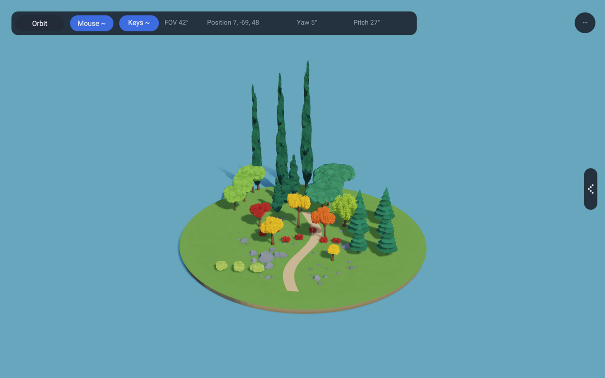
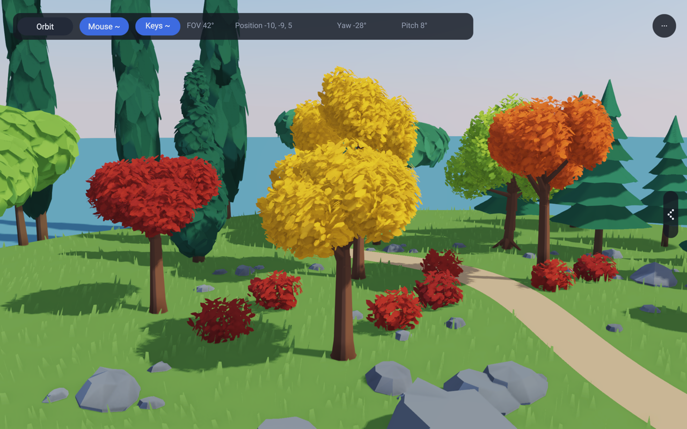
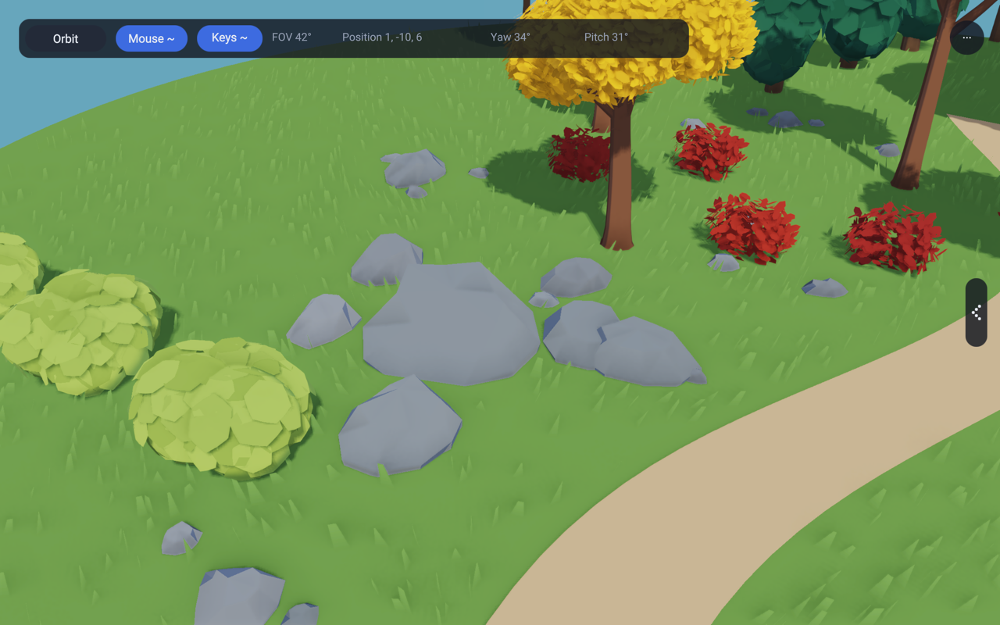
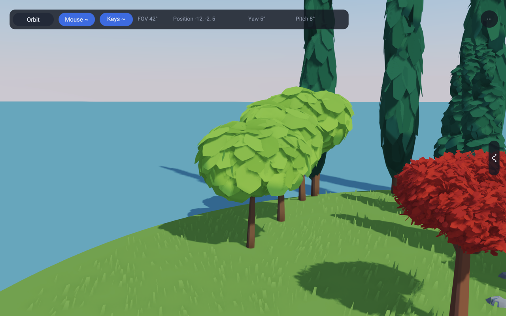
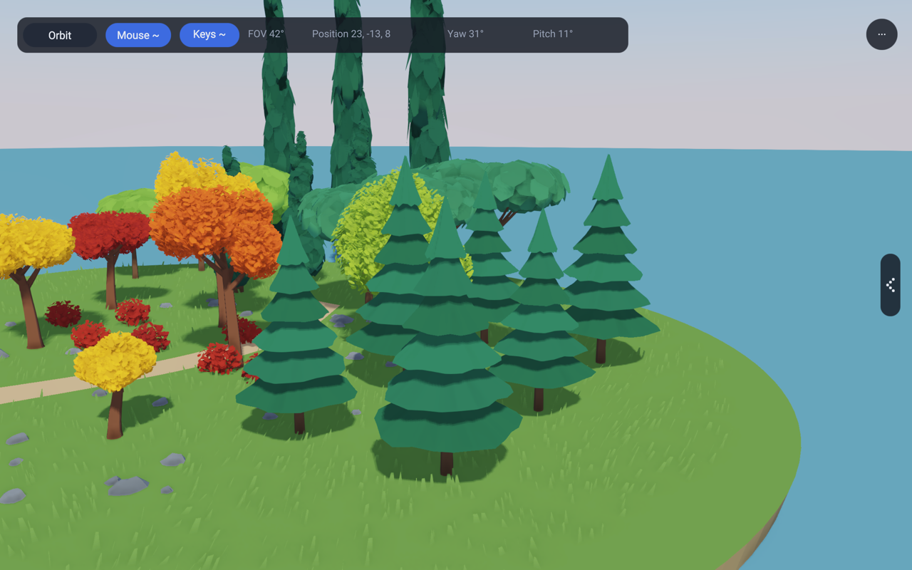

# Autumn Grove

A procedural prop showcase with twenty-four trees (including the six original
autumn trees), rock groups across the island, low shrubs, the standard GPU grass
and a winding path on a raised garden base.

- **1** restores the complete grove.
- **2** frames the branching wood and leaf crowns.
- **3** frames the stone outcrop.
- **4** frames the broad, fluffy leaf patches.
- **5** frames the cypress and umbrella pine group.
- **6** frames the six layered spruces.
- Drag to orbit, scroll to zoom. The camera bar's **Orbit** button switches to
  the free WASD camera (Q/E down/up, shift to boost) and back.
- The menu button opens the settings panel: the six views (Scene 1-6), sky
  model, time of day and date, shadows and TAA.
- The chrome is the shared editor panel (`lib/app3d/EditorPanel.rae`); the
  debug widget on top shows frame rate and memory.

Run from the repository root:

```sh
compiler/bin/rae run --project examples/138_procgen_showcase examples/138_procgen_showcase/Main.rae
```

`RAE_GROVE_VIEW=trees` or `rocks` selects a reproducible initial close-up.
The default is the complete grove. The example gate renders all three views.

## Geometry and shading

The lib's `procgen/Foliage` builds seeded mesh data in Rae. Five trees have ordinary
wood: a straight, slightly leaning trunk with a flared foot, a leader that
carries on up, and three or four main limbs that each fork in two. Every part
is one continuous tapered tube: the segments share their rings, so a limb
bends and thins without a step at any joint, and each limb starts inside its
parent at the parent's thickness. A leaf crown sits on every limb tip. The
green tree keeps the older palm-style stem as its own species.

Each crown is made of small, two-sided six-sided leaves. Leaf normals follow
the crown envelope so light describes its volume without treating every leaf
as an unrelated flat surface. Three material batches give each crown a
restrained colour variation.

The rocks are the lib's faceted rocks (`lib/procgen/Rock.rae`), stretched,
turned and sunk a little into the ground: an outcrop by the path, nine smaller
groups over the island (one big rock with smaller ones around it) and single
pebbles wherever the ground is clear.

The grass is the standard lib GPU grass (`lib/GrassCompute.rae`, the walker's,
with its tuned settings): a compute pass places the blades each frame and
the G-buffer pass draws them. `assets/grove_surface.wgsl` gives that pass the
grove's ground: the island's height, grass inside the rim and none on the
path. The rocks and trunks go to it as obstacle circles in the surface field
(`GroveGrass.rae`), so no blade grows through them.

`GroveScene.rae` owns the gold, copper, scarlet and green palette, the path,
the ground and every placement. All meshes are uploaded once and attached to
entities in `World3d`; the deferred renderer owns the uploaded resources. Every
material uses the existing cel-shading flag and the same directional light
and cascaded shadows. The example uses no bitmap textures or imported meshes.







## Broad-leaf comparison garden

Keys **4** and **5** (or `RAE_GROVE_VIEW=fluffy` / `evergreen`) inspect the
new rounded broadleaf and Mediterranean evergreen groups. The island is now
44 by 40 metres instead of 27.6 by 25, with twelve additional plants: three
rounded broadleaves, three slender cypresses, three umbrella pines and three
low lime-green bushes. The original autumn trees remain for comparison.

`lib/procgen/FluffyFoliage.rae` uses fewer, larger, shallow-domed leaf patches
with softened lobed edges. Their normals follow each crown envelope, giving
rounded lighting instead of separate flat-card lighting. Seven overlapping
crowns make a broadleaf or umbrella, nine tapered crowns make a cypress, and
five make a bush. Dark evergreen colours belong to the example materials.
All geometry is generated in Rae; no new shaders, runtime C or bitmap assets.

This experiment uses opaque leaf silhouettes. Textured alpha cards can reduce
triangle counts further, but need matching alpha tests in the shadow pass,
coverage-preserving mipmaps and an overdraw budget. Opaque patches use the
existing shadow path and avoid those transparent areas. They trade extra
vertices for simple shading and a consistent silhouette from every angle.

| Form | Patches | Foliage triangles | Foliage vertices |
|---|---:|---:|---:|
| Broadleaf / umbrella | 336 | 8,064 | 4,368 |
| Cypress | 432 | 10,368 | 5,616 |
| Bush | 240 | 5,760 | 3,120 |

These counts include reversed triangles for back faces and exclude wood.
The wood adds 420 triangles for broadleaf/umbrella, 70 for cypress, none for
bush. `patchCount` is per crown, across all three tones. The showcase uses
48; 24 and 12 are lower-cost generation budgets tested for deterministic
output and valid indices. They are not automatic runtime LODs, and their
transition quality is not yet validated. Bounds change slightly as patches
get larger, so future culling must use generated mesh bounds.

`FluffyGrove.rae` uploads each form once, then shares its wood and three leaf
mesh handles among rotated/scaled entities. Mesh ownership remains with the
renderer. This demonstrates reusable assets, not a benchmark of thousands of
trees: draw batching, pooled instance updates, distance-selected LODs and
far billboards remain upstream integration work. Do not render thousands of
the near-view meshes with individual draw calls.




Technique references: [radial normals and leaf shading](https://www.aversionofreality.com/blog/2022/8/7/stylized-tree-shader)
and [clustered shells with silhouette leaves](https://cremuss.artstation.com/projects/Vyz12R).
The generator is original Rae code; no meshes, textures or shader code were
copied from those examples.

Validation: fixture `1141_fluffy_foliage` checks all five forms at 48/24/12
detail settings, deterministic vertex output and valid indices. The 138
example gate renders all six views. Captures are inspected separately and
stored above; `RAE_MEM_STATS=1` runs check tracked String/Buffer cleanup.

## Layered spruces and slender cypresses

Six normal-sized spruces (6, 6.7 and 7.4 metres, two of each) stand on the
right side. `procgen/Spruce` builds six continuous scalloped branch skirts
with smooth upper normals and closed undersides. Broad inter-tier shadows
replace the dense leaf-on-leaf self-shadowing of the old patch-based spruce.
Lighting and other species are unchanged; ground shadows remain enabled.
The giant master-tree experiment is removed.

At detail 48 each spruce has 864 foliage triangles and 444 vertices,
plus 1,590 wood triangles. Detail 24/12 reduces the radial subdivision.
All six trees reuse the same uploaded meshes, with different rotations/scales.
Key 6 or `RAE_GROVE_VIEW=spruces` frames this group.

The three tall cypresses remain 22.5, 24.6 and 26.7 metres tall. Only their
vertical scale is tripled: foliage width and trunk thickness now match the
original 7.5, 8.2 and 8.9 metre cypresses. All six reuse the same meshes.


