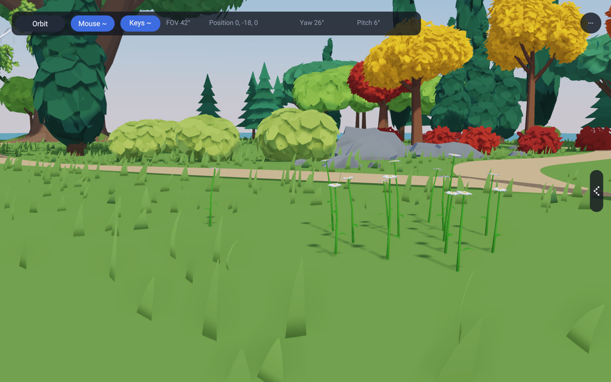
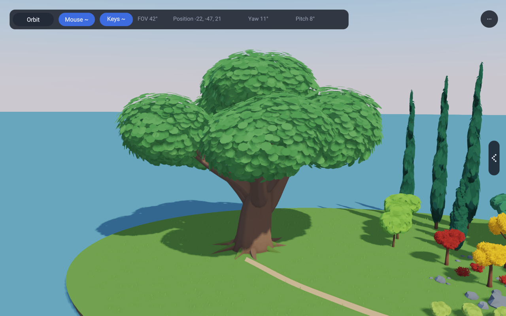
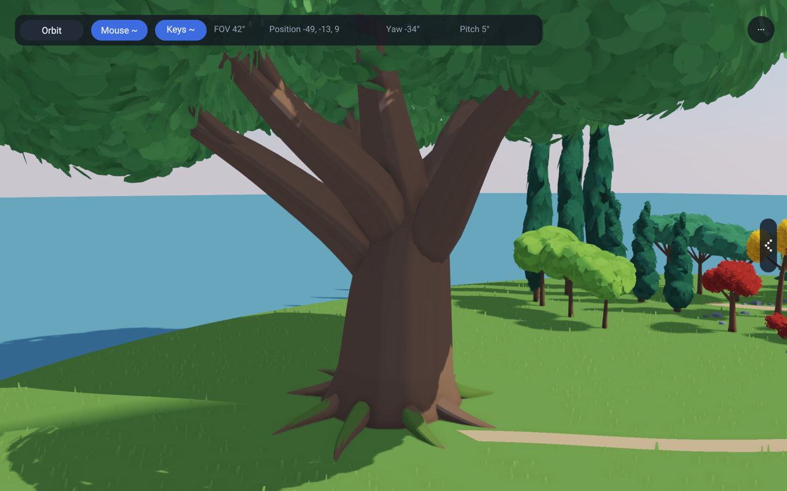
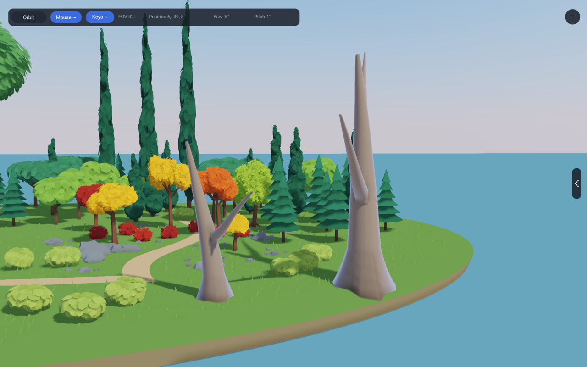
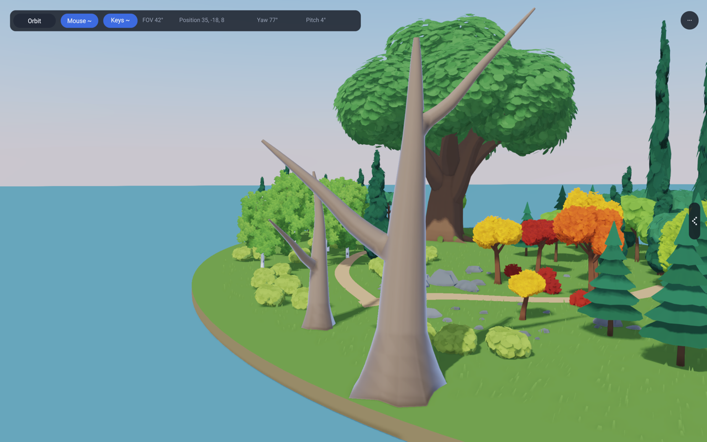
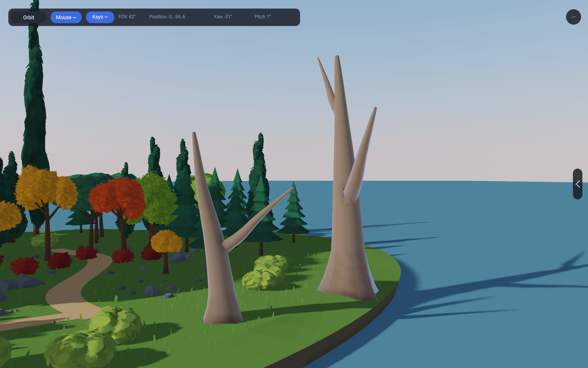
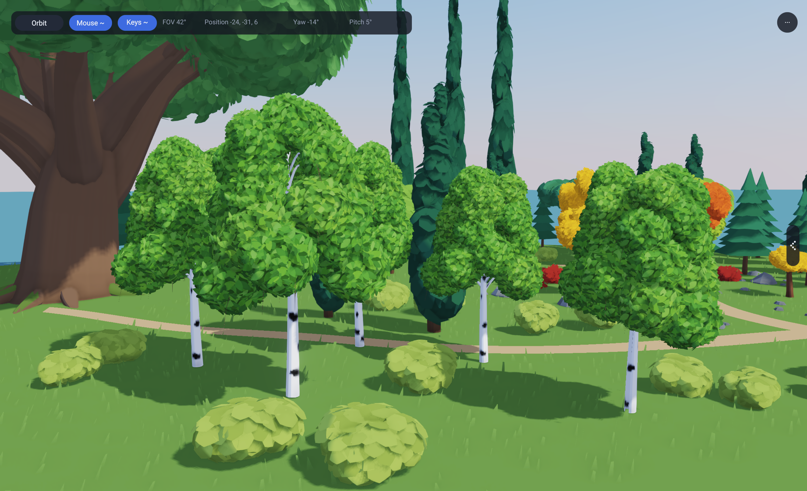

# Autumn Grove

A procedural prop showcase with about sixty trees (including the six original
autumn trees and a woodland of the leaf-patch forms over the whole island), rock
groups across the island, low shrubs, modeled oxeye daisies, the standard GPU
grass and a winding path on a raised garden base.

- **1** restores the complete grove.
- **2** frames the branching wood and leaf crowns.
- **3** frames the stone outcrop.
- **4** frames the broad, fluffy leaf patches.
- **5** frames the cypress and umbrella pine group.
- **6** frames the six layered spruces.
- **7** frames the giant camphor.
- **8** looks beneath its canopy at the roots and branching trunk.
- **9** visits the silver-birch stand: white bark with bold black marks, hanging twigs
  and rounded textured leaf clumps.
- `RAE_GROVE_VIEW=forks-front`, `forks-side` and `forks-grazing` inspect the
  young and mature bare joined-fork studies. These art-study views are outside
  the 1-9 keyboard set.
- `RAE_GROVE_VIEW=flowers` frames one oxeye daisy and one 13-plant patch.
- Drag to orbit, scroll to zoom. The camera bar's **Orbit** button switches to
  the free WASD camera (Q/E down/up, shift to boost) and back.
- The menu button opens the settings panel. Its app section names the active
  botanical subject and describes the view. The shared chooser exposes views
  1-3; keys 1-9 reach every inspection view. The panel also controls the sky
  model, time of day and date, shadows and TAA.
- The chrome is the shared editor panel (`lib/app3d/EditorPanel.rae`); the
  debug widget on top shows frame rate and memory.

Run from the repository root:

```sh
compiler/bin/rae run --project examples/138_procgen_showcase examples/138_procgen_showcase/Main.rae
```

`RAE_GROVE_VIEW=trees` or `rocks` selects a reproducible initial close-up.
The default is the complete grove. The example gate renders eleven named views.
[`docs/landscape-comparison-views.md`](../../docs/landscape-comparison-views.md)
records the fixed cameras and the capture command used before each landscape
art pass.

## Geometry and shading

The lib's `procgen/Foliage` builds seeded mesh data in Rae. Five trees have ordinary
wood: a straight, slightly leaning trunk with a flared foot, a leader that
carries on up, and three or four main limbs that each fork in two. Every part
is one continuous tapered tube: the segments share their rings, so a limb
bends and thins without a step at any joint, and each limb starts inside its
parent at the parent's thickness. A leaf crown sits on every limb tip. The
green tree keeps the older palm-style stem as its own species.

Each crown is made of small, two-sided six-sided leaves. Leaf normals follow
the crown envelope so light describes its volume without treating every leaf
as an unrelated flat surface. Three material batches give each crown a
restrained colour variation.

The rocks are the lib's faceted rocks (`lib/procgen/Rock.rae`), stretched,
turned and sunk a little into the ground: an outcrop by the path, nine smaller
groups over the island (one big rock with smaller ones around it) and single
pebbles wherever the ground is clear.

The grass is the standard lib GPU grass (`lib/GrassCompute.rae`, the walker's,
with its tuned settings): a compute pass places the blades each frame and
the G-buffer pass draws them. Broad seeded patches leave readable ground gaps,
while blade variation remains an independent control. `assets/grove_surface.wgsl`
gives that pass the grove's ground: the island's height, grass inside the rim
and none on the path. The rocks and trunks go to it as obstacle circles in the
surface field (`GroveGrass.rae`), so no blade grows through them. Set
`RAE_GROVE_VIEW=grass` for the low meadow/contact inspection.

`lib/procgen/MeadowFlower.rae` generates the oxeye daisy as one stem-and-leaf
mesh, one modeled-petal mesh and one disc mesh. A close petal has a lit top,
underside and narrow edge rather than an alpha card. One root pivot moves each
complete plant coherently. The 138 study uses three entities for one plant and
three for the complete patch; the walkers reuse a seven-plant patch through
three bounded instanced batches. No petal owns an entity or draw, and all three
rough materials have zero emission.



`GroveScene.rae` owns the gold, copper, scarlet and green palette, the path,
the ground and every placement. All meshes are uploaded once and attached to
entities in `World3d`; the deferred renderer owns the uploaded resources. Every
material uses the existing cel-shading flag and the same directional light
and cascaded shadows. Tree and rock geometry is generated in Rae, with no
imported tree meshes. The silver birch is the current exception to the older
untextured-foliage description: its generated wood and leaf cards sample the
shared birch bark and leaf textures.


## Broad-leaf comparison garden

Keys **4** and **5** (or `RAE_GROVE_VIEW=fluffy` / `evergreen`) inspect the
new rounded broadleaf and Mediterranean evergreen groups. This group first expanded the island to
44 by 40 metres from 27.6 by 25, with twelve additional plants: three
rounded broadleaves, three slender cypresses, three umbrella pines and three
low lime-green bushes. The original autumn trees remain for comparison.

`lib/procgen/FluffyFoliage.rae` uses fewer, larger, shallow-domed leaf patches
with softened lobed edges. Their normals follow each crown envelope, giving
rounded lighting instead of separate flat-card lighting. Seven overlapping
crowns make a broadleaf or umbrella, nine tapered crowns make a cypress, and
five make a bush. Dark evergreen colours belong to the example materials.
All geometry is generated in Rae; no new shaders, runtime C or bitmap assets.

This experiment uses opaque leaf silhouettes. Textured alpha cards can reduce
triangle counts further, but need matching alpha tests in the shadow pass,
coverage-preserving mipmaps and an overdraw budget. Opaque patches use the
existing shadow path and avoid those transparent areas. They trade extra
vertices for simple shading and a consistent silhouette from every angle.

| Form | Patches | Foliage triangles | Foliage vertices |
|---|---:|---:|---:|
| Broadleaf / umbrella | 336 | 8,064 | 4,368 |
| Cypress | 432 | 10,368 | 5,616 |
| Bush | 240 | 5,760 | 3,120 |

These counts include reversed triangles for back faces and exclude wood.
The wood adds 420 triangles for broadleaf/umbrella, 70 for cypress, none for
bush. `patchCount` is per crown, across all three tones. The showcase uses
48; 24 and 12 are lower-cost generation budgets tested for deterministic
output and valid indices. They are not automatic runtime LODs, and their
transition quality is not yet validated. Bounds change slightly as patches
get larger, so future culling must use generated mesh bounds.

`FluffyGrove.rae` uploads each form once, then shares its wood and three leaf
mesh handles among rotated/scaled entities. Mesh ownership remains with the
renderer. This demonstrates reusable assets, not a benchmark of thousands of
trees: draw batching, pooled instance updates, distance-selected LODs and
far billboards remain upstream integration work. Do not render thousands of
the near-view meshes with individual draw calls.

The same meshes also make the island's woodland (`addFluffyWoodland`): about
34 broadleaves, spruces, umbrella pines and cypresses and 18 bushes at seeded
spots inside the rim. A spot is kept only when the plant's crown has room:
clear of the paths, the camphor's clearing, the shrub row, every trunk and
rock, the woodland so far and the spruce view's line of sight. The lawn in
front of the overview camera gets only bushes, so the grove stays in view. The
walker examples 136, 137 and 143 stream the same forms over their terrain.


Technique references: [radial normals and leaf shading](https://www.aversionofreality.com/blog/2022/8/7/stylized-tree-shader)
and [clustered shells with silhouette leaves](https://cremuss.artstation.com/projects/Vyz12R).
The generator is original Rae code; no meshes, textures or shader code were
copied from those examples.

Validation: fixture `1141_fluffy_foliage` checks all five forms at 48/24/12
detail settings, deterministic vertex output and valid indices. The 138
example gate renders the named views. Captures are inspected separately and
stored above; `RAE_MEM_STATS=1` runs check tracked String/Buffer cleanup.

## Layered spruces and slender cypresses

Six normal-sized spruces (6, 6.7 and 7.4 metres, two of each) stand on the
right side. `procgen/Spruce` builds six continuous scalloped branch skirts
with smooth upper normals and closed undersides. Broad inter-tier shadows
replace the dense leaf-on-leaf self-shadowing of the old patch-based spruce.
Lighting and other species are unchanged; ground shadows remain enabled.
The giant master-tree experiment is removed.

At detail 48 each spruce has 864 foliage triangles and 444 vertices,
plus 1,590 wood triangles. Detail 24/12 reduces the radial subdivision.
All six trees reuse the same uploaded meshes, with different rotations/scales.
Key 6 or `RAE_GROVE_VIEW=spruces` frames this group.

The three tall cypresses remain 22.5, 24.6 and 26.7 metres tall. Only their
vertical scale is tripled: foliage width and trunk thickness now match the
original 7.5, 8.2 and 8.9 metre cypresses. All six reuse the same meshes.


## Old camphor clearing

One giant evergreen stands in a new western clearing. The island is now
86 by 56 metres, centred at (-15, 6), and a narrow curved path joins the old
path to its roots. CPU ground geometry and the grass surface shader use the
same ellipse. Existing tree meshes, placements, materials and lighting remain
unchanged. The grass grid spans 112 metres to cover the expanded island.

The measured camphor crown reaches **27.93 metres** after its 1.025 vertical
instance scale. The tallest existing cypress reaches 26.92 metres including
its leaf patches, so the difference is about one metre.

`procgen/Camphor` is an original seeded Rae generator. Its heavy flared trunk,
nine spreading roots and seven scaffold limbs support 26 overlapping crown
volumes. Interpolated wood paths soften the bends; coherent crown ripples and
rounded silhouette leaves break up the outline. Crown-oriented normals and
three close green tones keep the broad masses readable. A fifth mesh follows
upward-facing root surfaces with patches of moss. The design studies old
camphor trunks and wide crowns, including the [municipal tree photograph](https://www.city.takeo.lg.jp/images/takeo/gallery04.jpg).
No reference images, external meshes or textures are included in the assets.

At 800 leaves per crown, the foliage has 249,600 two-sided triangles and
166,400 vertices. Wood adds 8,112 triangles; moss adds 462. This is a close-view
landmark, not the mesh budget for thousands of distant trees. The generator
also accepts 400/200 leaves per crown (124,800/62,400 foliage triangles), with
larger leaves maintaining coverage. Automatic LOD selection and billboards
remain separate work. All five meshes are built/uploaded once and attached to
World3d entities; nothing is regenerated per frame. No runtime C or shared
renderer/shading changes are needed.

Fixture `1142_camphor_tree` checks curve interpolation, deterministic seeds, changed output for a
new seed, indices, finite positions, three leaf budgets, height bounds and
empty-input handling. Exit-time String/Buffer accounting is also checked.
Keys 7/8 or `RAE_GROVE_VIEW=camphor` / `roots` select the inspection views.





## Joined sculptural fork study

`lib/procgen/SculpturalFork.rae` is a bounded wood primitive for later species
work. It uses the path tangent and carried frame from `procgen/Foliage` and the
Catmull-Rom curve from `CamphorGeometry`. A trunk ring patch is omitted where a
primary branch starts. The branch bridge reuses the six vertices around that
opening, so there is one connected surface instead of an intersecting branch
tube. The trunk and branch UVs advance along their paths, and the carried frame
does not flip. Four broad root lobes flare below the ground plane.

The young study has one unequal fork at **266 vertices / 518 triangles**. The
mature study has two staggered forks at **327 vertices / 640 triangles**. Five
headless 138 runs on the baseline M1 Max generated both meshes in **59-83 us**
before upload. This range includes allocator and desktop load and is an
art-pass check, not an engine benchmark. The wood has no wind pivots, so it
remains rigid.

The silhouette choices use the private art-plan crops T02 and T06 for the
continuous unequal split, T07 for branch flow that can remain visible through
a future crown, and T09 for long lean, different curvature and stable tube
frames. The primitive is not wired into an existing species yet.







## Silver birch

Five birches use deterministic seeds 1437, 311, 4201, 827 and 2189 at 6.6 to
8.4 metres. The shared walker forests use the same generator and its selected
seed as their instanced silver-birch kind. Key **9** or
`RAE_GROVE_VIEW=birches` frames the daylight stand. The named studies
`birches-side`, `birches-under`, `birches-warm`, `birches-cool` and
`birches-night` keep the subject fixed while changing the view or light.

The structural mesh reuses the shared sculptural-fork path and junction code:
a buried root flare leads into a slender leaning stem, two unequal primary
branches join through openings in the trunk, and the smaller limbs use stable
transported frames. The revised `birchBark.png` has clean whites, medium-scale
near-black lenticels, thicker irregular scars and quiet paper grain. Seeded UV
offsets stop every limb from starting on the same mark; duplicated minor-branch
seams and the low-contrast texture edges keep the wrap quiet.

The crown uses the original four-cell `birchLeaves.png` atlas. Broad, drooping
and forked sprays have different silhouettes, fine cutout edges and deliberate
holes. Interior cards keep their twig plane while smaller edge cards face the
camera. Each fine brown twig and its attached cards share one fixed pivot and
slow response, while the trunk and primary branches remain rigid. Crown normals
stay independent of card orientation. Deferred, forward, shadow and
distant-bake passes share the same alpha cutoff and coverage-preserving mips.

The shared forest kind has five mesh parts and two textures reused by every
instance in 136, 137 and 143. Those forests retain the common
near/middle/impostor distance path, although birch's middle level still shares
the close mesh. The distant bake includes the revised bark and masked leaves.
Autumn Grove uploads five independent close prototypes for inspection and does
not switch LODs per instance. See
[the rendering review](../../docs/tree-rendering-2026.md).

The close mesh still exposes a crossed card at an exact grazing angle, and the
painted sprays can repeat where several overlap. The forest's missing dedicated
middle mesh and those atlas limits remain later work; other tree species do not
inherit this treatment implicitly.


